<div align="center">

# ⚡ ZEUS Terminal · 宙斯期权终端

### The self-hosted, all-in-one options trading terminal · 本地部署的全方位期权交易终端

*Rule the Greeks. · 驾驭希腊值。*

**Live positions & Greeks · P/L and risk · exit discipline · paper trading with option and stock legs · a four-source news desk (Benzinga · Finviz · WSJ · MarketWatch) · stock picker · earnings & SEC filings · an honest trade journal — tastytrade API or a plain CSV, running entirely on your own computer, in 中文 / 双语 / English.**

[中文说明 → README_zh.md](README_zh.md) · [What's new](#-whats-new) · [All features](docs/FEATURES.md) · [User manual](docs/USER_GUIDE.md) · [Quick start](#-quick-start) · [Contributing](#-contributing) · [License](#-license-non-commercial)

   

</div>

---

## Contents

- [🆕 What's new](#-whats-new) · [The story](#the-story) · [Two ways to play](#two-ways-to-play)
- [🗺️ Feature tour](#️-feature-tour): [Positions](#️-positions--the-command-center) · [Discipline engine](#-discipline-engine--the-part-that-saves-money) · [Picker](#-picker--find-the-next-trade) · [Paper trade](#-paper-trade--practice-before-real-money) · [Market brief](#-market-brief--the-big-picture-without-the-drama) · [Digest](#-digest--four-wires-two-languages) · [Events](#-events) · [Trade journal](#-trade-journal--the-honest-mirror) · [Three languages](#-three-interface-languages-中文--双语--english) · [Bring your own AI](#-bring-your-own-ai) · [Your agents (MCP)](#-plug-in-your-own-agents-mcp)
- [📸 Screenshots](#-screenshots) · [🚀 Quick start](#-quick-start) · [🔑 What each setting unlocks](#-what-each-setting-unlocks) · [📄 Manual trades: the CSV](#-manual-trades-the-csv)
- [🔒 Privacy & security](#-privacy--security) · [🏗️ Under the hood](#️-under-the-hood) · [❓ FAQ](#-faq) · [🤝 Contributing](#-contributing) · [📜 License](#-license-non-commercial)

## 🆕 What's new

<sub>Latest release **0.3.0** (2026-11-12). The full history is in the [changelog](CHANGELOG.md).</sub>

| | New in 0.3.0 and 0.2.x |
|---|---|
|  | **🔌 Plug in your own AI agents (MCP)**: Claude Code, Claude Desktop, GPT through Codex, Gemini CLI or an agent you build can read your positions, run the pre-trade checkup, price spreads, and read the news and your journal. If you allow it, they can also paper trade. ZEUS is a local MCP server, so no API key is needed. [Connect an agent →](docs/USER_GUIDE.md#18-ai-agents-mcp) |
|  | **🟩 Heatmap**: the picker's heatmap is back, one click away from the K-line chart wall. [How to use it →](docs/USER_GUIDE.md#69-heatmap) |
|  | **🧪 Paper Trade**: build any strategy on the live option chain with option *and* stock legs, save it as a simulated trade and follow its P/L. [How to use it →](docs/USER_GUIDE.md#8-paper-trade) |
|  | **📧 E-mail alerts**: every desktop alert can also arrive in your inbox, on macOS and on Linux. [How to set it up →](docs/USER_GUIDE.md#123-e-mail-alerts) |
|  | **🔄 Sector rotation**: 80 industry groups ranked by momentum and trend, and **🎲 options sentiment** works out of the box. [How to use it →](docs/USER_GUIDE.md#66-sector-rotation) |
|  | **∞ Exact max profit and loss**: short puts and stock are measured down to zero, and unlimited strategies show ∞. [How it is calculated →](docs/USER_GUIDE.md#47-how-positions-are-grouped-and-priced) |
|  | **🌐 English everywhere**: the TA screener and single-ticker page now follow 中文 / 双语 / English. [Languages →](docs/USER_GUIDE.md#13-interface-languages) |
|  | **📚 A complete user manual** and a feature checklist, in English and Chinese, with clickable contents. [Open the manual →](docs/USER_GUIDE.md) |

---

## The story

I built ZEUS Terminal for myself over about six months, on and off, and I have traded with it every day for more than a year.

It started as a P/L viewer for my tastytrade spreads. It grew, one real trading problem at a time, into a complete options trading terminal that I run on my own machine: every position priced live with Greeks and probabilities, exit rules that catch me before I make the same mistake twice, a news desk that reads Benzinga, Finviz, The Wall Street Journal and MarketWatch in two languages, a stock picker built on charts I actually look at, earnings and SEC filings in one place, and a trade journal that tells me the truth about my own trading.

I have lived inside this tool through rallies, crashes and earnings seasons, and I have fixed almost every bug I ran into. Now I am handing it over. **Nothing of mine is inside** — no accounts, no trades, no keys. You bring your own; they stay on your computer.

**Free wherever possible.** Most of what traders usually pay for, such as option quotes, a news terminal, a screener and journal software, runs here locally for free: option data from Cboe's delayed feed, news from Finviz, WSJ and MarketWatch, and your trades from a plain CSV. A tastytrade or Benzinga account makes it smoother, but neither is required.

**Beyond automation, play the game yourself.** Trading agents are automating more and more of trading. Alongside them, you can still step in and play the game yourself: think about what the other players are doing and what the price has already absorbed, then make your own call. After more than a year with this tool, my strongest lesson is that decision discipline and risk control matter more than finding the next great setup: when to take profit, when to admit a mistake, how much one position may lose. Much of ZEUS exists for exactly that, from the exit rules and the pre-trade checkup to the stress tests and the trade journal.

*Why ZEUS?* Options are priced by the Greeks — Delta, Gamma, Theta, Vega — and Zeus is the king of the Greek gods. This terminal is where you rule them.

<table>
<tr><td>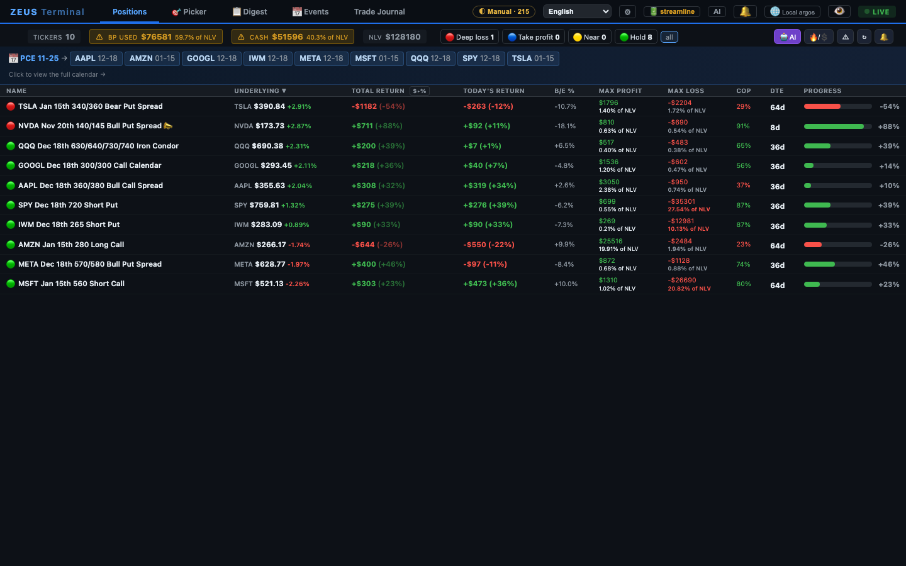<br><sub><b>Positions</b> — every strategy with live P/L, max profit/loss, chance of profit and DTE</sub></td>
<td>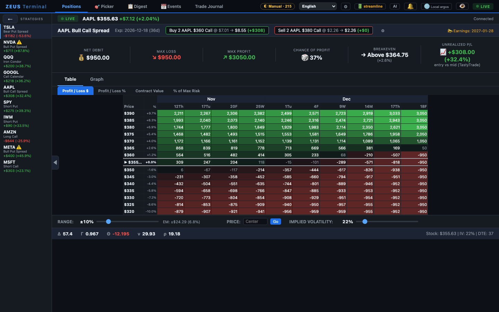<br><sub><b>Strategy detail</b> — P/L across prices and dates, Greeks, chance of profit</sub></td></tr>
<tr><td>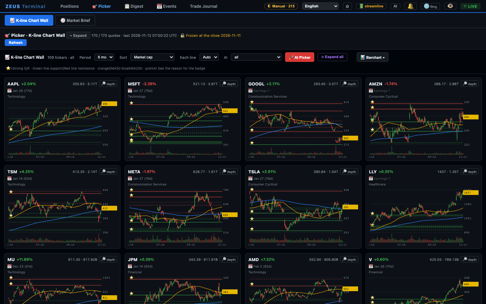<br><sub><b>Picker</b> — the K-line chart wall with support/resistance and EMA 50/200</sub></td>
<td>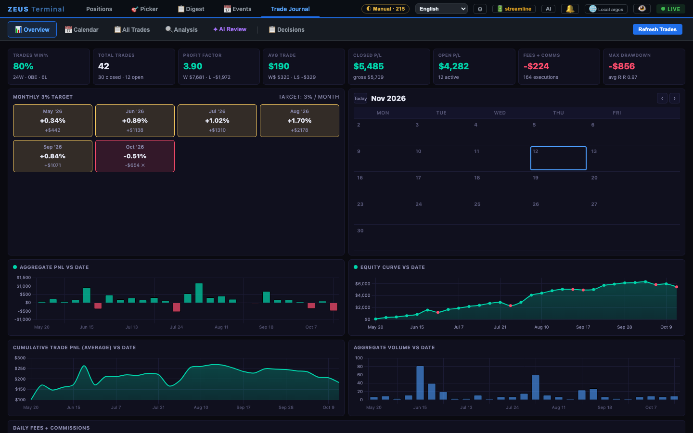<br><sub><b>Trade journal</b> — win rate, profit factor, monthly targets, equity curve</sub></td></tr>
</table>

<sub>All trades and positions in the screenshots are made up (free manual mode); quotes, news and SEC filings are live public data from the day they were taken. Every view is in <a href="#-screenshots">📸 Screenshots</a>.</sub>

---

## Two ways to play

| | **tastytrade API** — *recommended, the smoothest* | **Free mode** — *no broker account needed* |
|---|---|---|
| Positions | Pulled live from your account | Upload a CSV or type trades in (stocks **and** options) |
| Quotes | Real-time DXLink streaming, sub-second | Options from Cboe delayed quotes (free, ~15 min delayed; after the close they keep the closing bid/ask, IV and Greeks), stocks from Yahoo Finance, automatically switching to Finviz when Yahoo rate-limits |
| Fills, expirations, assignments | Booked automatically | Replayed FIFO from your fills; expired options settle at intrinsic value |
| Trade journal | Syncs every hour by itself | Rebuilt instantly from your uploads |
| Buying power, live orders, missing take-profit orders | ✅ | — |
| Everything else (picker, digest, events, journal analytics, AI…) | ✅ | ✅ |

> If you have a tastytrade account, connect it. The whole terminal was designed around that feed and it shows: streaming P/L that moves with every tick, real fills, nothing to maintain. Free mode is there so that anyone, with any broker, can still use it.

**Benzinga is optional too.** With a Benzinga Pro login you get the live Benzinga wire, pre-market commentary, market events and real-time signals. Without it, the Digest runs on the **free bilingual wire: Finviz + WSJ + MarketWatch**.

---

## 🗺️ Feature tour

This tour covers the highlights. ZEUS does far more than fits on one page: the **[complete feature checklist](docs/FEATURES.md)** lists every page, button, alert and background job, and the **[user manual](docs/USER_GUIDE.md)** explains how to use every one of them, with clickable contents.

### ⚔️ Positions — the command center
- **Every strategy recognized automatically**: verticals, calendars, diagonals, iron condors, butterflies, naked and covered legs, stock. Legs are grouped by the order that opened them, so spreads stay together even when you leg in or roll.
- **Live P/L that matches your broker**: mark-to-market per leg, today's P/L from the official previous close, total return in $ and %.
- **Risk at a glance**: max profit, max loss (∞ when unlimited), breakevens, distance to breakeven, probability of profit, days to expiry and a progress bar toward max profit — for every position, in one sortable table.
- **Status lights**: 🔴 deep loss · 🔵 take profit · 🟡 near target · 🟢 hold. One click filters the board.
- **Detail view per strategy**: a full P/L table across prices and dates, a P/L graph, implied-volatility override, mid/natural pricing, a TradingView chart, and per-leg Greeks (Δ Γ Θ Vega) with a skew-aware, vega-weighted spread IV.
- **Stress test**: 1σ / 2σ moves, VaR 95 %, CVaR 95 %, worst case, an expiry calendar, scenario sliders and P/L probabilities for the whole book.
- **Privacy blur** (one key) for screen sharing, **compact** and **freeze** views, installable as a desktop app (**PWA**).

### 🩺 Discipline engine — the part that saves money
- **Exit advisor** with a regime-adaptive take-profit: take ~70–80 % of max profit in a bull regime, ~50–60 % when the market is choppy, never sit on a winner until expiry.
- **Missing take-profit order alarm** *(tastytrade)*: a red bar the moment a position has no working GTC exit.
- **Credit-spread mistake detector**, **concentration**, **correlation** and **liquidity** checks, position sizing as % of NLV, cash-reserve guard.
- **Pre-trade checkup** — a four-layer gate you run *before* opening (`/pretrade-checkup`): trend → touch of support/resistance → IV & earnings → macro calendar. It exists to create friction on purpose. The 🩺 button on Positions adds a checkup panel: correlation with what you hold, concentration, a mirror of your past mistakes, spread suggestions and a liquidity scan.
- **Risk radar**: today's news risk, event density for the next 30 days and a landmine calendar.
- **Desktop and e-mail alerts** for take-profit hits, support/resistance touches, risk-radar spikes and big movers. Desktop notifications (macOS) fire even when the browser is closed, and with e-mail set up every alert also arrives in your inbox (macOS and Linux).

### 🎯 Picker — find the next trade
- **K-line chart wall**: a wall of daily candles with EMA 50/200, multi-timeframe support/resistance, gold zones and badges; sort by market cap, today's change or TA score, filter by earnings date and by bullish / bearish setup.
- **TA scan** of the whole universe on trading days (MACD, RSI, volume, EMA breaks, with walk-forward win rates); the full table lives at `/ta/`.
- **AI picker** — trend-following and dip-buying candidates with strikes, chance of profit and ready-to-paste orders; with an AI provider set, an AI pass over news and earnings re-ranks them.
- **Barchart lists** *(optional, your own Barchart account)*: intersect or union saved screeners and signal pages.
- **Single-ticker deep dive**: chart, fundamentals, bull/bear narratives from recent news, company profile, earnings history.

### 🧪 Paper trade — practice before real money
- **An OptionStrat-style builder on the live chain**: type a ticker, pick an expiration on the timeline, drag legs along the strike bar, or start from 23 one-click strategies, from long calls and verticals to iron condors, butterflies, straddles, strangles, ratio backspreads and jade lizards.
- **Option legs and stock legs**: buy or sell shares next to your options, so covered calls, protective puts and collars are priced correctly.
- **Everything before you commit**: net debit or credit, exact max profit and max loss (∞ when unlimited), breakeven, chance of profit, Greeks, and a P/L table and chart across prices and dates with range, price and IV controls.
- **Save Paper Trade** records a simulated fill at the mid price. Nothing is ever sent to a broker.
- **Saved trades with live P/L**: open trades are marked to market from the terminal's own quotes, with total return, today's return and a summary of open, today's and realized P/L. Groups, sorting, close at market, CSV export.
- **⚡ from the TA screener**: the recommended spread on a ticker's detail page opens here with one click.

### 🧭 Market brief — the big picture, without the drama
- **AI market judgement**: how bad the news is versus how much price has already priced in, crash probability against historical base rates, three layers of support, and what would prove the view wrong. No bull/bear labels — probabilities and falsifiers.
- **Sector rotation**: 80 industry groups (575 tickers) ranked by their moves over 5 days to a year, with each group's trend and the share of its stocks above the 50- and 200-day averages.
- **Options sentiment** by sector: IV percentile, 25-delta skew percentile, put/call volume and open-interest percentiles, each against its own history. It reads the daily option-chain archive (run it from the `/ta/` page), so the percentiles need a few weeks of history.

### 📋 Digest — four wires, two languages
- **Benzinga** *(Pro login)*: the live wire pushed in real time, pre-market commentary and options-flow reports, Benzinga's own categories.
- **Free bilingual wire**: **Finviz** (free page or your Elite token), **WSJ** (Markets, Business, Tech, World) and **MarketWatch** — refreshed every five minutes, every headline translated into Chinese.
- **Source chips** to mix the wires, **must-read** filter for strong catalysts and big macro, **de-noise** filter for clickbait templates, **watchlist-only** mode, sentiment filters, category and ticker filters.
- **AI summary** of the day (or of any filter) that merges duplicates into a two-minute read; incremental updates when new stories land.
- **Tickers view**: news counts per ticker over 1/3/7/30 days with live prices; **positions news**: only what touches what you hold.
- **Calendar & history** search across every stored day; **❤️ liked** stories that survive across days.
- **Market chart**: SPY/QQQ full-history candles with every major turning point marked — click a pivot and the AI explains which news drove it.

### 📅 Events
- **Earnings calendar** for your universe and positions, with before/after-market timing and high-impact macro dates.
- **Corporate events** *(Benzinga)*: IPOs, M&A, secondary offerings, splits, unusual options activity.
- **SEC filings reader**: 10-K / 10-Q / 8-K straight from EDGAR, bilingual side-by-side, plus **earnings-call transcripts** (from public call recordings, needs `yt-dlp`).
- **Risk radar** from any tab.

### 📓 Trade journal — the honest mirror
- **Overview**: win rate, profit factor, average trade, max drawdown, closed vs open P/L, fees, monthly targets, equity curve.
- **Calendar**, **all trades** (every leg, every fill), **analysis** (P/L by symbol, by holding time, by setup; distribution; cumulative curves).
- **What-if engine**: would taking profit earlier, later or never have paid off — on your own trades?
- **AI review**: an AI coach reads your trades and your notes and tells you what you keep doing wrong.
- **Decision log**: record the thesis, confidence, emotion and signal source for every opening and closing decision, attach screenshots, see the price path after you acted, and get reminded to fill in what you skipped.

### 🌐 Three interface languages: 中文 · 双语 · English
- **中文** — the original interface: explanations, tips and news translations in Chinese, while trading tables such as Positions, the strategy detail, Paper Trade and the journal keep the usual English labels (Max Profit, Win Rate…).
- **双语 Bilingual** — the Chinese interface with the English term beside Chinese tabs, buttons, headers and labels, and English inside tooltips. Made for learning the market vocabulary in both languages.
- **English** — the interface in English, the TA screener and single-ticker page included; a few labels may still show Chinese.
- Switch in the top bar at any time. News arrives in English with a Chinese translation under every headline (hidden by default in English mode, one click to show). AI answers follow your language.

### 🤖 Bring your own AI
Use whichever you have: **Claude Code CLI** (your Claude subscription), an **Anthropic API key**, or **any OpenAI-compatible endpoint** (OpenAI, DeepSeek, OpenRouter, a local Ollama…). With nothing configured, ZEUS simply runs without the AI buttons.

### 🔌 Plug in your own agents (MCP)
It works the other way round too: ZEUS is an MCP server. Point Claude Code, Claude Desktop, Codex (GPT), Gemini CLI or your own agent at `http://127.0.0.1:8765/mcp`. It gets 18 tools backed by ZEUS's own numbers: positions with exact max profit and loss, breakevens, Greeks and exit advice, what-if pricing of any strategy, the four-gate checkup, liquidity, news, events, sector rotation and your journal. Then ask something like *"which of my positions should I take profit on, and what earnings land before they expire?"* It is read-only unless you let agents paper trade, it answers only programs on this computer, and it never touches a real order. [Connect an agent →](docs/USER_GUIDE.md#18-ai-agents-mcp)

---

## 📸 Screenshots

<sub>Made-up demo trades in free (manual) mode; quotes, news and filings are live public data.</sub>

<table>
<tr><td width="50%"><br><sub><b>Positions</b> — live P/L, breakeven distance, max profit / loss, chance of profit, progress</sub></td>
<td width="50%"><br><sub><b>Strategy detail</b> — P/L table across prices and dates, Greeks</sub></td></tr>
<tr><td width="50%">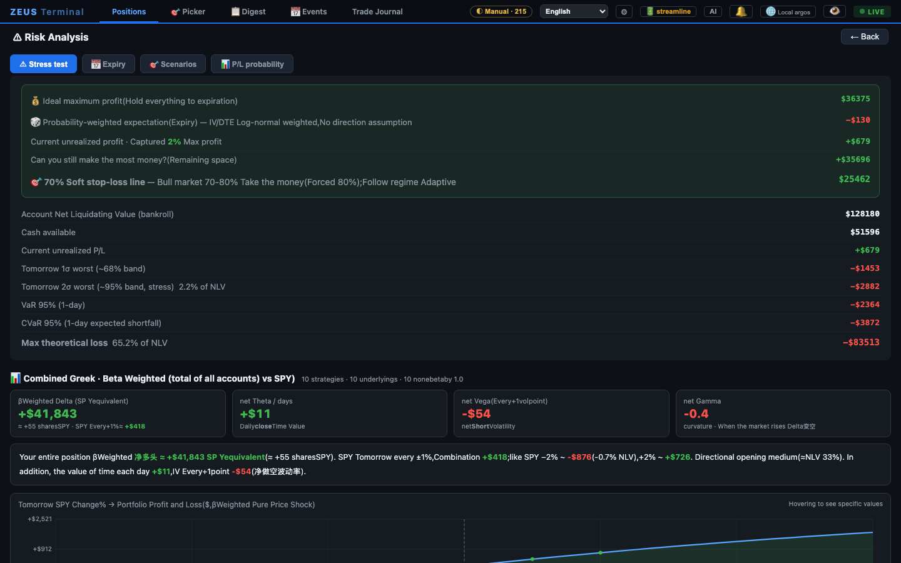<br><sub><b>Risk analysis</b> — stress test, VaR / CVaR, beta-weighted Greeks for the whole book</sub></td>
<td width="50%">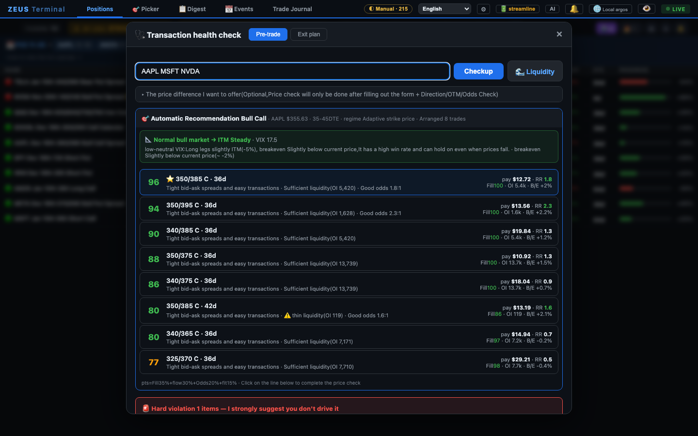<br><sub><b>Pre-trade checkup</b> — spread suggestions ranked by liquidity and reward / risk</sub></td></tr>
<tr><td width="50%"><br><sub><b>Picker</b> — K-line chart wall with support / resistance and EMA 50/200</sub></td>
<td width="50%">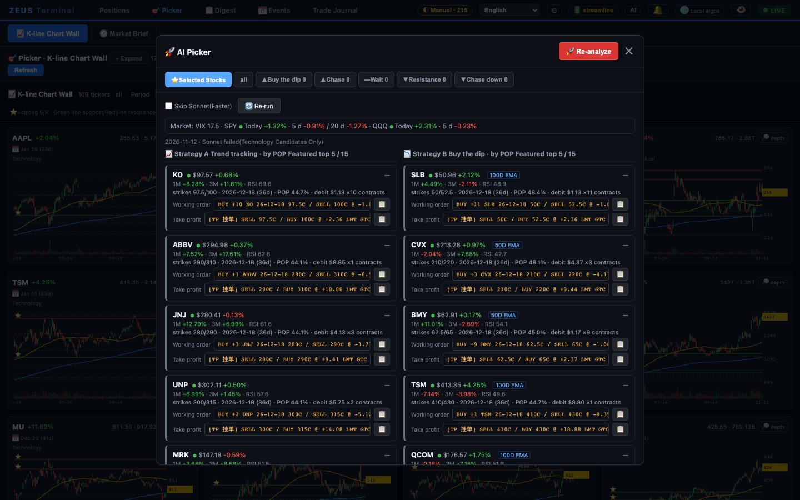<br><sub><b>AI picker</b> — trend and dip candidates with strikes and ready-to-paste orders, works without AI too</sub></td></tr>
<tr><td width="50%">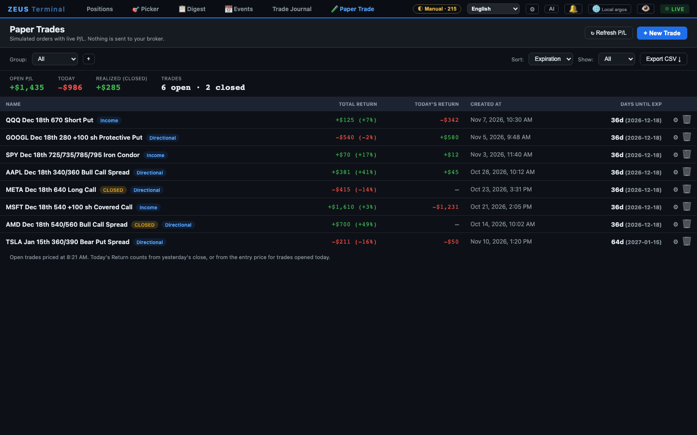<br><sub><b>Paper trades</b> — simulated option and stock trades with total, today's and realized P/L</sub></td>
<td width="50%">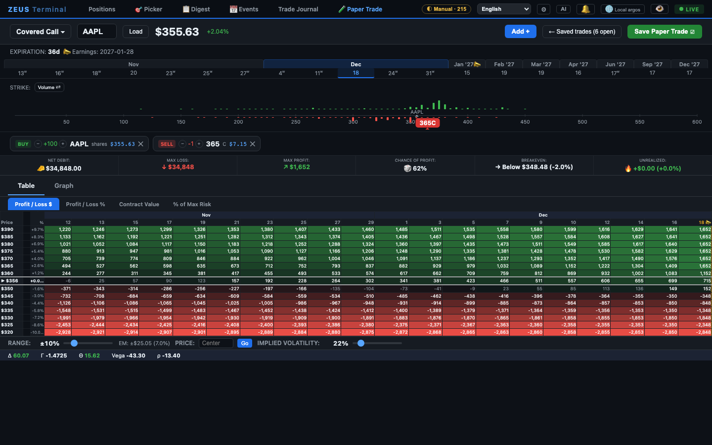<br><sub><b>Paper trade builder</b> — a covered call (100 shares + a short call): exact max profit and loss, P/L by price and date</sub></td></tr>
<tr><td width="50%">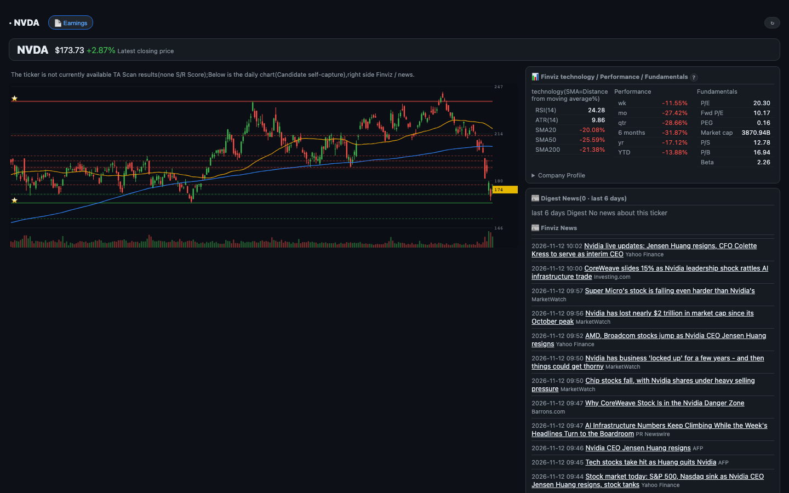<br><sub><b>Single-ticker page</b> — chart, Finviz technicals and fundamentals, news</sub></td>
<td width="50%">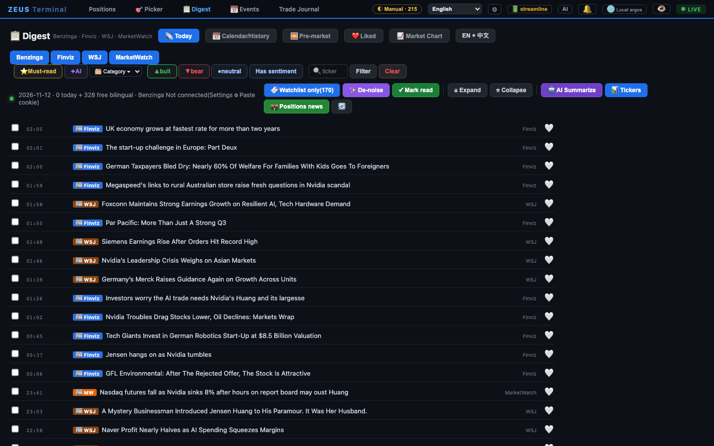<br><sub><b>Digest</b> — Finviz, WSJ and MarketWatch, plus Benzinga with a login</sub></td></tr>
<tr><td width="50%">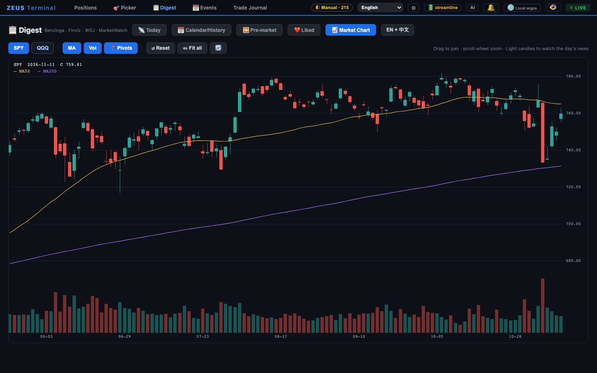<br><sub><b>Market chart</b> — SPY / QQQ full-history candles</sub></td>
<td width="50%">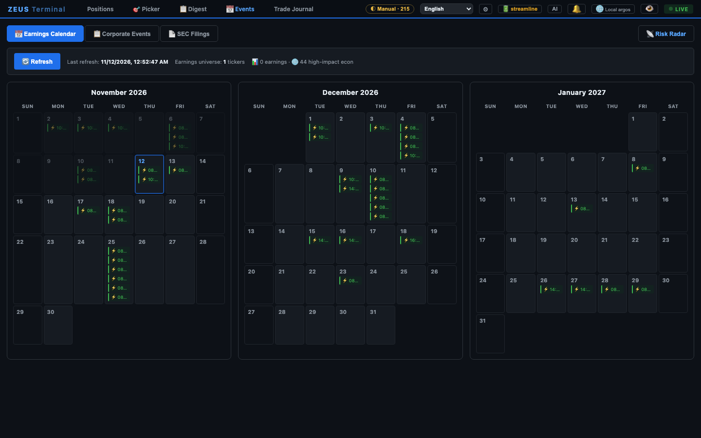<br><sub><b>Calendar</b> — earnings and high-impact macro dates</sub></td></tr>
<tr><td width="50%">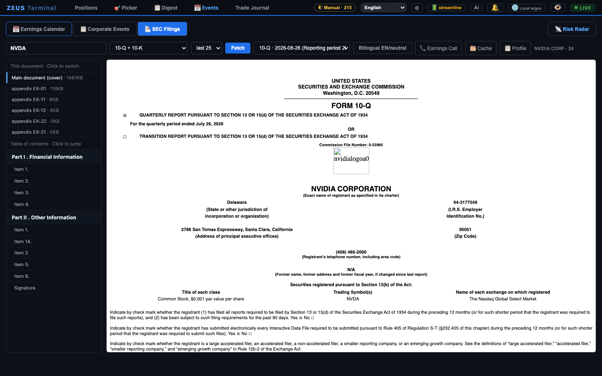<br><sub><b>SEC filings reader</b> — 10-K / 10-Q / 8-K straight from EDGAR</sub></td>
<td width="50%">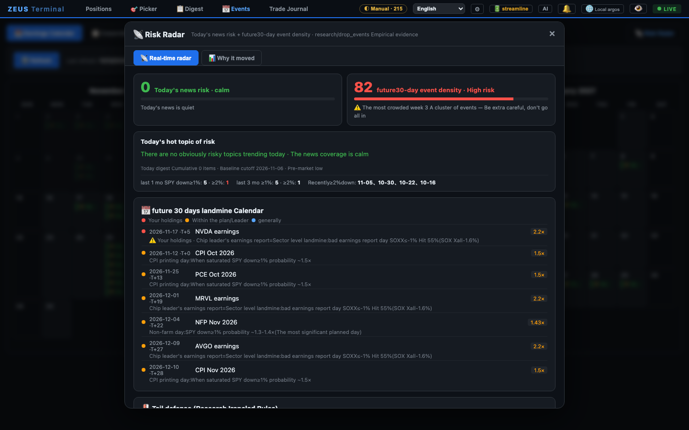<br><sub><b>Risk radar</b> — today's news risk and a 30-day landmine calendar</sub></td></tr>
<tr><td width="50%"><br><sub><b>Trade journal</b> — win rate, profit factor, monthly targets, equity curve</sub></td>
<td width="50%">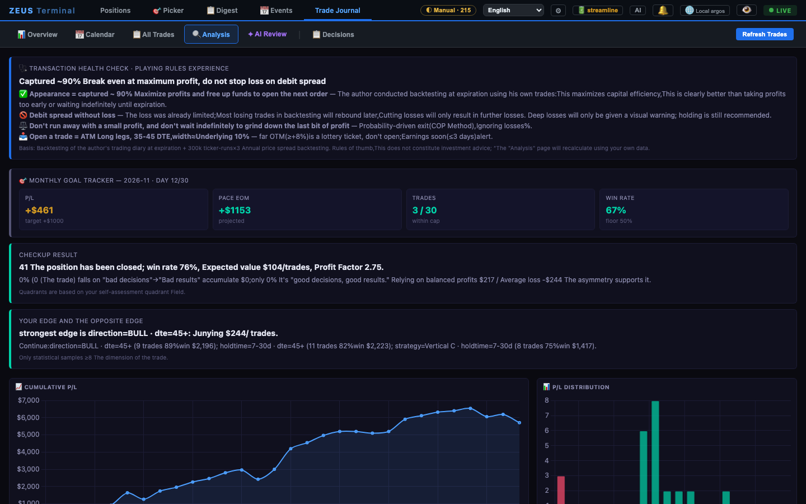<br><sub><b>Journal analysis</b> — what works and what doesn't, from your own trades</sub></td></tr>
<tr><td width="50%">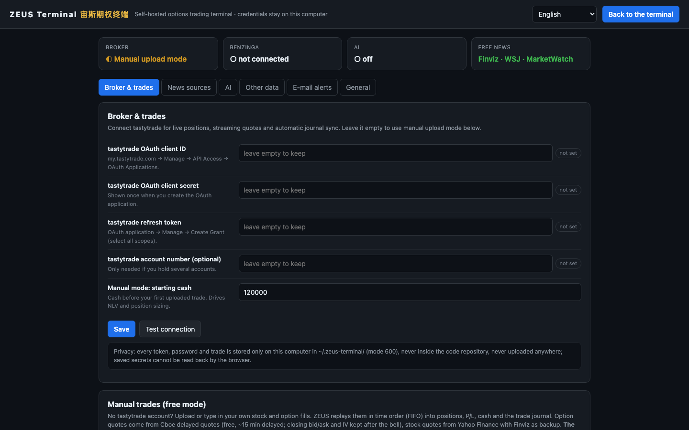<br><sub><b>Settings</b> — everything is entered in the browser; saved secrets are write-only</sub></td>
<td width="50%">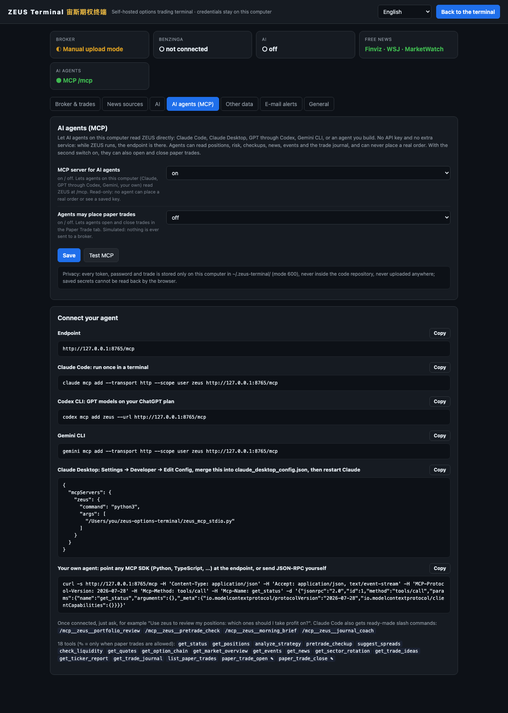<br><sub><b>AI agents (MCP)</b> — connect Claude, GPT (Codex), Gemini or your own agent; no API key</sub></td></tr>
</table>

---

## 🚀 Quick start

```bash
git clone https://github.com/jackson-cmd/zeus-options-terminal
cd zeus-options-terminal
./start.sh          # macOS / Linux  (Windows: double-click start.bat)
```

The first run creates a virtual environment and installs everything (Python 3.10+). Then open **http://localhost:8765** and click **⚙ Settings**:

1. **Broker & trades** — paste your tastytrade OAuth *client secret* and *refresh token*, **or** upload your trades CSV.
2. **News sources** — paste your Benzinga Pro cookies (optional), your Finviz Elite token (optional).
3. **AI** — pick a provider (optional).

That's it. Nothing to edit by hand. Port 8765 already taken? Run `PORT=8790 ./start.sh`, or change the port in Settings.

### Where to get the tastytrade credentials
my.tastytrade.com → **Manage → API Access → OAuth Applications** → create an application (keep the *client secret*) → **Manage → Create Grant** (all scopes) → copy the *refresh token*. Paste both into Settings and press **Test connection**.

---

## 🔑 What each setting unlocks

| Setting | Unlocks | Free? |
|---|---|---|
| tastytrade OAuth (client secret + refresh token) | Live positions, streaming quotes, automatic journal, buying power, working orders | free with a tastytrade account |
| Manual trades (CSV / form) | Positions, P/L, journal and analytics without any broker connection | ✅ |
| Benzinga Pro cookies | Benzinga live digest, pre-market, market events, history | Benzinga Pro subscription |
| Benzinga data API key | Real-time signals feed, scanner | from your Benzinga Pro session |
| Finviz Elite token | Finviz news through the official export (otherwise the free page) | optional |
| AI provider | AI summaries, market brief, AI picker, AI journal review, position review | your own |
| Barchart login | Barchart screener and signal lists | Barchart account |
| E-mail (SMTP) | Every alert also by e-mail, with a test button (macOS and Linux) | ✅ |
| AI agents (MCP) | Your own agents (Claude, GPT through Codex, Gemini…) use ZEUS as tools; on by default, paper trading by agents off | ✅ |

---

## 📄 Manual trades: the CSV

Download the template from Settings (or use [`examples/trades_template.csv`](examples/trades_template.csv)):

```csv
date,symbol,asset,side,effect,qty,price,fees,option_type,strike,expiration,multiplier,order_id,note
2026-03-02 10:15,AAPL,stock,buy,open,50,231.40,0,,,,,,long stock
2026-03-03 11:02,NVDA,option,buy,open,1,12.50,1.10,C,180,2026-04-17,100,nvda-bcs-1,bull call spread long leg
2026-03-03 11:02,NVDA,option,sell,open,1,6.20,1.10,C,190,2026-04-17,100,nvda-bcs-1,bull call spread short leg
```

- `side`: buy / sell — or broker shorthand **BTO, STO, BTC, STC**, "Buy to Open", "Sell to Close"…
- `effect`: open / close / *(blank = decided automatically)*.
- Options can also be given as one symbol: OCC (`AAPL  260618C00200000`), compact (`AAPL260618C200`) or broker text (`AAPL 06/18/2026 200.00 C`).
- Legs with the same `order_id` (or the same minute) are shown as one strategy.
- **tastytrade CSV exports** and most broker exports with date / symbol / side / quantity / price columns are recognized as is.
- Starting cash is inferred as the smallest account that could have funded your history; set your real number in Settings.

---

## 🔒 Privacy & security

- **Everything stays on your machine.** Tokens, cookies, passwords and uploaded trades live in `~/.zeus-terminal/` (permission 600), never inside the repository — a `git push` cannot leak them.
- **The code folder holds code only.** Everything the terminal writes while running — position snapshots, the trade journal and its screenshots, news archives, caches, downloads, logs — goes to `~/.zeus-terminal/runtime/`. The runtime folders inside the code are links to that place and are ignored by git.
- **Sharing safely.** Publish with `git push`, or build a zip with `tools/export_clean_zip.sh`; both contain code only. Do not drag the whole folder into a website or zip it by hand. `tools/install_git_hook.sh` adds a local pre-commit check that refuses links, data files, anything shaped like a key or token, and your own home path, login name or git identity.
- Saved secrets are **write-only** from the browser: the settings API reports *set / not set* and never sends a secret back.
- The MCP endpoint for AI agents answers only programs on this computer, and no MCP tool can place a real order or read a saved key. What an agent reads goes to that agent's model provider.
- The server listens on **127.0.0.1** only by default, refuses foreign `Host` headers (DNS rebinding), only accepts cross-origin calls from localhost, and write endpoints need a header that other websites cannot send.
- No telemetry. The app only talks to the services you connect plus public market data (Cboe delayed quotes, Yahoo Finance, SEC EDGAR, Finviz, Dow Jones RSS).
- Free market data is rate-limit aware: company data (sector, industry, market cap) comes from Finviz in batches of 20 tickers, stock quotes fall back to Finviz whenever Yahoo Finance throttles, and a whole option chain is one Cboe request instead of one Yahoo request per expiration.

---

## 🏗️ Under the hood

```
browser (PWA, 中文 / 双语 / English)
   │  WebSocket + REST
   ▼
FastAPI server  ── options_analyzer/optionstrat_server.py
   ├─ broker ........ tastytrade REST + DXLink stream   │  local_broker.py (manual mode, Cboe + Yahoo)
   ├─ news .......... Benzinga (cookies / WS)           │  zeus_news.py (Finviz · WSJ · MarketWatch)
   ├─ picker ........ heatmap/ · ta_screener/ · ai_picks/ · stock_selector/ · barchart/
   ├─ brief ......... market_brief/ · narratives/
   ├─ events ........ sec_filings/ · benzinga_market_events/ · trade_journal/calendar_events.py
   ├─ journal ....... trade_journal/ · journal_review/ · journal_expiry_whatif/
   ├─ discipline .... options_analyzer/checkup/ · pre_trade_checkup/ · sr_alert/
   ├─ paper trade ... options_analyzer/paper_trade.py · paper_trade_routes.py (simulated, never sent to a broker)
   ├─ AI ............ zeus_ai.py (Claude CLI · Anthropic · OpenAI-compatible)
   └─ settings ...... zeus_config.py → ~/.zeus-terminal/config.json
```

Runtime data (candles, caches, digests) lives in `~/.zeus-terminal/runtime/`; folders such as `data/` inside the code are only links to it. Configuration can also come from environment variables (`ZEUS_<KEY>`, e.g. `ZEUS_TT_REFRESH_TOKEN`) and the settings folder can be moved with `ZEUS_HOME`.

---

## ❓ FAQ

**Do I need tastytrade?** No. Free mode covers stocks and options from any broker through a CSV. tastytrade is simply the smoothest.

**Do I need Benzinga?** No. The Digest runs on Finviz + WSJ + MarketWatch for free.

**Does it place orders?** Not real ones. The 🧪 Paper Trade tab records simulated trades for practice; real trades happen in your broker.

**Does it work on Windows / Linux?** The core does. Desktop notifications are macOS only; on Linux, set up e-mail alerts instead.

**Where are my settings?** `~/.zeus-terminal/config.json`. Delete the folder to forget everything.

**First launch after the close and the picker shows 0 quotes?** Press **Refresh** on the picker; the last session's closing prices fill in within seconds.

---

## 🤝 Contributing

ZEUS has far more features than this page can show, and it keeps growing; new features may be added over time. **Pull requests are welcome**: a bug fix, a new data source or broker, a translation, better docs, or one of the [parts not wired up yet](docs/FEATURES.md#not-wired-up-yet--ideas-for-pull-requests). Read [CONTRIBUTING.md](CONTRIBUTING.md) first. Every pull request runs the test suite on Linux, macOS and Windows, and `main` only accepts pull requests whose checks pass.

---

## 📜 License: non-commercial

ZEUS Terminal is released under the **[PolyForm Noncommercial License 1.0.0](LICENSE)**.

- ✅ Personal use, study, research, hobby trading, non-profit use.
- ❌ **Commercial use is prohibited** — no selling it, no paid services built on it, no use inside a company's business.

**Rights holders:** if you believe anything in this repository infringes your rights (trademarks, data, terms of service or anything else), **open an issue** and the material will be removed promptly.

**Disclaimer.** This is a personal tool shared as is, without any warranty. It is **not investment advice**. Options involve substantial risk of loss. You are responsible for your own trades and for complying with the terms of every data provider and broker you connect. ZEUS Terminal is not affiliated with or endorsed by tastytrade, Benzinga, Cboe, Finviz, Dow Jones / The Wall Street Journal / MarketWatch, Barchart, Yahoo or Anthropic; all names belong to their owners.
