<div align="center">

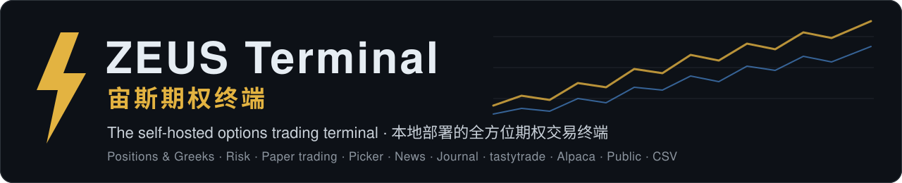

**做期权要开十个网页才看得全的东西，一个终端全搞定。**

实时持仓与希腊值 · 盈亏与风险 · 出场纪律 · 期权和股票都能下的模拟盘 · 四路新闻台 · 选股 · 财报与 SEC 文件 · 不说假话的交易日记。连 tastytrade、Alpaca 或 Public，或者上传任何券商导出的 CSV；完全跑在你自己的电脑上，界面支持 中文 / 双语 / English。

[🌐 网站](https://jackson-cmd.github.io/zeus-options-terminal/zh/) · [English → README.md](README.md) · [🚀 快速开始](#-快速开始) · [新功能](#-新功能) · [全部功能](docs/FEATURES_zh.md) · [使用手册](docs/USER_GUIDE_zh.md) · [参与贡献](#-参与贡献)

[](https://github.com/jackson-cmd/zeus-options-terminal/actions/workflows/ci.yml) [](https://github.com/jackson-cmd/zeus-options-terminal/releases) [](https://pypi.org/project/zeus-options-terminal/)    

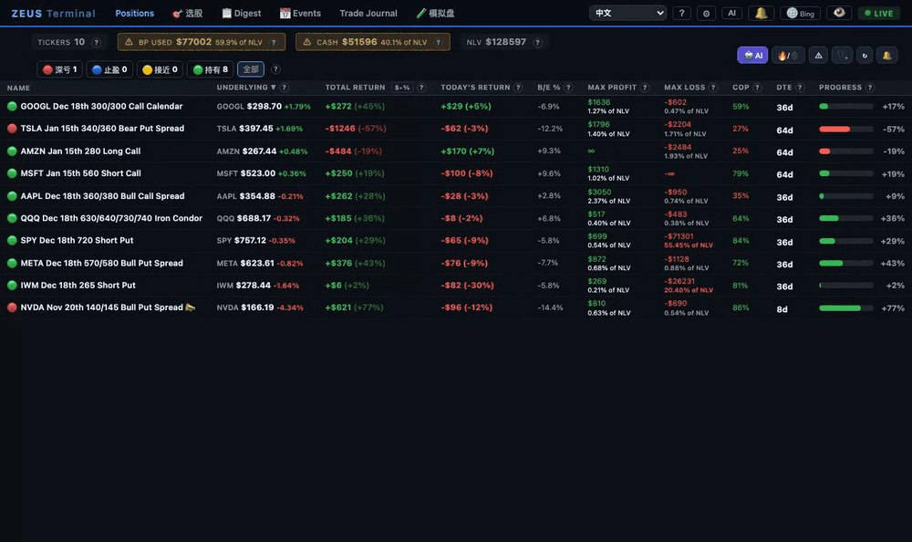

<sub>演示里的交易是编的；报价、新闻和图表是录制当天的真实数据。</sub>

</div>

## 🚀 快速开始

```bash
git clone https://github.com/jackson-cmd/zeus-options-terminal
cd zeus-options-terminal
./start.sh          # macOS / Linux（Windows 双击 start.bat）
```

第一次运行会在本地建虚拟环境、装好依赖（需要 Python 3.10+），然后自动打开 **<http://localhost:8765>**。接着：

1. 点 **载入示例组合**，用按当天报价生成的示例组合把每个页面试一遍；或者
2. 打开 **⚙ 设置 → 券商与行情**，连 tastytrade、Alpaca 或 Public（每家都有 **测试连接** 按钮），或者上传你的交易 CSV。
3. 新闻源、AI、邮件提醒都是可选的，也在设置页里填，不用手改任何文件。

8765 端口被占用？用 `PORT=8790 ./start.sh`。各家券商的 key 去哪拿，见[连接券商](#-连接券商)。

### 📦 用 pipx 安装

一条命令，不用 clone。[pipx](https://pipx.pypa.io/) 会把 ZEUS 装进它自己的环境（需要 Python 3.10+）：

```bash
pipx install zeus-options-terminal
zeus                # 打开 http://localhost:8765（换端口用 zeus --port 8790）
```

设置和数据都在 `~/.zeus-terminal`，所以 `pipx upgrade zeus-options-terminal` 升级不会丢。在虚拟环境里用 `pip install zeus-options-terminal` 也可以。详见[手册 §1.8](docs/USER_GUIDE_zh.md#18-用-pipx-安装)。

### 🐳 用 Docker 运行

不用装 Python。镜像发布在 GitHub Packages 上，支持 Intel 和 AMD（`amd64`），也支持 ARM（`arm64`，比如 Apple 芯片的 Mac 和树莓派）：

```bash
docker run -d --name zeus --restart unless-stopped \
  -p 127.0.0.1:8765:8765 -v zeus-data:/data \
  ghcr.io/jackson-cmd/zeus-options-terminal:latest
```

然后打开 **<http://localhost:8765>**。设置、交易和缓存都存在 `zeus-data` 卷里。更新时先运行 `docker pull ghcr.io/jackson-cmd/zeus-options-terminal:latest` 和 `docker rm -f zeus`，再运行同一条 `docker run`，数据不会丢。`-p` 里的 `127.0.0.1:` 不要去掉：ZEUS 没有登录，端口只能留在你自己的电脑上。时区、AI 智能体、Compose 写法和镜像里没有的功能，见[手册 §1.7](docs/USER_GUIDE_zh.md#17-用-docker-运行)。

## 适合你吗？

- 你做**期权**：垂直价差、铁鹰、日历、备兑、卖看跌，想在一个屏幕上看清每个持仓的盈亏、希腊值和风险。
- 你的券商是 **tastytrade、Alpaca 或 Public**，或者能把成交导出成 CSV 的任何券商。
- 你希望持仓和密钥**只留在自己电脑上**：不用云端账号，不用订阅，没有遥测。
- 你看**中文或英文**的美股新闻，或者两种都看。
- 你想要有规矩：止盈指示灯、价差没挂平仓单的提醒、开单前体检，还有一本不给你面子的交易日记。

<sub>如果你在找：本地部署的美股期权交易终端、带实时希腊值的期权盈亏计算器、tastytrade / Alpaca / Public 持仓管理、期权交易日记、期权价差和股票的模拟盘、带支撑阻力的美股选股器、中英双语美股新闻 —— 都在这一个应用里。</sub>

---

## 目录

- [🚀 快速开始](#-快速开始) · [🐳 用 Docker 运行](#-用-docker-运行) · [适合你吗？](#适合你吗) · [🆕 新功能](#-新功能) · [写在前面](#写在前面) · [四种接入方式](#四种接入方式)
- [🗺️ 功能全景](#️-功能全景)：[持仓](#️-持仓--指挥中心) · [纪律引擎](#-纪律引擎--真正帮你省钱的部分) · [选股](#-选股--找下一笔) · [模拟盘](#-模拟盘--先用假钱练手) · [市场判断](#-市场判断--大局观不带情绪) · [Digest](#-digest--四路新闻两种语言) · [事件](#-事件) · [交易日记](#-交易日记--照妖镜) · [三种界面语言](#-三种界面语言中文--双语--english) · [自带 AI](#-自带-ai) · [接入智能体（MCP）](#-接入你自己的-ai-智能体mcp)
- [📸 截图一览](#-截图一览) · [🔌 连接券商](#-连接券商) · [🔑 每一项设置能解锁什么](#-每一项设置能解锁什么) · [📄 手动交易：CSV 格式](#-手动交易csv-格式)
- [🔒 隐私与安全](#-隐私与安全) · [🏗️ 架构](#️-架构) · [❓ 常见问题](#-常见问题) · [🤝 参与贡献](#-参与贡献) · [📜 许可证](#-许可证禁止商业使用)

## 🆕 新功能

<sub>最新版本 **0.7.1**（2026-11-13）。完整的更新历史见[更新记录](CHANGELOG_zh.md)。</sub>

| | 0.7.x、0.6.0、0.5.x、0.4.x、0.3.x 和 0.2.x 新加入 |
|---|---|
|  | **🤖 进了官方 MCP Registry**：从这个目录安装 MCP 服务器的 AI 客户端能找到 ZEUS（`io.github.jackson-cmd/zeus-options-terminal`），自己用 `uvx zeus-options-terminal` 或 Docker 镜像把它启动起来。[连接智能体 →](docs/USER_GUIDE_zh.md#182-连接你的智能体) |
|  | **📦 pip 和 pipx**：`pipx install zeus-options-terminal` 之后运行 `zeus`，不用 clone 代码就能装好并启动 ZEUS；`pipx upgrade` 升级时设置和交易都保留。[用 pipx 安装 →](docs/USER_GUIDE_zh.md#18-用-pipx-安装) |
|  | **🐳 用 Docker 运行**：一条 `docker run` 就能从 GitHub Packages 拉起 ZEUS，Intel、AMD、ARM 都能跑。设置和交易存在卷里，端口只留在你自己的电脑上，AI 智能体通过 `docker exec` 连进来。[怎么运行 →](docs/USER_GUIDE_zh.md#17-用-docker-运行) |
|  | **🔌 Alpaca 和 Public**：连上 Alpaca（免费，自带模拟盘）或 Public 账户，就有实时持仓、成交、在途订单和带希腊值的报价。持仓和行情分开选，也可以照样上传自己的交易、行情改用 Alpaca。ZEUS 只读，从不下单。[连接券商 →](docs/USER_GUIDE_zh.md#22-连接券商) |
|  | **🧪 示例组合**：新装好以后点一下，就载入 6 个持仓和 1 笔已平仓交易，价格取自当天的真实期权报价，什么都不连也能把每个页面试一遍。一键清除。[怎么开始 →](docs/USER_GUIDE_zh.md#21-先选持仓从哪来) |
|  | **❓ 每个页面都有说明**：表头、分数、卡片旁边的小 ? 用大白话讲清这一项是什么、怎么算、怎么用；顶栏的 ? 列出这个页面上的每个按钮和数字。[怎么用 →](docs/USER_GUIDE_zh.md#31-每个页面的说明) |
|  | **🔌 接入你自己的 AI 智能体（MCP）**：Claude Code、Claude Desktop、通过 Codex 用的 GPT、Gemini CLI 或你自己写的智能体，都能读你的持仓、跑开单前体检、给价差估价、读新闻和交易日记；你允许的话还能下模拟单。ZEUS 本身就是一个本地 MCP 服务器，不需要 API key。[连接智能体 →](docs/USER_GUIDE_zh.md#18-ai-智能体mcp) |
|  | **🟩 热力图**：选股页的热力图回来了，和 K 线墙一键切换。[怎么用 →](docs/USER_GUIDE_zh.md#69-热力图) |
|  | **🧪 模拟盘**：在实时期权链上搭任何策略，期权腿和股票腿都能加，存成模拟单后跟踪盈亏。[怎么用 →](docs/USER_GUIDE_zh.md#8-模拟盘) |
|  | **📧 邮件提醒**：每条桌面提醒都能同时发到你的邮箱，macOS 和 Linux 都支持。[怎么配置 →](docs/USER_GUIDE_zh.md#123-邮件提醒) |
|  | **🔄 行业轮动**：80 个细分行业按动量和趋势排名，**🎲 期权情绪** 也开箱即用。[怎么用 →](docs/USER_GUIDE_zh.md#66-行业轮动) |
|  | **∞ 精确的最大盈亏**：卖出看跌和股票一直算到价格为 0，没有上限的策略显示 ∞。[怎么算的 →](docs/USER_GUIDE_zh.md#47-持仓怎么归组和估值) |
|  | **🌐 全面支持英文**：TA 扫描和单票详情页也跟着中文 / 双语 / English 切换。[界面语言 →](docs/USER_GUIDE_zh.md#13-界面语言) |
|  | **📚 完整使用手册** 和功能清单，中英文各一份，目录可以点击跳转。[打开手册 →](docs/USER_GUIDE_zh.md) |

---

## 写在前面

ZEUS Terminal（宙斯期权终端）是我给自己做的网站。前前后后做了半年，到现在天天用它交易已经一年多了。

一开始它只是给我在 tastytrade 上的价差算盈亏。后来每遇到一个真实的交易问题，我就补一块功能，慢慢长成了一个部署在我自己电脑上的全方位期权交易终端：每个仓位实时定价、带希腊值和概率；出场规则会在我重犯同一个错之前把我拦下；新闻台同时读 Benzinga、Finviz、华尔街日报和 MarketWatch，中英双语；选股页是我真正每天看的 K 线墙；财报和 SEC 文件放在一处；交易日记会把我自己的交易真相摆在面前。

它陪我经历过大涨、大跌和一个又一个财报季，我遇到的 bug 几乎都修掉了。现在把它交出来。**里面没有任何我的信息**：没有账号、没有交易、没有密钥。你用你自己的，全部只存在你自己的电脑上。

**能免费的都免费。** 平时要花钱买的东西，比如期权报价、新闻终端、选股器、交易日记软件，在这里基本都能本地免费用：期权行情走 Cboe 的延迟数据，新闻走 Finviz、华尔街日报和 MarketWatch，交易用一份 CSV 就能导进来。有 tastytrade、Benzinga 账户接上会更顺，但都不是必需的。

**自动化之外，自己也下场玩一玩。** 交易智能体（trading agents）正在把越来越多的交易自动化。与此同时，你完全可以自己下场玩一玩博弈：想清楚对手在做什么、价格里已经算进了什么，再做自己的决定。我用了一年多最大的体会是，决策的纪律和风险控制比找到好机会更重要：什么时候止盈、什么时候认错、一笔仓位最多亏多少。ZEUS 里很多功能就是为这个做的，比如出场规则、开单前体检、压力测试和交易日记。

*为什么叫宙斯？* 期权靠希腊值定价 —— Delta、Gamma、Theta、Vega，而宙斯是希腊众神之王。这个终端，就是让你驾驭它们的地方。

<table>
<tr><td>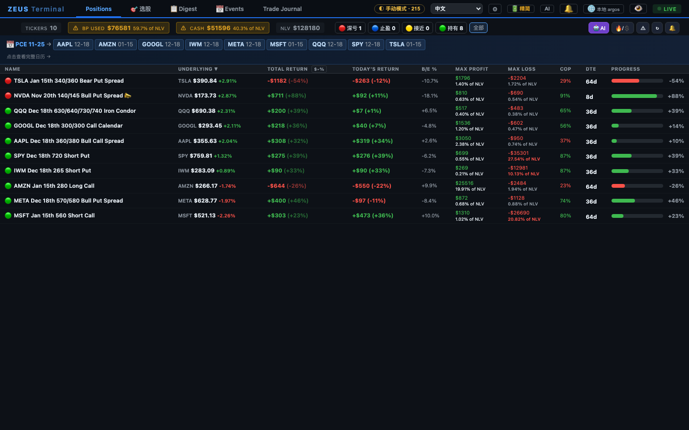<br><sub><b>持仓</b> —— 每个策略的实时盈亏、最大盈亏、获利概率、剩余天数</sub></td>
<td>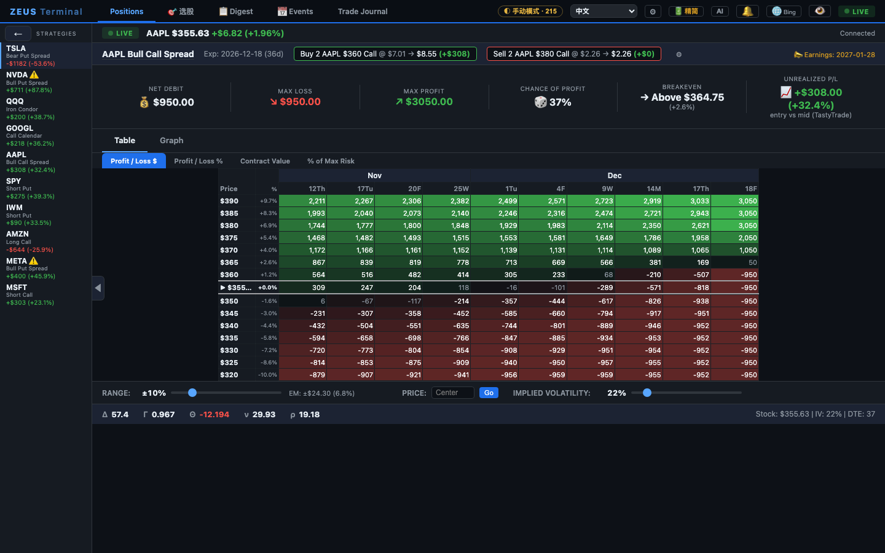<br><sub><b>策略详情</b> —— 按价格和日期的盈亏表、希腊值、获利概率</sub></td></tr>
<tr><td>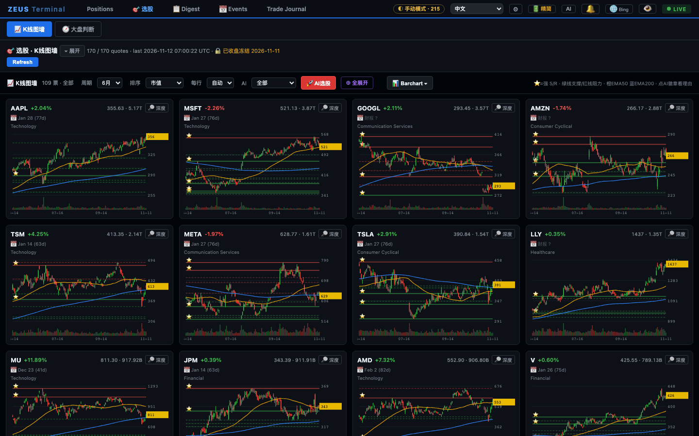<br><sub><b>选股</b> —— K 线墙，带支撑阻力和 EMA50/200</sub></td>
<td>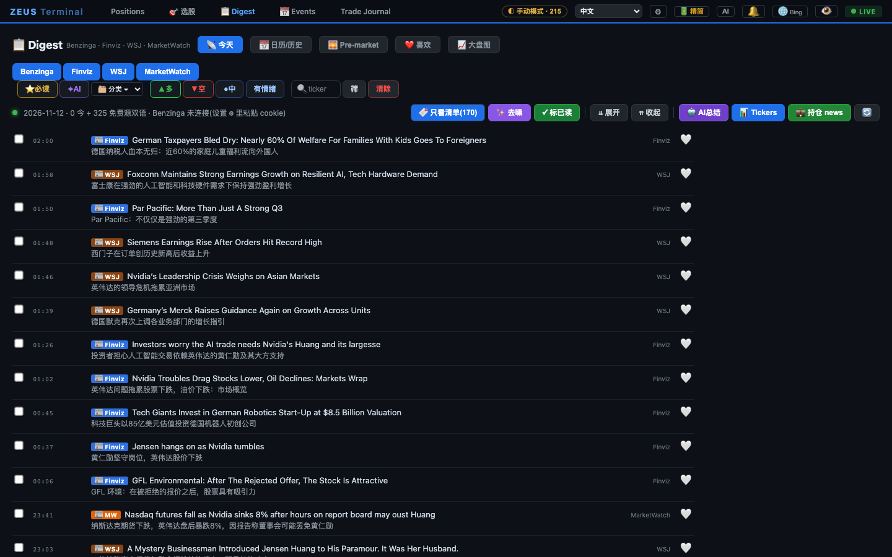<br><sub><b>Digest</b> —— Finviz、华尔街日报、MarketWatch，每条标题配中文翻译</sub></td></tr>
</table>

<sub>截图里的交易和持仓全部是编造的演示数据（免费手动模式）；行情、新闻和 SEC 文件是截图当天的公开数据。全部场景见 <a href="#-截图一览">📸 截图一览</a>。</sub>

---

## 四种接入方式

| | **tastytrade API** —— *最顺滑* | **Alpaca** —— *免费，自带模拟盘* | **Public** | **免费模式** —— *不需要券商账户* |
|---|---|---|---|---|
| 持仓 | 从你的账户实时拉取 | 从你的模拟盘或实盘实时拉取 | 从你的账户实时拉取 | 上传 CSV 或手动录入（**股票和期权都支持**） |
| 报价 | DXLink 实时推送，亚秒级 | 免费行情：股票 IEX 实时；期权用 Alpaca 参考价，带希腊值和隐波 | 实时报价、期权链和希腊值 | 期权用 Cboe 延迟行情（免费，约延迟 15 分钟；收盘后仍保留收盘买卖价、隐波和希腊值），股票用 Yahoo Finance，Yahoo 限流时自动改用 Finviz |
| 成交、到期、行权 | 自动入账 | 读你的成交记录 | 读你的历史记录 | 按你的成交 FIFO 回放；过期期权按内在价值自动结算 |
| 交易日记 | 每小时自动同步 | 每小时按成交重算 | 每小时按历史记录重算 | 上传后立刻重算 |
| 购买力、在途订单、漏挂止盈单提醒 | ✅ | ✅ | ✅ | — |
| 其他所有功能（选股、Digest、事件、日记分析、AI……） | ✅ | ✅ | ✅ | ✅ |

> 有 tastytrade 账户就连上它。整个终端就是围绕这条数据流设计的：盈亏随每一笔成交跳动，成交真实，什么都不用维护。Alpaca 是免费拿到实时账户数据的办法，还自带模拟盘；Public 的用户可以直接连 Public。ZEUS 对它们只读，从不下单。免费模式是为了让任何券商的用户都能用上它。持仓和行情在设置里分开选：比如照样上传自己的交易，行情改用 Alpaca。

> **只想先看看？** 在空的持仓页点 **载入示例组合**：6 个持仓加 1 笔已平仓交易，价格取自那一刻的真实期权报价，每个页面立刻有内容。看完一键清除。

**Benzinga 也是可选的。** 有 Benzinga Pro 登录，就有 Benzinga 实时新闻、盘前点评、市场事件和实时信号。没有的话，Digest 自动跑在**免费双语新闻源：Finviz + 华尔街日报 + MarketWatch** 上。

---

## 🗺️ 功能全景

这里只挑重点讲。ZEUS 的功能远不止这一页写得下的：**[功能清单](docs/FEATURES_zh.md)** 列出了每个页面、按钮、提醒和后台任务，**[使用手册](docs/USER_GUIDE_zh.md)** 讲清每一项怎么用，目录可以点击跳转。

### ⚔️ 持仓 —— 指挥中心
- **自动识别所有策略**：垂直价差、日历、对角、铁鹰、蝶式、裸腿和备兑、股票。按开仓那一单把各条腿归到一起，分批建仓、移仓也不会拆散。
- **和券商对得上的实时盈亏**：每条腿按市价估值，今日盈亏以官方昨收为基准，总回报同时显示金额和百分比。
- **一眼看清风险**：最大盈利、最大亏损（没有上限时显示 ∞）、盈亏平衡点和距离、获利概率、剩余天数、离满利的进度条，所有仓位一张表、随意排序。
- **状态灯**：🔴 深亏 · 🔵 该止盈 · 🟡 接近目标 · 🟢 持有，点一下就筛。
- **单个策略详情**：不同价格和日期的完整盈亏表、盈亏曲线、隐波可调、中间价/对手价切换、TradingView 图表，以及每条腿的希腊值（Δ Γ Θ Vega）和考虑偏斜、按 vega 加权的价差隐波。
- **压力测试**：1σ / 2σ 波动、VaR 95%、CVaR 95%、最坏情况、到期日历、情景滑杆、整个账户的盈亏概率。
- 一键**隐私模糊**（录屏、分享屏幕用），**紧凑**和**冻结**视图，可以像应用一样装到电脑上（**PWA**）。

### 🩺 纪律引擎 —— 真正帮你省钱的部分
- **出场顾问**，止盈线随市场状态自适应：牛市吃到最大利润的 70–80% 就走，震荡市 50–60%，绝不把赚钱的单子死扛到到期。
- **漏挂止盈单警报**（tastytrade）：某个仓位没有挂 GTC 止盈单，顶部立刻出现红条。
- **卖方价差错误检测**、**集中度**、**相关性**、**流动性**体检，单笔仓位占净值比例、现金底线守卫。
- **开单前体检**：开仓之前跑的四层闸门（打开 `/pretrade-checkup`）—— 趋势 → 是否触及支撑阻力 → 隐波和财报 → 宏观日历。它存在的唯一目的就是故意制造摩擦。持仓页的 🩺 按钮还能打开体检面板：和现有持仓的相关性、集中度、你以前犯过的错、价差推荐和流动性扫描。
- **风险雷达**：今日新闻风险、未来 30 天事件密度、地雷日历。
- **桌面和邮件提醒**：触及止盈、碰到支撑阻力、风险雷达报警、大幅异动。macOS 上浏览器关着也会弹桌面通知；配上邮箱后，每条提醒还会同时发到你的邮箱（macOS 和 Linux）。

### 🎯 选股 —— 找下一笔
- **K 线墙**：一整面日线蜡烛图墙，带 EMA50/200、多周期支撑阻力、黄金区间和标记；可按市值、今日涨跌、TA 评分排序，按财报日期和多空形态筛选。
- **技术扫描**：交易日定时扫描整个票池（MACD、RSI、量能、均线突破，带滚动前向胜率），完整表格在 `/ta/` 页。
- **AI 选股**：趋势跟踪和回踩抄底两套候选，附行权价、获利概率和可直接复制的挂单；配了 AI 之后，再由 AI 结合新闻和财报复核排序。
- **Barchart 榜单**（可选，用你自己的 Barchart 账户）：对保存的筛选器和信号页取交集或并集。
- **单票深挖**：图表、基本面、根据近期新闻生成的多空叙事、公司简介、历次财报反应。

### 🧪 模拟盘 —— 先用假钱练手
- **在实时期权链上搭策略，用法和 OptionStrat 一样**：输入代码，在时间轴上选到期日，在行权价条上拖动每条腿；也可以从 23 个一键模板开始，从单买看涨、垂直价差到铁鹰、蝶式、跨式、宽跨式、比率价差和 Jade Lizard。
- **期权腿和股票腿都能加**：可以在期权旁边买入或卖空股票，所以备兑看涨、保护性看跌、领口策略都能算对。
- **下单之前什么都看得到**：净付出或净收入、精确的最大盈利和最大亏损（没有上限时显示 ∞）、盈亏平衡点、获利概率、希腊值，以及按价格和日期的盈亏表和曲线，范围、价格和隐波都能调。
- **「Save Paper Trade」按中间价记一笔模拟成交**，永远不会发到券商。
- **存下来的单子实时算盈亏**：持仓中的单子用终端自己的行情重新估值，有总收益、今日收益，以及持仓盈亏、今日盈亏、已实现盈亏的汇总。可以分组、排序、按市价平仓、导出 CSV。
- **从 TA 扫描一键载入**：单票详情页里推荐的价差，点 ⚡ 就进模拟盘。

### 🧭 市场判断 —— 大局观，不带情绪
- **AI 市场判断**：坏消息有多坏、价格已经反映了多少；对照历史基准率的大跌概率；三层支撑；以及什么情况会证明这个判断是错的。不贴「看多 / 看空」标签，只给概率和证伪条件。
- **行业轮动**：80 个细分行业（575 只股票）按 5 天到 1 年的涨跌排名，附带每个行业的趋势，以及行业里站上 50 日、200 日均线的股票占比。
- **期权情绪**：按板块看 IV 百分位、25Δ 偏斜百分位、Put/Call 成交量和持仓量百分位，都是和自己的历史比。数据来自每日期权链归档（在 `/ta/` 页运行），要攒几周历史，百分位才有意义。

### 📋 Digest —— 四路新闻，两种语言
- **Benzinga**（Pro 登录）：实时推送的新闻流、盘前点评和期权流报告、Benzinga 自带的分类。
- **免费双语新闻源**：**Finviz**（免费页面，或者填你的 Elite token）、**华尔街日报**（市场、商业、科技、国际）、**MarketWatch**，每 5 分钟更新，每条标题都配中文翻译。
- **来源开关**自由组合几路新闻；**必读**只看强催化剂和大宏观；**去噪**过滤标题党模板；**只看清单**；按情绪、分类、代码筛选。
- **AI 总结**：把当天（或任意筛选结果）的新闻合并去重，两分钟读完；有新消息时增量更新。
- **按代码排行**：1/3/7/30 天每只票的新闻数，带实时价格；**持仓新闻**：只看和你持仓有关的。
- **日历 / 历史**搜索所有存过的日子；**❤️ 收藏**跨天保留。
- **大盘图**：SPY/QQQ 全历史蜡烛图，每个大转折都有标记 —— 点一下，AI 告诉你是哪条消息推动的。

### 📅 事件
- **财报日历**：你的票池和持仓，盘前 / 盘后时间，加上高影响宏观日期。
- **企业事件**（Benzinga）：IPO、并购、增发、拆股、异动期权。
- **SEC 文件阅读器**：10-K / 10-Q / 8-K 直接取自 EDGAR，中英对照；还有**财报电话会文字稿**（来自公开的电话会录音，需要 `yt-dlp`）。
- 任何页面都能打开**风险雷达**。

### 📓 交易日记 —— 照妖镜
- **总览**：胜率、盈亏比、平均每笔、最大回撤、已平仓与持仓盈亏、费用、月度目标、资金曲线。
- **日历**、**全部交易**（每条腿、每次成交）、**分析**（按代码、持有时间、开仓理由的盈亏，分布图，累计曲线）。
- **假设引擎**：在你自己的交易上算，早点止盈、晚点止盈、或者扛到到期，结果会怎样。
- **AI 复盘**：AI 教练读你的交易和笔记，告诉你哪些错一直在犯。
- **决策日志**：每次开仓平仓记下理由、信心、情绪、信号来源，可以贴截图，事后看价格怎么走；漏写的会提醒你补。

### 🌐 三种界面语言：中文 · 双语 · English
- **中文** —— 原汁原味的界面：说明、提示和新闻翻译是中文；持仓表、策略详情、模拟盘、交易日记这类页面沿用交易软件里常见的英文标签（Max Profit、Win Rate……）。
- **双语** —— 在中文界面上，中文的标签页、按钮、表头和字段旁边挂上对应的英文，鼠标悬停的提示里也附英文。适合边用边熟悉中英两套交易术语。
- **English** —— 界面换成英文，TA 扫描和单票详情页也是；个别标签可能还是中文。
- 顶栏随时切换。新闻以英文原文为主，每条标题下面配中文翻译（英文模式默认隐藏，点一下就显示）。AI 的回答跟着你的语言走。

### 🤖 自带 AI
你有哪个就用哪个：**Claude Code CLI**（用你自己的 Claude 订阅）、**Anthropic API key**，或者**任何 OpenAI 兼容接口**（OpenAI、DeepSeek、OpenRouter、本地 Ollama……）。什么都不配也能用，只是没有 AI 按钮。

### 🔌 接入你自己的 AI 智能体（MCP）
反过来也行：ZEUS 本身就是一个 MCP 服务器。把 Claude Code、Claude Desktop、Codex（GPT）、Gemini CLI 或者你自己写的智能体指向 `http://127.0.0.1:8765/mcp`，它就有了 18 个工具，数字全是 ZEUS 自己算的：带精确最大盈亏、盈亏平衡点、希腊值和出场建议的持仓，任意策略的假设估价，四道关体检，流动性，新闻，事件，行业轮动，还有你的交易日记。然后直接问，比如 *「我哪些仓位该止盈？到期之前有哪些财报？」* 默认只读，你允许了才能下模拟单；只回应本机程序，碰不到任何真实订单。它也在官方 MCP Registry 里（`io.github.jackson-cmd/zeus-options-terminal`），从那里安装服务器的客户端可以用 `uvx zeus-options-terminal` 直接启动它。[连接智能体 →](docs/USER_GUIDE_zh.md#18-ai-智能体mcp)

---

## 📸 截图一览

<sub>编造的演示交易（免费手动模式）；行情、新闻和 SEC 文件是公开数据。</sub>

<table>
<tr><td width="50%"><br><sub><b>持仓</b> —— 实时盈亏、盈亏平衡距离、最大盈亏、获利概率、进度</sub></td>
<td width="50%"><br><sub><b>策略详情</b> —— 按价格和日期的盈亏表、希腊值</sub></td></tr>
<tr><td width="50%">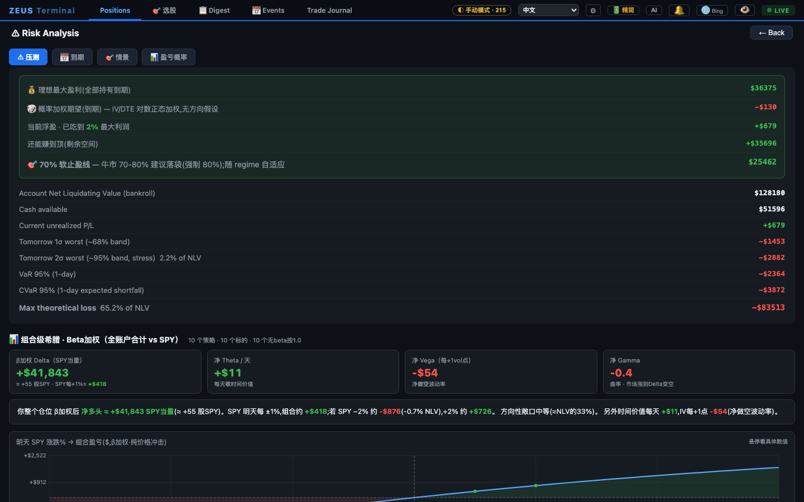<br><sub><b>风险分析</b> —— 压力测试、VaR / CVaR、整个账户按 Beta 加权的希腊值</sub></td>
<td width="50%">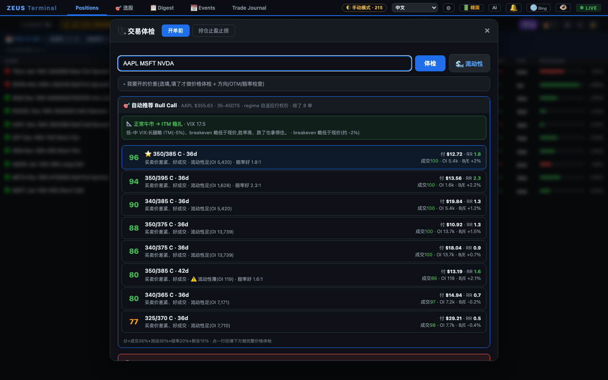<br><sub><b>开单前体检</b> —— 按流动性和赔率排好的价差推荐</sub></td></tr>
<tr><td width="50%"><br><sub><b>选股</b> —— K 线墙，带支撑阻力和 EMA50/200</sub></td>
<td width="50%">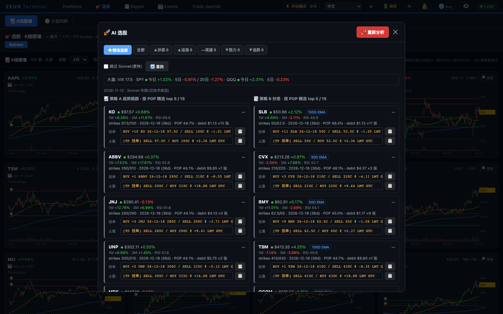<br><sub><b>AI 选股</b> —— 趋势和回踩候选，附行权价和可直接复制的挂单，不配 AI 也能用</sub></td></tr>
<tr><td width="50%">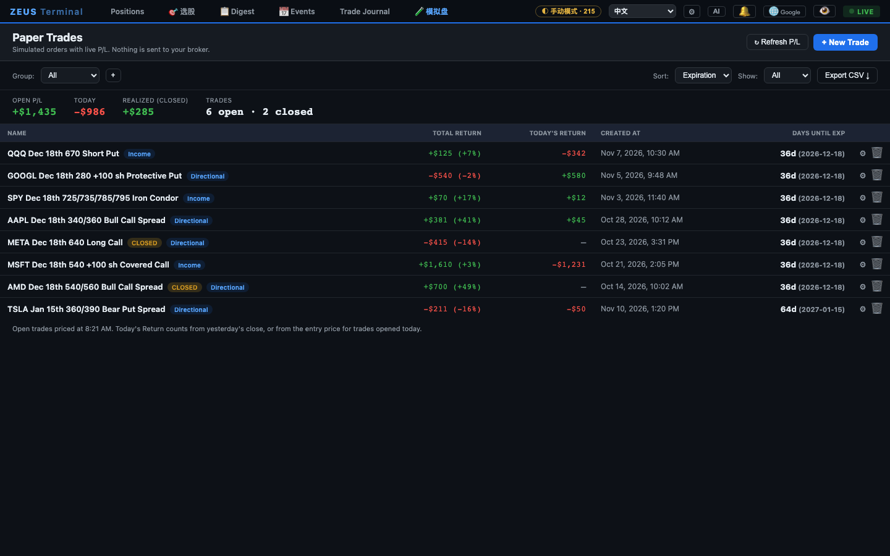<br><sub><b>模拟盘</b> —— 期权和股票的模拟单，总收益、今日收益、已实现盈亏</sub></td>
<td width="50%">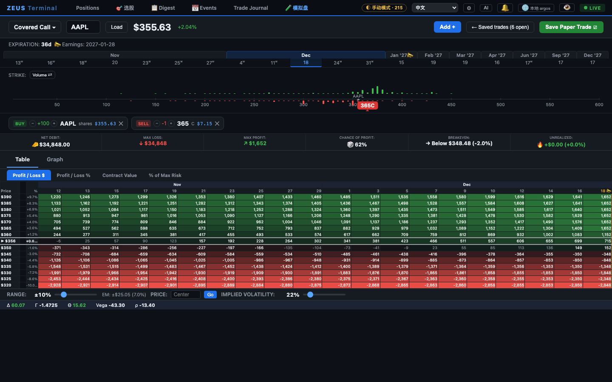<br><sub><b>模拟盘搭策略</b> —— 备兑看涨（100 股加一张卖出看涨）：精确的最大盈亏，按价格和日期的盈亏表</sub></td></tr>
<tr><td width="50%">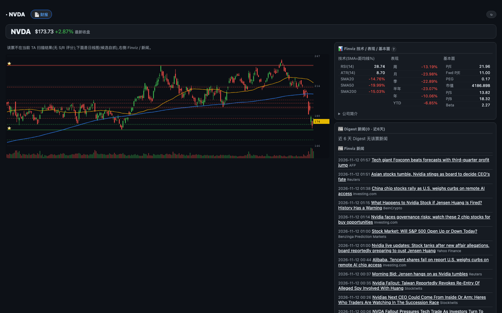<br><sub><b>单票详情</b> —— K 线、Finviz 技术面和基本面、新闻</sub></td>
<td width="50%"><br><sub><b>Digest</b> —— Finviz、华尔街日报、MarketWatch，登录 Benzinga 后再加一路</sub></td></tr>
<tr><td width="50%">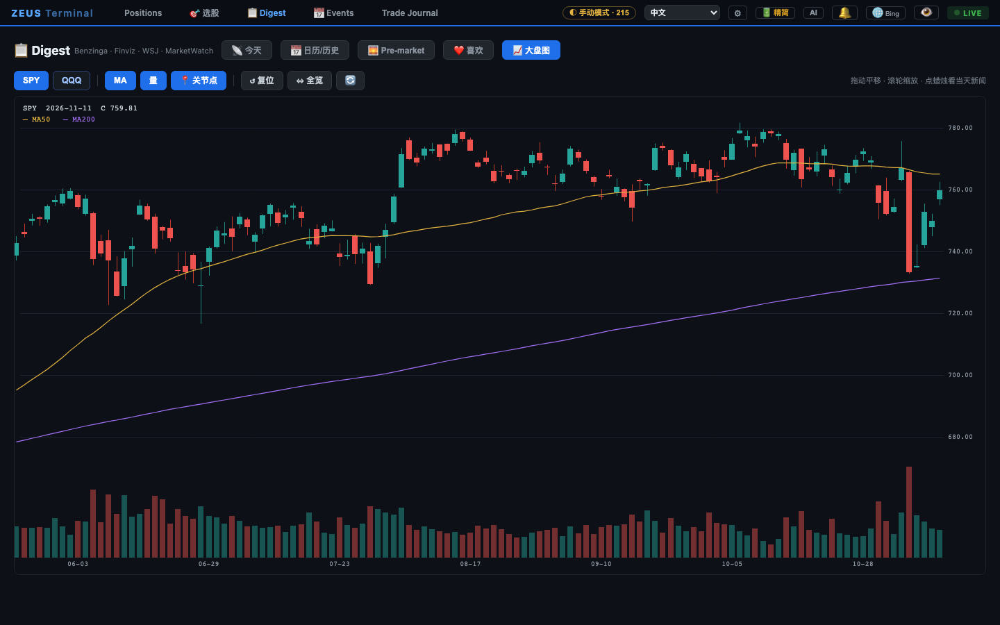<br><sub><b>大盘图</b> —— SPY / QQQ 全历史蜡烛图</sub></td>
<td width="50%">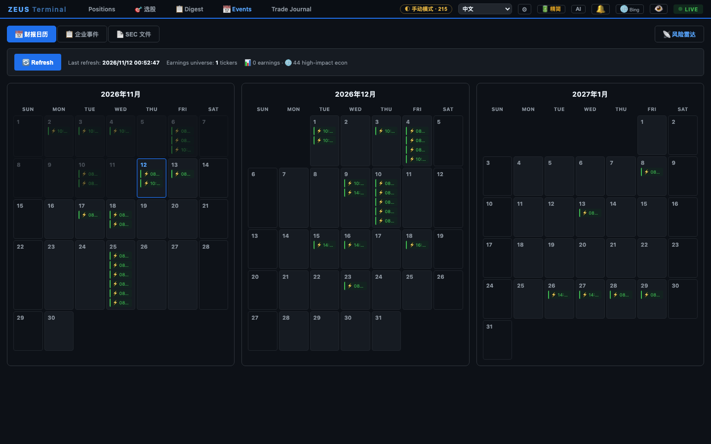<br><sub><b>日历</b> —— 财报和高影响宏观日期</sub></td></tr>
<tr><td width="50%">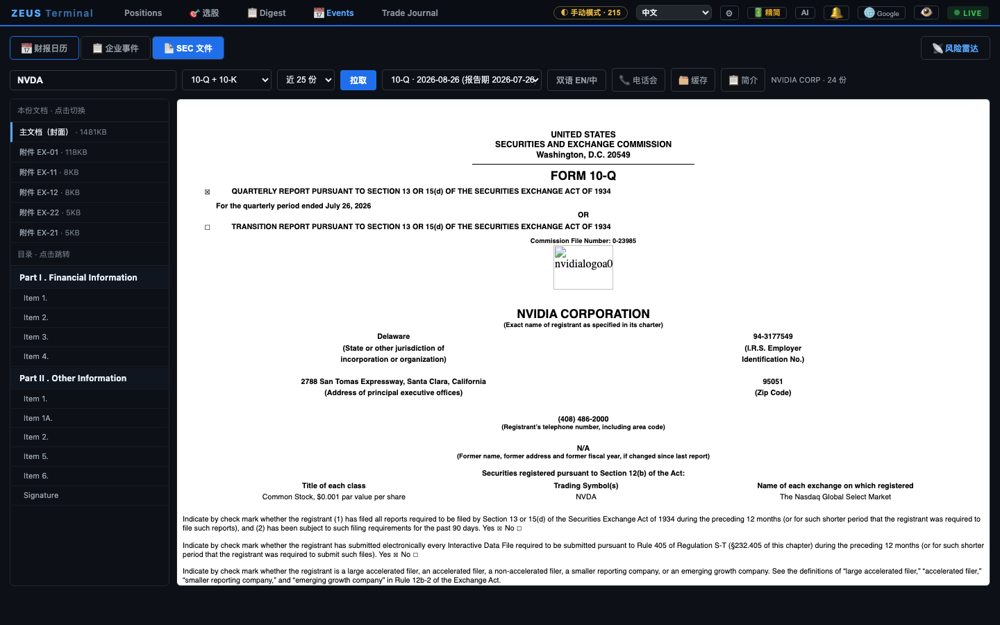<br><sub><b>SEC 文件阅读器</b> —— 10-K / 10-Q / 8-K 直接取自 EDGAR</sub></td>
<td width="50%">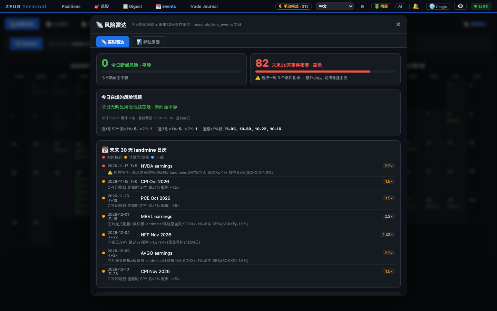<br><sub><b>风险雷达</b> —— 今日新闻风险和未来 30 天地雷日历</sub></td></tr>
<tr><td width="50%">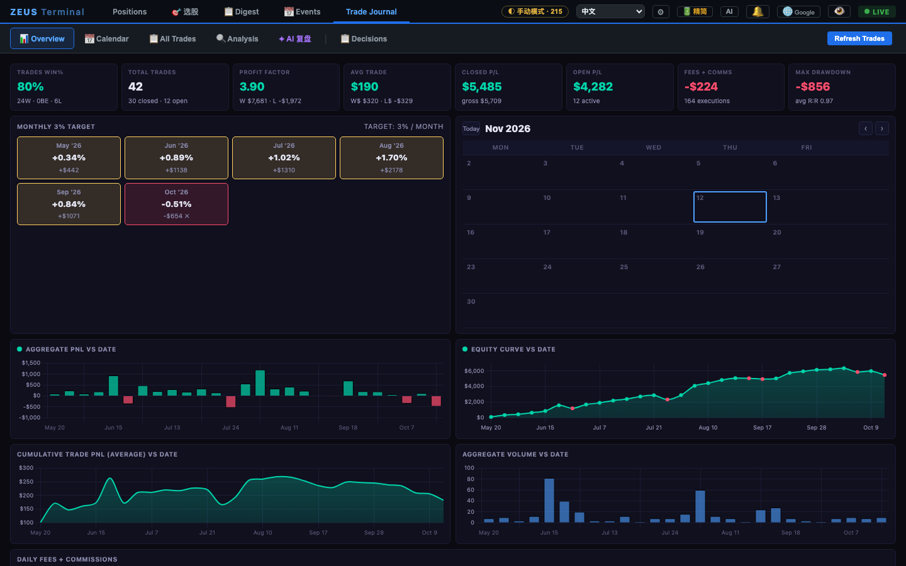<br><sub><b>交易日记</b> —— 胜率、盈亏比、月度目标、资金曲线</sub></td>
<td width="50%">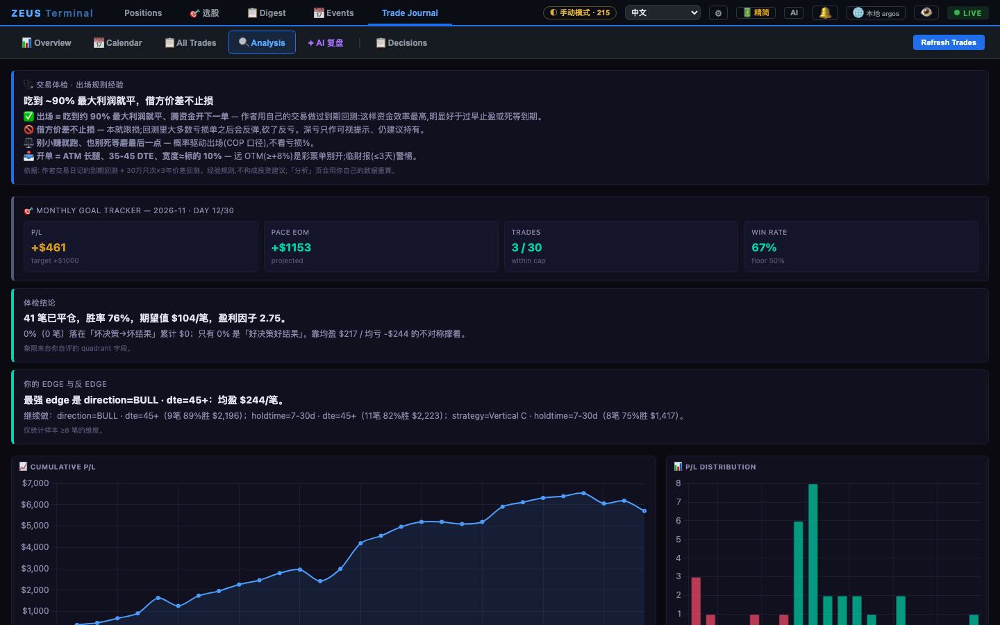<br><sub><b>日记分析</b> —— 从你自己的交易里看出什么有效、什么无效</sub></td></tr>
<tr><td width="50%">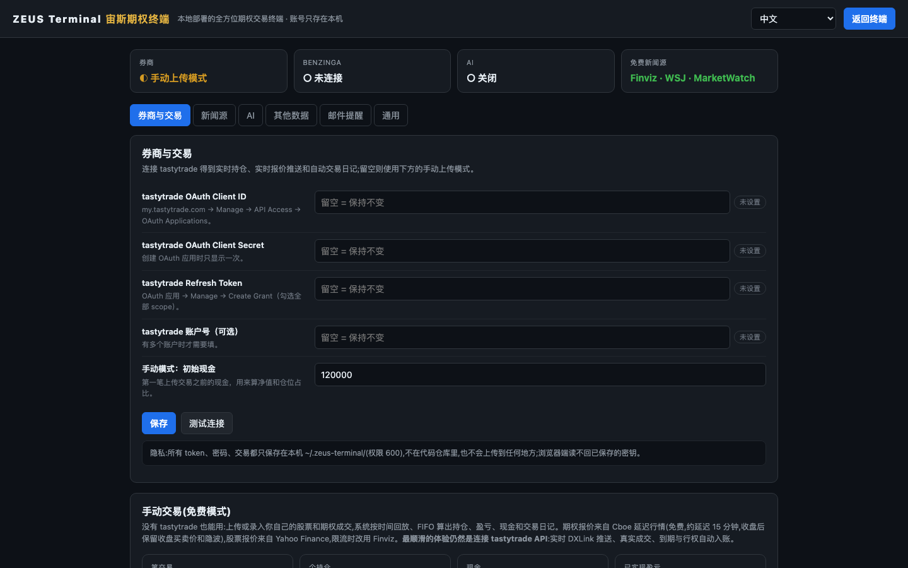<br><sub><b>设置</b> —— 所有信息都在网页里填，保存的密钥只写不读</sub></td>
<td width="50%">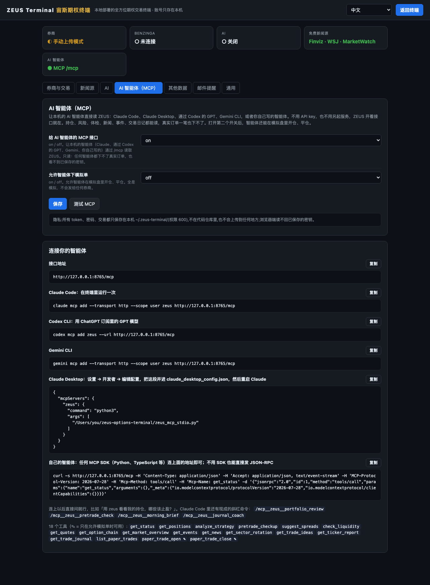<br><sub><b>AI 智能体（MCP）</b> —— 接入 Claude、GPT（Codex）、Gemini 或你自己的智能体，不要 API key</sub></td></tr>
</table>

---

## 🔌 连接券商

全部在浏览器里设置：**⚙ 设置 → 券商与行情**，每家券商一栏，都有 **测试连接** 按钮。持仓和行情分开选，券商没有的数据走免费源。ZEUS 只读，从不下单。

### tastytrade 凭证在哪拿
my.tastytrade.com → **Manage → API Access → OAuth Applications** → 新建一个应用（记下 *client secret*）→ **Manage → Create Grant**（勾选全部 scope）→ 复制 *refresh token*。两样粘进设置页，点 **测试连接**。

### Alpaca 和 Public 的 key 在哪拿
**Alpaca**：在 alpaca.markets 免费注册 → 进入 **Paper Trading** 模拟盘 → **API Keys → Generate** → 复制 key ID（PK 开头）和 secret。接实盘就在实盘账户里生成（AK 开头），并把 *Alpaca 模拟盘* 改成 *off*。**Public**：public.com → **Account → Settings → API** → 生成 secret key。分步说明见[使用手册](docs/USER_GUIDE_zh.md#22-连接券商)。

---

## 🔑 每一项设置能解锁什么

| 设置 | 解锁 | 是否免费 |
|---|---|---|
| tastytrade OAuth（client secret + refresh token） | 实时持仓、实时报价推送、自动交易日记、购买力、在途订单 | 有 tastytrade 账户即免费 |
| Alpaca key ID + secret | 模拟盘或实盘的实时持仓、成交、在途订单；免费的 IEX 股票价格和带希腊值的期权参考价 | ✅ 账户和行情都免费 |
| Public secret key | 实时持仓、历史记录、在途订单、实时报价、期权链和希腊值 | 有 Public 账户即免费 |
| 持仓来源 / 行情来源 | 账户和行情分开选；券商没有的数据走免费源 | ✅ |
| 手动交易（CSV / 表单） | 不连任何券商也有持仓、盈亏、日记和分析 | ✅ |
| Benzinga Pro cookie | Benzinga 实时 Digest、盘前、市场事件、历史 | 需要 Benzinga Pro 订阅 |
| Benzinga data API key | 实时信号流、扫描器 | 来自你的 Benzinga Pro 会话 |
| Finviz Elite token | 通过官方导出接口拿 Finviz 新闻（不填则用免费页面） | 可选 |
| AI 提供方 | AI 总结、市场判断、AI 选股、AI 复盘、持仓点评 | 用你自己的 |
| Barchart 账号 | Barchart 筛选器和信号榜单 | 需要 Barchart 账户 |
| 邮件（SMTP） | 每条提醒同时发邮件，带测试按钮（macOS 和 Linux） | ✅ |
| AI 智能体（MCP） | 你自己的智能体（Claude、通过 Codex 的 GPT、Gemini……）把 ZEUS 当工具用；默认开，智能体下模拟单默认关 | ✅ |

---

## 📄 手动交易：CSV 格式

在设置页下载模板（或者直接用 [`examples/trades_template.csv`](examples/trades_template.csv)）：

```csv
date,symbol,asset,side,effect,qty,price,fees,option_type,strike,expiration,multiplier,order_id,note
2026-03-02 10:15,AAPL,stock,buy,open,50,231.40,0,,,,,,long stock
2026-03-03 11:02,NVDA,option,buy,open,1,12.50,1.10,C,180,2026-04-17,100,nvda-bcs-1,bull call spread long leg
2026-03-03 11:02,NVDA,option,sell,open,1,6.20,1.10,C,190,2026-04-17,100,nvda-bcs-1,bull call spread short leg
```

- `side`：buy / sell，也认券商简写 **BTO、STO、BTC、STC**，以及 "Buy to Open"、"Sell to Close" 这种写法。
- `effect`：open / close，留空就自动判断。
- 期权也可以只写一个代码：OCC（`AAPL  260618C00200000`）、紧凑写法（`AAPL260618C200`）或券商描述（`AAPL 06/18/2026 200.00 C`）。
- `order_id` 相同（或者同一分钟成交）的几条腿会显示成一个策略。
- **tastytrade 导出的 CSV**，以及大多数带 日期 / 代码 / 买卖 / 数量 / 价格 列的券商导出，都能直接认。
- 初始现金默认推算成「刚好能撑起你这些交易的最小账户」，在设置里填上你的真实数字更准。

---

## 🔒 隐私与安全

- **一切都只在你的电脑上。** token、cookie、密码和上传的交易都存在 `~/.zeus-terminal/`（权限 600），从不放进代码仓库 —— `git push` 不可能把它们推出去。
- **代码文件夹里只有代码。** 终端运行时写的所有东西 —— 持仓快照、交易日记和截图、新闻存档、缓存、下载、日志 —— 都写到 `~/.zeus-terminal/runtime/`。代码里的那些运行目录只是指向那里的链接，git 会忽略它们。
- **安全地分享。** 用 `git push` 发布，或者用 `tools/export_clean_zip.sh` 打一个 zip，两种方式都只包含代码。不要把整个文件夹直接拖进网页、也不要自己手动打包。`tools/install_git_hook.sh` 会装一个本地的提交前检查：链接、数据文件、任何像密钥或 token 的字符串、你自己的主目录路径、登录名和 git 身份，一律拒绝提交。
- 保存过的密钥对浏览器**只写不读**：设置接口只告诉你「已设置 / 未设置」，从不把密钥回传。
- 给 AI 智能体的 MCP 接口只回应本机程序（用 Docker 时通过 `docker exec` 连进容器），任何 MCP 工具都下不了真实订单、读不出已保存的密钥；智能体读到的内容会发给它背后的模型服务商。
- 服务默认只监听 **127.0.0.1**，拒绝陌生的 `Host` 头（防 DNS 重绑定），跨域请求只接受本机来源，写操作需要一个其他网站发不出来的请求头。
- **用 Docker 时**，程序以普通用户身份运行，改不了自己的代码；你的数据留在 `/data` 卷里；文档里的命令只把端口发布在 127.0.0.1 上。本机检查（`Host` 头、跨域）和不用 Docker 时完全一样。
- 没有任何遥测。应用只连接你自己接入的服务，以及公开行情数据（Cboe 延迟行情、Yahoo Finance、SEC EDGAR、Finviz、道琼斯 RSS）。
- 免费数据会避开限流：公司资料（行业、细分行业、市值）从 Finviz 每次批量查 20 只；Yahoo Finance 一旦限流，股票报价自动改用 Finviz；一整条期权链只向 Cboe 请求一次，不再按到期日逐个请求 Yahoo。
- **发现安全问题？** 请按 [SECURITY.md](.github/SECURITY.md) 私下报告，不要公开发 Issue。

---

## 🏗️ 架构

东西放在哪：

```
zeus-options-terminal/
├── zeus/                 全部代码
│   ├── options_analyzer/   服务器（optionstrat_server.py）、持仓、体检、模拟盘、页面资源
│   ├── heatmap/ · ta_screener/ · ai_picks/ · stock_selector/ · barchart/      选股和扫描
│   ├── benzinga_digest/ · news_radar/ · market_brief/ · sec_filings/ …        新闻、市场判断、事件
│   ├── trade_journal/ · journal_review/ · journal_expiry_whatif/              交易日记
│   ├── zeus_*.py · local_broker.py    设置、券商（Alpaca、Public）、AI、新闻、MCP、邮件
│   ├── Dockerfile          ghcr.io 上的容器镜像（还有 Dockerfile.dockerignore）
│   └── defaults/           第一次启动时放进去的股票清单
├── docs/                 使用手册、功能清单、截图、README 用的图
├── site/                 项目网站（GitHub Pages）
├── tests/                离线测试：python -m pytest
├── tools/                隐私检查钩子、干净打包脚本、发版说明、Docker 镜像和 pip 安装包的检查
├── examples/             手动交易的 CSV 模板
├── .github/              CI 和发版工作流、Issue 表单、CONTRIBUTING、安全政策、行为准则
├── server.json · glama.json · CITATION.cff   MCP Registry、Glama 和 Zenodo 用的登记信息
└── start.sh · start.command · start.bat · requirements.txt · pyproject.toml
```

各部分怎么连起来（下面的路径都在 `zeus/` 里）：

```
浏览器（PWA，中文 / 双语 / English）
   │  WebSocket + REST
   ▼
FastAPI 服务 ── options_analyzer/optionstrat_server.py
   ├─ 券商 ......... tastytrade REST + DXLink 推送      │  local_broker.py（手动模式，Cboe + Yahoo）
   │                                                   │  zeus_brokers.py（Alpaca · Public，只读）
   ├─ 新闻 ......... Benzinga（cookie / WS）            │  zeus_news.py（Finviz · WSJ · MarketWatch）
   ├─ 选股 ......... heatmap/ · ta_screener/ · ai_picks/ · stock_selector/ · barchart/
   ├─ 市场判断 ..... market_brief/ · narratives/
   ├─ 事件 ......... sec_filings/ · benzinga_market_events/ · trade_journal/calendar_events.py
   ├─ 日记 ......... trade_journal/ · journal_review/ · journal_expiry_whatif/
   ├─ 纪律 ......... options_analyzer/checkup/ · pre_trade_checkup/ · sr_alert/
   ├─ 模拟盘 ....... options_analyzer/paper_trade.py · paper_trade_routes.py（只做模拟，从不发到券商）
   ├─ AI ........... zeus_ai.py（Claude CLI · Anthropic · OpenAI 兼容）
   └─ 设置 ......... zeus_config.py → ~/.zeus-terminal/config.json
```

运行时数据（K 线、缓存、新闻存档）写在 `~/.zeus-terminal/runtime/`，代码里 `zeus/data/` 这类目录只是指向那里的链接。配置也可以用环境变量给（`ZEUS_<KEY>`，比如 `ZEUS_TT_REFRESH_TOKEN`），设置文件夹可以用 `ZEUS_HOME` 换位置。

---

## ❓ 常见问题

**一定要 tastytrade 吗？** 不用。Alpaca（免费，自带模拟盘）和 Public 也能直接连，免费模式通过 CSV 支持任何券商的股票和期权。tastytrade 只是最顺。

**什么账户都没有，能先试试吗？** 能：在持仓页点 **载入示例组合**。选股、Digest、事件和 TA 扫描本来就用免费数据。

**一定要 Benzinga 吗？** 不用。Digest 免费跑在 Finviz + 华尔街日报 + MarketWatch 上。

**它会帮我下单吗？** 不会真的下单。它对 tastytrade、Alpaca 和 Public 都只读。🧪 模拟盘只记模拟交易，用来练手；真正的交易在你自己的券商里做。

**Windows / Linux 能用吗？** 核心功能都能用。桌面通知只支持 macOS，Linux 上可以改用邮件提醒。

**能用 Docker 跑吗？** 能，见[用 Docker 运行](#-用-docker-运行)。镜像支持 Intel、AMD 和 ARM。镜像里没有桌面通知，邮件提醒可以用。

**我的设置存在哪？** `~/.zeus-terminal/config.json`（用 Docker 时在 `zeus-data` 卷里）。删掉这个文件夹就什么都忘了。

**收盘后第一次打开，选股页显示 0 只报价？** 点一下选股页的 **Refresh**，几秒钟就会补上最近一个交易日的收盘价。

---

## 🤝 参与贡献

ZEUS 的功能远比这一页能写下的多，而且还在长，以后也可能加新功能。**欢迎提 PR**：修 bug、接新的数据源或券商、改翻译、补文档，或者把[还没接上的部分](docs/FEATURES_zh.md#还没接上的部分欢迎-pr)接起来都可以。动手前先看 [CONTRIBUTING.md](.github/CONTRIBUTING.md)。每个 PR 都会在 Linux、macOS、Windows 上跑一遍测试，`main` 只接受测试全部通过的 PR。

提问和讨论去 [Discussions](https://github.com/jackson-cmd/zeus-options-terminal/discussions)，bug 走 [Issues](https://github.com/jackson-cmd/zeus-options-terminal/issues/new/choose)，安全问题请私下报告（[SECURITY.md](.github/SECURITY.md)）。大家都遵守[行为准则](.github/CODE_OF_CONDUCT.md)。

---

## 📜 许可证：禁止商业使用

ZEUS Terminal（宙斯期权终端）以 **[PolyForm Noncommercial License 1.0.0](LICENSE)** 发布。

- ✅ 个人使用、学习、研究、业余交易、非营利用途。
- ❌ **禁止商业使用** —— 不能拿去卖，不能基于它做收费服务，不能在公司业务里使用。

**权利人请注意：** 如果你认为本仓库的任何内容侵犯了你的权利（商标、数据、服务条款或其他），**直接提 Issue**，相关内容会尽快移除。

**免责声明。** 这是一个按原样分享的个人工具，不提供任何担保，**不构成任何投资建议**。期权交易有很大亏损风险，你要为自己的交易负责，也要遵守你接入的每个数据源和券商的服务条款。ZEUS Terminal 与 tastytrade、Alpaca、Public、Benzinga、Cboe、Finviz、道琼斯 / 华尔街日报 / MarketWatch、Barchart、Yahoo、Anthropic 均无关联，也未获其认可；所有名称归各自所有者。
