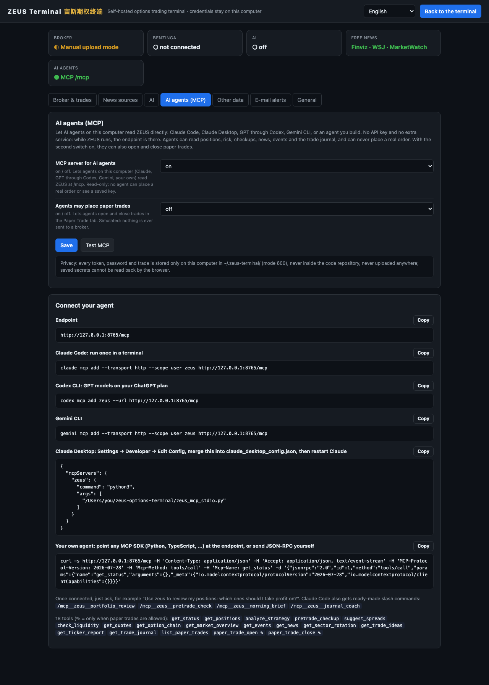

# ZEUS Terminal — user manual

[中文 → USER_GUIDE_zh.md](USER_GUIDE_zh.md) · [Feature checklist](FEATURES.md) · [What's new](../CHANGELOG.md) · [Back to README](../README.md)

This manual explains every page, button and setting of ZEUS Terminal: what it does, how to use it and what data it needs. Click any line in the contents to jump there. The short list of everything is in the [feature checklist](FEATURES.md); new features are listed in the [changelog](../CHANGELOG.md).

**What a feature needs** is marked like this: **Free** (works in free manual mode), **tastytrade** (a connected account), **Benzinga** (a Benzinga Pro login), **AI** (an AI provider), **macOS** (desktop notifications).

## Contents

1. [Install and start](#1-install-and-start)
   - [1.1 Requirements](#11-requirements) · [1.2 First start](#12-first-start) · [1.3 Stop, restart, change the port](#13-stop-restart-change-the-port) · [1.4 Install as an app](#14-install-as-an-app) · [1.5 Update](#15-update) · [1.6 Uninstall](#16-uninstall)
2. [First-time setup](#2-first-time-setup)
   - [2.1 Choose how your positions get in](#21-choose-how-your-positions-get-in) · [2.2 Connect tastytrade](#22-connect-tastytrade) · [2.3 Free mode: your trades from a CSV](#23-free-mode-your-trades-from-a-csv) · [2.4 News sources](#24-news-sources) · [2.5 AI](#25-ai) · [2.6 Notifications and e-mail](#26-notifications-and-e-mail) · [2.7 Every setting](#27-every-setting)
3. [The top bar](#3-the-top-bar)
4. [Positions](#4-positions)
   - [4.1 The board](#41-the-board) · [4.2 Status lights and filters](#42-status-lights-and-filters) · [4.3 Board tools](#43-board-tools) · [4.4 Strategy detail](#44-strategy-detail) · [4.5 Risk view](#45-risk-view) · [4.6 AI position review](#46-ai-position-review) · [4.7 How positions are grouped and priced](#47-how-positions-are-grouped-and-priced)
5. [Discipline tools](#5-discipline-tools)
   - [5.1 Exit advisor](#51-exit-advisor) · [5.2 Checkup panel](#52-checkup-panel) · [5.3 Liquidity scan](#53-liquidity-scan) · [5.4 Risk radar](#54-risk-radar) · [5.5 Four-gate pre-trade page](#55-four-gate-pre-trade-page)
6. [Picker](#6-picker)
   - [6.1 K-line chart wall](#61-k-line-chart-wall) · [6.2 AI picks](#62-ai-picks) · [6.3 Barchart lists](#63-barchart-lists) · [6.4 Ticker detail](#64-ticker-detail) · [6.5 Market brief](#65-market-brief) · [6.6 Sector rotation](#66-sector-rotation) · [6.7 Options sentiment](#67-options-sentiment) · [6.8 After-close crawl](#68-after-close-crawl)
7. [TA screener](#7-ta-screener)
   - [7.1 Run a scan](#71-run-a-scan) · [7.2 Views](#72-views) · [7.3 Signals and recommended spreads](#73-signals-and-recommended-spreads) · [7.4 Single-ticker page](#74-single-ticker-page)
8. [Paper Trade](#8-paper-trade)
   - [8.1 Start a strategy](#81-start-a-strategy) · [8.2 Strategy templates](#82-strategy-templates) · [8.3 Add and edit legs](#83-add-and-edit-legs) · [8.4 Read the analysis](#84-read-the-analysis) · [8.5 Save a paper trade](#85-save-a-paper-trade) · [8.6 The saved-trades list](#86-the-saved-trades-list) · [8.7 Trade detail and closing](#87-trade-detail-and-closing) · [8.8 How paper P/L is calculated](#88-how-paper-pl-is-calculated)
9. [Digest](#9-digest)
   - [9.1 Modes](#91-modes) · [9.2 Filters](#92-filters) · [9.3 Reading tools](#93-reading-tools) · [9.4 AI summary](#94-ai-summary) · [9.5 Tickers view and positions news](#95-tickers-view-and-positions-news) · [9.6 Calendar, history and search](#96-calendar-history-and-search) · [9.7 Liked stories](#97-liked-stories) · [9.8 Market chart](#98-market-chart)
10. [Events](#10-events)
    - [10.1 Earnings calendar](#101-earnings-calendar) · [10.2 Corporate events](#102-corporate-events) · [10.3 SEC filings reader](#103-sec-filings-reader)
11. [Trade journal](#11-trade-journal)
    - [11.1 Overview and targets](#111-overview-and-targets) · [11.2 Calendar](#112-calendar) · [11.3 All trades](#113-all-trades) · [11.4 Analysis and what-if](#114-analysis-and-what-if) · [11.5 AI review](#115-ai-review) · [11.6 Decision log](#116-decision-log) · [11.7 Weekly and daily review](#117-weekly-and-daily-review)
12. [Alerts and notifications](#12-alerts-and-notifications)
    - [12.1 What raises an alert](#121-what-raises-an-alert) · [12.2 Desktop and browser notifications](#122-desktop-and-browser-notifications) · [12.3 E-mail alerts](#123-e-mail-alerts) · [12.4 Mute and pause](#124-mute-and-pause)
13. [Interface languages](#13-interface-languages)
14. [Manual trades: the CSV format](#14-manual-trades-the-csv-format)
    - [14.1 Columns](#141-columns) · [14.2 Side and effect](#142-side-and-effect) · [14.3 Option symbols](#143-option-symbols) · [14.4 How positions are rebuilt](#144-how-positions-are-rebuilt)
15. [Your data and privacy](#15-your-data-and-privacy)
    - [15.1 Where files live](#151-where-files-live) · [15.2 Environment variables](#152-environment-variables) · [15.3 Back up, move, reset](#153-back-up-move-reset) · [15.4 What goes over the network](#154-what-goes-over-the-network)
16. [Keyboard shortcuts](#16-keyboard-shortcuts)
17. [Troubleshooting](#17-troubleshooting)
18. [AI agents (MCP)](#18-ai-agents-mcp)
    - [18.1 What agents can do](#181-what-agents-can-do) · [18.2 Connect your agent](#182-connect-your-agent) · [18.3 Your own agent](#183-your-own-agent) · [18.4 Permissions and privacy](#184-permissions-and-privacy)
19. [Glossary](#19-glossary)

---

## 1. Install and start

### 1.1 Requirements

- Python 3.10 or newer.
- macOS, Linux or Windows. Desktop notifications need macOS; e-mail alerts work on macOS and Linux.
- A recent Chrome, Edge, Safari or Firefox.
- No accounts are needed to start. A tastytrade account, a Benzinga Pro login and an AI provider each unlock more (see [2.7](#27-every-setting)).

### 1.2 First start

```bash
git clone https://github.com/jackson-cmd/zeus-options-terminal
cd zeus-options-terminal
./start.sh
```

- **macOS:** you can also double-click `start.command`. **Windows:** double-click `start.bat`.
- The first run creates a virtual environment in `.venv` and installs the requirements. This takes a minute or two; later starts take seconds.
- After about four seconds the browser opens **http://localhost:8765**. On the very first start the terminal shows a short onboarding hint for free mode.
- On first start ZEUS also seeds the default ticker lists into `data/`: the heatmap universe, the industry groups, the ETF list and the watchlists. Your own edits to those files are never overwritten.

### 1.3 Stop, restart, change the port

- **Stop:** press Ctrl+C in the window where the terminal runs.
- **Restart:** stop, then start again. Changing the listen address or the port in Settings needs a restart.
- **Port 8765 taken?** Start once with `PORT=8790 ./start.sh` (Windows: `set PORT=8790`, then `start.bat`), or set the port in ⚙ Settings → General. The launchers open the browser on the right port.

### 1.4 Install as an app

ZEUS is a progressive web app. In Chrome or Edge, click "Install ZEUS Terminal" in the address bar; it then opens in its own window and can sit in the Dock or the taskbar. The app works as long as the terminal is running.

### 1.5 Update

```bash
git pull
.venv/bin/python -m pip install -r requirements.txt
```

On Windows the second command is `.venv\Scripts\python -m pip install -r requirements.txt`. Deleting `.venv` also works; the next start rebuilds it. After updating, reload the page with Cmd+Shift+R (Ctrl+Shift+R on Windows) so the installed app picks up the new pages.

### 1.6 Uninstall

Delete the code folder. Delete `~/.zeus-terminal/` too if you also want to remove your settings, trades and caches.

---

## 2. First-time setup

Open **⚙** in the top bar. Everything is configured in the browser; you never edit a file by hand. Saved secrets are write-only: the page shows *set* or *not set* and never sends a secret back. The four cards at the top show the broker mode, Benzinga, AI and the free news sources at a glance.

### 2.1 Choose how your positions get in

| | tastytrade (recommended) | Free mode |
|---|---|---|
| Positions | Pulled live from your account | From a CSV you upload, or trades you type in |
| Quotes | Real-time DXLink streaming | Options from Cboe's delayed feed (about 15 minutes late), stocks from Yahoo Finance with Finviz as a fallback |
| Fills, expirations, assignments | Booked by the broker | Replayed from your fills; expired options settle at intrinsic value |
| Trade journal | Synced every hour | Rebuilt as soon as you upload |
| Buying power, working orders, missing take-profit alarm | Yes | No |

You can switch at any time: filling in the tastytrade credentials turns live mode on; clearing them goes back to free mode.

### 2.2 Connect tastytrade

1. On my.tastytrade.com open **Manage → API Access → OAuth Applications** and create an application. Copy the *client ID* and the *client secret* (the secret is shown once).
2. Open **Manage → Create Grant**, select all scopes, and copy the *refresh token*.
3. In ⚙ Settings → **Broker & trades**, paste the client ID, client secret and refresh token. Add the account number only if you have more than one account.
4. Press **Save**, then **Test connection**. A green ✓ shows how many accounts were found. Positions load within seconds.

### 2.3 Free mode: your trades from a CSV

1. In ⚙ Settings → **Broker & trades**, scroll to the trades section.
2. Drop a CSV on the upload area, or click it to pick a file. Tick *replace* to replace everything instead of adding.
3. Or add one trade with the form below it: date, symbol, stock or option, buy or sell, open or close, quantity, price, fees, and for options the type, strike and expiration.
4. Set **Manual mode: starting cash** to your real cash before the first trade; it drives net liquidating value and position sizing.
5. **Template** downloads an example CSV, **Export** downloads what is stored, **Clear all** deletes your manual trades.

The CSV format is described in [section 14](#14-manual-trades-the-csv-format). tastytrade exports and most broker exports are recognized as they are.

### 2.4 News sources

- The **free wire** (Finviz, WSJ, MarketWatch) is on from the start. *Free news sources* lists which ones to use.
- **Benzinga Pro** (optional): export the cookies of pro.benzinga.com from your logged-in browser (for example with a cookie-export extension) and paste the JSON array. This adds the live Benzinga wire, pre-market notes and corporate events. **Test · Benzinga** checks the cookies.
- **Benzinga data API key** (optional): adds the real-time signals feed and the scanner.
- **Finviz Elite token** (optional): switches Finviz news to the official export.
- **Headline translation**: *google* (rotates Google, Bing and local engines), *bing*, *ai* or *off*. A Google translate key is optional. The 🌐 button in the top bar shows which engine works right now.
- **Test connection** on this tab fetches each enabled free source and shows how many stories came back.

### 2.5 AI

1. Pick an **AI provider**: *auto* (the first one configured), *claude_cli* (your Claude subscription through `claude -p`), *anthropic* (API key), *openai* (any OpenAI-compatible endpoint: OpenAI, DeepSeek, OpenRouter, a local Ollama…) or *off*.
2. Fill in what that provider needs: the Claude CLI path (optional; PATH is searched), an Anthropic key, or an OpenAI-compatible key and base URL.
3. Optional: a **fast model** for summaries and a **smart model** for picks and reviews. Empty means the provider's default (for OpenAI-compatible endpoints, fill in model names).
4. **AI answer language**: *auto* follows the interface, or force *zh* / *en*.
5. **Scheduled AI jobs**: *on* runs the morning news summary, the market brief, AI picks and the position review by themselves.
6. **Test connection** sends a one-word request and shows the reply.

Without AI, ZEUS works fully; AI buttons say that AI is not configured.

### 2.6 Notifications and e-mail

- **Desktop notifications (macOS)**: ⚙ Settings → General. They fire even when the browser is closed. If none appear, allow notifications for your terminal app in macOS System Settings.
- **Browser notifications**: Positions → 🔔 → **Enable Notifications**.
- **E-mail alerts**: ⚙ Settings → E-mail alerts. Fill in the sender, the recipients (comma-separated), an app password (Gmail: Google Account → Security → App passwords) and the SMTP server and port (587 for STARTTLS, 465 for SSL). Press **Save**, then **Send a test e-mail**. Details in [12.3](#123-e-mail-alerts).

### 2.7 Every setting

**General**

| Setting | What it does | Default |
|---|---|---|
| Interface language | *auto* follows the browser; *zh*, *bi* (bilingual) or *en* | auto |
| Listen address | Keep 127.0.0.1; 0.0.0.0 exposes your portfolio to the whole network | 127.0.0.1 |
| Port | Where the terminal listens; restart to apply | 8765 |
| Desktop notifications (macOS) | Take-profit, missing GTC, risk radar and support/resistance alerts on the desktop | on |

**Broker & trades**

| Setting | What it does |
|---|---|
| tastytrade OAuth client ID / client secret / refresh token | The live connection (see [2.2](#22-connect-tastytrade)) |
| tastytrade account number (optional) | Only if you hold several accounts |
| Manual mode: starting cash | Cash before your first uploaded trade |

**News sources**

| Setting | What it does |
|---|---|
| Benzinga Pro cookies (JSON) | Live Benzinga wire, pre-market, events, history |
| Benzinga data API key (optional) | Real-time signals feed and scanner |
| Benzinga login e-mail / password (optional) | Only for the optional automatic re-login helper |
| Finviz Elite auth token (optional) | Finviz news through the official export |
| Free news sources | Comma list of finviz, wsj, marketwatch |
| Headline translation | google / bing / ai / off |
| Google translate key (optional) | Without it, Bing or your AI provider translates |

**AI**

| Setting | What it does |
|---|---|
| AI provider | auto / claude_cli / anthropic / openai / off |
| Claude Code CLI path (optional) | Path to `claude`; empty searches PATH |
| Anthropic API key | For the anthropic provider |
| OpenAI-compatible API key and base URL | For OpenAI, DeepSeek, OpenRouter, a local Ollama… |
| Fast model / Smart model | Models for summaries, and for picks and reviews |
| AI answer language | auto / zh / en |
| Scheduled AI jobs | on / off |

**Other data**

| Setting | What it does |
|---|---|
| Barchart username / password (optional) | Barchart screener and signal lists in the picker |
| Finviz "why is it moving" crawl | on / off; a slow crawl (about one request per second) of your universe for the ✦AI notes |
| SEC EDGAR User-Agent | SEC asks for a contact e-mail; put your own |

**E-mail alerts**

| Setting | What it does |
|---|---|
| Alert e-mail: from | The account that sends alerts and logs in to the SMTP server |
| Alert e-mail: to | Where alerts go; several addresses separated by commas |
| SMTP app password | Not your normal password; Gmail needs an app password |
| SMTP server / SMTP port | smtp.gmail.com and 587 by default; 465 uses SSL |

---

## 3. The top bar

| Element | What it does |
|---|---|
| **ZEUS Terminal** | The brand; hover for a one-line description |
| **Positions** | Your positions board ([section 4](#4-positions)) |
| **🎯 Picker** | Chart wall, AI picks, market brief, sector rotation ([section 6](#6-picker)) |
| **📋 Digest** | The news desk ([section 9](#9-digest)) |
| **📅 Events** | Earnings, corporate events, SEC filings, risk radar ([section 10](#10-events)) |
| **Trade Journal** | Statistics, analysis and the decision log ([section 11](#11-trade-journal)); a red badge counts decisions waiting for your notes |
| **🧪 Paper Trade** | Simulated trades with live P/L ([section 8](#8-paper-trade)) |
| **Language menu** | 中文 · 双语 · English ([section 13](#13-interface-languages)) |
| **⚙** | Opens Settings in an overlay; hover it to see the mode: ● tastytrade live, or ◐ manual upload with the number of manual trades (also on the first card in Settings) |
| **AI** | Pauses or resumes the scheduled AI jobs |
| **🔔** | Mutes every notification: take-profit, movers, risk, AI position review |
| **🌐** | Translation status: which engine works now, why the others fail, and a manual test |
| **👁** | Privacy blur for dollar amounts, for screen sharing and recording |
| **LIVE** | Green while the live data connection is up |

When the window is too narrow for all the tabs, the tabs scroll sideways (mouse wheel or trackpad) and the open one always stays in view. **Esc** closes the open pop-up (checkup, risk radar, alerts, liquidity, chart) or leaves a detail view, like the browser's Back button; switching to another tab closes pop-ups too.

---

## 4. Positions

### 4.1 The board

Every strategy is one row. Click a column header to sort; click again to reverse.

| Column | Meaning |
|---|---|
| Name | The strategy, for example *AAPL Dec 18 200/210 Bull Call Spread* |
| Underlying | The stock or ETF |
| Total Return | Unrealized P/L in $ and % since you opened it |
| Today's Return | P/L since yesterday's official close |
| B/E % | How far the stock is from the breakeven |
| Max Profit / Max Loss | At expiration; **∞** when unlimited |
| CoP | Chance of profit at expiration |
| DTE | Days to expiration |
| Progress | Share of max profit already earned (or of max loss already lost) |

The account bar above the board shows net liquidating value, buying power used, cash, and how many tickers are streaming live.

### 4.2 Status lights and filters

Each position gets a light from the exit advisor ([5.1](#51-exit-advisor)): 🔴 deep loss · 🔵 take profit · 🟡 near the target · 🟢 hold. The chips above the board filter by light; **All** shows everything again.

### 4.3 Board tools

| Button | What it does |
|---|---|
| 🤖 AI | AI position review ([4.6](#46-ai-position-review)) |
| 📈 | Portfolio overview: the whole book on one screen, with risk by sector |
| 🔥 / 💲 | P/L heatmap (tiles sized by max loss or max profit) and P/L bars; switch between them |
| ≡ Compact | Denser rows |
| ❄ Freeze | Freezes the numbers while you read; unfreeze to update again |
| ⚠ | Risk view ([4.5](#45-risk-view)) |
| ↻ | Refresh positions now |
| 🔔 | Alert panel: recent alerts and **Enable Notifications** |
| 🩺 | Checkup panel ([5.2](#52-checkup-panel)) |

### 4.4 Strategy detail

Click a row to open it. **← Back** returns to the board; ◀ hides the side panel.

- **Legs:** each leg with quantity, strike, type, entry and current price, and Greeks.
- **Summary:** net debit or credit, max loss, max profit, chance of profit, breakeven and unrealized P/L.
- **Table / Graph:** P/L at every price (rows) and date (columns) until expiration. The value tabs switch between **Profit / Loss $**, **Profit / Loss %**, **Contract Value** and **% of Max Risk**. The graph shows the expiration payoff and today's curve; its date slider moves through time.
- **RANGE:** how far above and below the current price the table reaches (±2 % to ±50 %), with the expected move shown next to it.
- **PRICE:** type a price and press **Go** to center the table there; **Clear** resets.
- **IMPLIED VOLATILITY:** slide to see P/L under a different IV; **Reset** returns to the market IV.
- **Midpoint / Bid / Ask:** value the legs at mid prices or at the prices you would actually get.
- **Greeks:** Δ Γ Θ Vega ρ for the whole strategy, using a skew-aware, vega-weighted spread IV.
- **TradingView chart** and **earnings:** open the underlying's chart, or its next earnings date with past reactions.

### 4.5 Risk view

Open with **⚠**. Four tabs:

| Tab | What it shows |
|---|---|
| ⚠ Stress | Per position: IV, DTE, 1σ move, 1σ and 2σ worst case for tomorrow, VaR 95 %, CVaR 95 %, max loss, max profit, share of profit already captured, chance of profit, distance to max profit. Totals: net liquidating value, cash, unrealized P/L, 1σ and 2σ worst case, VaR, CVaR and the max theoretical loss (−∞ when a position has unlimited loss) |
| 📅 Expiry | What expires when, and the theta each week earns |
| 🎯 Scenarios | Move the market and IV with sliders and see the whole book |
| 📊 P/L probabilities | The probability distribution of the book's P/L |

Click a column header to sort. **📊 Risk data & rules** opens the research notes behind the exit advice.

### 4.6 AI position review

**🤖 AI → ▶ Start** asks your AI provider to read every position together with its news and suggest hold, trim or close, with reasons. With scheduled AI jobs on, it also runs by itself. **Needs:** AI.

### 4.7 How positions are grouped and priced

- Legs are grouped by the order that opened them, so a spread stays one strategy even if you legged in or rolled. Without an order ID (free mode), legs of the same underlying opened on the same day are grouped.
- Each leg is marked to market: the broker mark, or the Cboe mid in free mode. Today's P/L uses the official previous close.
- Max profit and max loss are calculated at expiration: at a price of zero, at every strike and above the top strike. So a short put's max loss is the stock going to zero, and a long call's max profit is ∞.

---

## 5. Discipline tools

### 5.1 Exit advisor

The exit advisor gives every position its light and a one-line reason:

- **🔵 take profit** once a position has captured enough of its max profit. The band adapts to the market regime: about 70–80 % in a bull market, about 50–60 % when the market is choppy. A forced take-profit level follows; with little time left it comes earlier.
- **🟡 near** when it approaches the band.
- **🔴 deep loss** at −50 % or worse, with a note that a debit spread's loss is already limited.
- **🟢 hold** otherwise. Positions with unlimited max profit have no progress and stay on hold.

Take-profit alerts fire when a position enters the band ([section 12](#12-alerts-and-notifications)).

### 5.2 Checkup panel

Open it with **🩺** in the Positions toolbar, or by clicking the red alert bar at the top of the terminal when it appears (a position without a take-profit order, or one that expires today). Two tabs:

- **Before opening:** type the tickers you want to buy, or an alias (MAG7, MAGNIFICENT7, FAANG, FAAMG, SEMIS, BANKS), and press **Check**. For each candidate you see its trend, its beta to SPY, how closely it moves with what you already hold (ordinary and downside correlation, weighted by position size), how concentrated the book would become, and a *mistake mirror*: warnings, backed by your own journal, about mistakes you tend to repeat. Correlation inside the list is flagged too (buying all of MAG7 is one bet). Spread suggestions follow: bull call spreads ranked by fill quality, liquidity and reward to risk, adapted to the regime.
- **▸ The spread I want to open** (optional): enter your planned spread, or press **Load chain** to pick strikes. The checkup then adds price, direction, how far out of the money and reward-to-risk checks.
- **Position exits:** the same checks for what you already hold: take profit, stop, or keep.

### 5.3 Liquidity scan

Press **🌊 Liquidity** in the checkup, then **Scan**. You get a grid of strikes (about −10 % to +15 % around the price) by expiration (up to about 50 days) for **Calls** or **Puts**, with bid/ask width, volume and open interest, a verdict for the ticker, and the same spread compared across weeks. Click a cell for details.

### 5.4 Risk radar

Open it from Events, or with the risk-radar button on any page. **📡 Live radar** shows today's news risk and the event density of the next 30 days as a landmine calendar. **📊 Why it moved** explains recent big moves. A risk-radar alert fires when risk jumps.

### 5.5 Four-gate pre-trade page

Open **http://localhost:8765/pretrade-checkup**; the [daily review](#117-weekly-and-daily-review) links to it as "Run today's checkup".

1. Enter a ticker, the direction (bull or bear) and the days to expiration (40 by default), then press **🩺 Run checkup**. **🔄** runs it again.
2. Four gates, each passed or failed with its reason: trend, a touch of support or resistance, IV and earnings, and the macro calendar. A verdict follows.
3. If the verdict says no and you still want the trade, write at least 20 characters on what you are betting on and press **🔓 Override the verdict and record it**. Overrides are kept, so you can look back at them later.

A link such as `/pretrade-checkup?ticker=NVDA&direction=bull&dte=40` fills in the form and runs the check at once.

---

## 6. Picker

The picker has three sub-views at the top: **📈 K-line chart wall**, **🟩 Heatmap** ([6.9](#69-heatmap)) and **🧭 Market brief**.

### 6.1 K-line chart wall

A wall of daily candle charts for your universe (about 110 tickers by default; edit `data/heatmap_universe.txt` to change it). Each card shows the price, today's change, market cap, next earnings date, sector, EMA 50 (orange) and EMA 200 (blue), support (green) and resistance (red) lines, and ★ for strong levels. Click **🔎 depth** for the [ticker detail](#64-ticker-detail).

Toolbar:

| Control | Choices |
|---|---|
| Period | 1 month, 3 months, 6 months, 1 year, 2 years |
| Sort | Market cap, today's change, TA score |
| Each line | Auto, or 3–6 charts per row |
| AI | All, ▲ bullish (all), ▲ dip buy, ▲ trend following, — no trade, ▼ bearish (all), ▼ resistance at highs, ▼ trend down |
| Earnings | All, exclude near earnings, only near earnings |
| 🚀 AI Picker | Opens [AI picks](#62-ai-picks) |
| ⊕ Expand all | Expands every card's details |
| 📊 Barchart ▾ | [Barchart lists](#63-barchart-lists); shown once a Barchart login is saved |
| Auto | Refresh the wall every 5 s to 1 h, or off |
| Refresh | Reload now; use it after the close if the wall shows no quotes |
| ▴ | Collapse the toolbar |

### 6.2 AI picks

**🚀 AI Picker** opens a report with two lists, trend-following and dip-buying candidates. Each candidate has strikes, chance of profit and an order you can paste into your broker. With AI configured, an AI pass over news and earnings re-ranks them; **🚀 Re-run** runs it again, and the date menu opens earlier reports. Without AI the lists still work. A notification fires when a scheduled run finishes.

### 6.3 Barchart lists

Once a Barchart login is saved in Settings → Other data, the **📊 Barchart ▾** button appears on the chart wall and lists your saved Barchart screeners and signal pages (crawl them first from the 📊 Barchart menu on the TA screener page, `/ta/`). Pick several and choose **Intersect** (tickers in all of them) or **Union** (tickers in any); **Clear** removes the filter. **Needs:** a Barchart account.

### 6.4 Ticker detail

Opens from a chart card (🔎 depth) or from a ticker link:

- **Chart** for 1 week up to 2 years.
- **Finviz** technicals (RSI, ATR, distance from SMA 20/50/200), performance (week to year) and fundamentals (P/E, forward P/E, PEG, market cap, P/S, P/B, beta).
- **⚖️ Bull / bear narratives** built from recent news. **Needs:** AI.
- **🏢 Company profile** written from the latest 10-Q; **🔄 Update** rebuilds it. **Needs:** AI.
- **📑 Filings** jumps to the [SEC reader](#103-sec-filings-reader); **🔍 Deep search** looks for more news.

### 6.5 Market brief

**🧭 Market brief → 🧭 Market judgement.** An AI reading of the market: how bad the news is versus how much price has already absorbed, the probability of a crash against historical base rates, three layers of support, and what would prove the view wrong. It runs every morning when scheduled AI jobs are on; **🔄 Re-analyze** (top right of the brief) runs it now, in about 3 minutes. **Needs:** AI.

### 6.6 Sector rotation

**🧭 Market brief → 🔄 Sector rotation.** 80 industry groups (575 tickers) ranked by how they moved.

- **Sorting period:** short (1 month), medium (3 months), long (6 months), extra long (1 year).
- **Hide ETF groups** and **chart only significant moves (≥ 3 %)**.
- The bar chart shows each group's move, colored by trend: uptrend, oversold bounce (unconfirmed), pullback from highs, downtrend. Hover a bar for the full name and numbers.
- The table lists every group with 5-day, 1-, 3-, 6- and 12-month returns, the share of its stocks above the 50- and 200-day averages, and its members.
- **🔄 Reload data** downloads fresh daily prices for all groups (about a minute). Edit `data/industry_universe.txt` to change the groups.

### 6.7 Options sentiment

**🧭 Market brief → 🎲 Options sentiment.** For each sector: IV percentile, 25-delta skew percentile, put/call volume percentile and put/call open-interest percentile, each against its own history. Sort by any of the four. It reads the daily option-chain archive that the [after-close crawl](#68-after-close-crawl) fills; **🔄 Aggregate new trading days** adds the latest days. The percentiles become meaningful after a few weeks of archives.

### 6.8 After-close crawl

**⚡ Crawl after the close now** (in the picker and on the TA page) downloads the day's closing data for the whole universe: candles, and option chains for the archive. **↻ Re-crawl** runs it again; a progress line shows the state.

### 6.9 Heatmap

**🟩 Heatmap** shows the same universe as tiles, grouped by sector and then by industry: the area is the market cap and the color is today's change, green up and red down. Hover a tile for its numbers and click it for the [ticker detail](#64-ticker-detail). The toolbar above it (auto refresh, earnings filter, **Refresh**) is shared with the chart wall, and the picker remembers which of the two you looked at last.

---

## 7. TA screener

The TA screener lives at `/ta/`. It also opens inside the picker when you click a ticker.

### 7.1 Run a scan

- Scans run by themselves four times a trading day: 09:40, 10:30, 12:00 and 15:00 New York time.
- **▶ Run scan** starts one now. The first scan takes 2–4 minutes.
- The scan looks for MACD, RSI, volume and EMA breaks and for confluence of multi-timeframe support and resistance, and shows walk-forward win rates for each signal.

### 7.2 Views

- **📋 Table:** every signal with its score and recommended spread.
- **📊 Chart:** candle charts with the signals.
- **🔥 Heatmap:** tiles colored by today's change, grouped by **Sector** or **Industry**.
- The sparkline window switches between short (3 months), medium (1 year) and long (2 years).
- **?** opens a plain-language help pop-up; Esc closes it.

### 7.3 Signals and recommended spreads

Each signal comes with a bull call or bear put spread at a suitable expiration:

- **⚠️ Earnings** marks an earnings date before expiration.
- **📋** copies the spread as an order ticket.
- **⚡ Paper Trade** opens the spread in the [Paper Trade builder](#8-paper-trade). On a ticker page, the **B** key does the same.

### 7.4 Single-ticker page

The latest close and change; a daily chart (3 months to 2 years) with support and resistance; Finviz technicals, performance and fundamentals; the company profile; recent Digest news and Finviz news; and **📄 Filings** for the SEC reader. The main recommended spread sits under the chart with its ⚡ button.

---

## 8. Paper Trade

Paper Trade records simulated trades and follows their profit and loss. Nothing is ever sent to a broker. **Needs:** nothing beyond the terminal's own quotes.

### 8.1 Start a strategy

1. Open **🧪 Paper Trade** and press **+ New Trade**.
2. Type a ticker and press Enter or **Load**. The price and today's change appear next to it.
3. ZEUS picks an expiration about 25–50 days out and starts with a bull call spread. The expiration timeline above the strike bar shows every expiration by month (w = weekly, 📣 = a month with earnings); click a date to switch.

### 8.2 Strategy templates

Open the menu with the strategy's name at the top left:

| Group | Templates |
|---|---|
| Novice | Long Call, Long Put, Covered Call, Cash-Secured Put, Protective Put |
| Intermediate — credit spreads | Bull Put Spread, Bear Call Spread |
| Intermediate — neutral | Iron Butterfly, Iron Condor, Long Put Butterfly, Long Call Butterfly |
| Intermediate — debit spreads | Bull Call Spread, Bear Put Spread |
| Intermediate — directional | Straddle, Strangle |
| Advanced — naked | Short Put, Short Call |
| Advanced — neutral | Short Straddle, Short Strangle |
| Advanced — ratio | Call Ratio Backspread, Put Ratio Backspread |
| Advanced — other | Jade Lizard, Reverse Jade Lizard |

Templates place strikes around the money; adjust them afterwards.

### 8.3 Add and edit legs

- **Add +** → buy or sell a call or put at the money, or buy or sell 100 shares.
- **Strike bar:** dots show volume per strike (or open interest; switch with **Volume ⇄**) for calls above the axis and puts below. Click a dot to add a leg there; drag a leg's label to move it.
- **Leg card:** − / + change the quantity (shares move in steps of 100); click the price to type your own fill; ✕ removes the leg.
- **Click a leg card** for its quote (bid, ask, volume, open interest, IV, Greeks), warnings (low open interest or volume, a wide bid/ask spread), and to switch call ↔ put or buy ↔ sell.
- Changing the expiration moves existing legs to the nearest strikes of the new date.

### 8.4 Read the analysis

- **Net debit / net credit**, **max loss**, **max profit** (∞ when unlimited), **chance of profit**, **breakeven** (the one nearest the price, with its distance) and **unrealized** P/L.
- **Table / Graph** and **Profit / Loss $, %, Contract Value, % of Max Risk**, as in the [strategy detail](#44-strategy-detail).
- **RANGE**, **PRICE**, **IMPLIED VOLATILITY** and the date slider, plus the Greeks bar.

### 8.5 Save a paper trade

Press **Save Paper Trade ☑**. The trade is recorded at the mid prices shown, in the current group. Every leg needs a price; if one has none, click its price and type one. The list opens with the new trade.

### 8.6 The saved-trades list

- **Summary bar:** open P/L, today's P/L, realized P/L of closed trades, and the number of open and closed trades.
- **Columns:** name (with CLOSED and group badges), total return in $ and %, today's return, created at, days until expiration. Click a header to sort.
- **Group:** pick a group; **+** creates one.
- **Sort:** expiration, created, P/L, name. **Show:** open, closed or all.
- **↻ Refresh P/L** re-prices every open trade. **Export CSV ↓** saves the list.
- **⚙** on a row: view details, change group, close the trade, delete. **🗑** deletes.
- A dash (—) means a quote is still missing; the note under the table says when the trades were priced.

### 8.7 Trade detail and closing

Click a trade for its legs (entry, current price and P/L per leg), the summary, the Greeks and the P/L table. **Close at market** closes it at the current prices, and its P/L moves to realized. An option leg past its expiration closes at its intrinsic value. **↻ Refresh** re-prices.

### 8.8 How paper P/L is calculated

- Option legs are valued at the broker mark (mid price); stock legs at the last price.
- **Total return** = current value − entry value. **Today's return** compares with yesterday's close, or with the entry price for trades opened today.
- In free mode before the market opens, stock prices are still yesterday's closes while Cboe's option quotes may already have moved, so today's return can look odd until the open.
- Paper trades are stored in `~/.zeus-terminal/runtime/` and never leave your computer.

---

## 9. Digest

### 9.1 Modes

| Mode | What it shows |
|---|---|
| 📡 Today | A live list of today's news, refreshed every five minutes |
| 📅 Calendar / history | Any earlier day, and search |
| 🌅 Pre-market | Benzinga's pre-market notes and options-flow reports (**Needs:** Benzinga) |
| ❤️ Liked | Stories you liked |
| 📈 Market chart | SPY and QQQ with turning points ([9.8](#98-market-chart)) |

Each story shows the source, time, tickers and sentiment, the English headline and a Chinese translation underneath. Click a story to expand it.

### 9.2 Filters

| Filter | What it keeps |
|---|---|
| ⭐ Must-read | Strong catalysts and big macro news |
| ✦AI | Finviz's "why is it moving" notes |
| ▲ / ▼ / ● / any sentiment | Bullish, bearish, neutral, or any story with a sentiment |
| Ticker box + **Filter** / **Clear** | Only these tickers |
| 🔖 Watchlist only | Only your watchlist |
| ✨ De-noise | Hides clickbait templates |
| 🗂 Categories | Analyst ratings, price targets, earnings, WIIM, movers, trading ideas, M&A, IPOs, crypto, economics |
| Source chips | Mix Benzinga, Finviz, WSJ and MarketWatch |

### 9.3 Reading tools

**✓ Mark read** marks everything read and hides it; **👁 Show all** brings read stories back; **⇊ Expand** and **⇈ Collapse** open or close every story; **🔄** reloads.

### 9.4 AI summary

**🤖 AI summary** merges the day, or whatever the filters show, into a two-minute read with duplicates removed, and updates it as new stories land. A morning summary is written by itself when scheduled AI jobs are on. **Needs:** AI.

### 9.5 Tickers view and positions news

- **📊 Tickers:** news counts per ticker for today, 3, 7 or 30 days, with prices. Click a ticker for its stories; **← Back** returns to the ranking.
- **💼 Positions news:** only stories about what you hold, for the same periods.

### 9.6 Calendar, history and search

In **📅 Calendar / history**, step day by day with ‹ ›, jump with « », pick a day on the calendar, or use the presets 7 days, 1 month and 3 months. Type words and press **Search** to search every stored day; **Clear** resets. **Expand all / Collapse all** work here too.

### 9.7 Liked stories

Click ❤️ on any story to keep it across days. **❤️ Liked** lists them; **🗑 Clear** removes them all.

### 9.8 Market chart

SPY and QQQ daily candles over their full history, with major turning points marked. Click a turning point and AI explains which news drove it. **Needs:** AI for the explanations.

---

## 10. Events

### 10.1 Earnings calendar

**📅 Earnings calendar** shows earnings for your universe and positions by day, before or after the market, plus high-impact macro dates (FOMC, CPI, jobs and the like). Click a company for its earnings history. **🔄 Refresh** reloads. The dates come from Nasdaq's earnings calendar; when Nasdaq refuses the request, the calendar uses the earnings dates the picker keeps (from tastytrade, Yahoo or Finviz), with the before / after market label when it is known.

### 10.2 Corporate events

**📋 Corporate events:** IPOs, mergers and acquisitions, secondary offerings and splits. **Needs:** Benzinga.

### 10.3 SEC filings reader

1. Open **📄 SEC filings**, type a ticker and press **Fetch**.
2. Pick a filing (10-K, 10-Q, 8-K). The table of contents on the side jumps to sections.
3. **Bilingual EN/中** shows English and Chinese side by side.
4. **📞 Earnings call** shows the call transcript from public recordings (needs `yt-dlp`).
5. **📋 Profile** writes a summary of the business from the filing (**Needs:** AI); **🔄 Regenerate** rebuilds it.
6. **🗂 Cache** lists filings you already opened; they open offline.

Put your contact e-mail in Settings → Other data → SEC EDGAR User-Agent.

---

## 11. Trade journal

Tabs along the top: **📊 Overview · 📅 Calendar · 📋 All Trades · 🔍 Analysis · ✦ AI review · 📋 Decisions**. **Refresh Trades** reloads; with tastytrade the journal also syncs every hour.

### 11.1 Overview and targets

Win rate, profit factor, average trade, max drawdown, closed versus open P/L, fees and the equity curve. **⚙ targets** sets monthly targets, which this page tracks.

### 11.2 Calendar

P/L by day, week and month; click a day for its trades.

### 11.3 All trades

Every leg and every fill, with filters and sorting.

### 11.4 Analysis and what-if

P/L by symbol, holding time and setup; distributions; cumulative curves. The **what-if engine** tests, on your own trades, whether taking profit earlier, later or holding to expiration would have paid better, and suggests a rule.

### 11.5 AI review

**✦ Let AI review my trades** reads your trades and notes and names the mistakes you keep repeating. **Needs:** AI.

### 11.6 Decision log

The decision log records why you opened or closed each trade.

- **Filters:** Pending, Completed, All; 🟢 Active, 🔒 Closed.
- **🔄 Sync from TastyTrade** pulls new fills (tastytrade); **🔔 Test Notification** checks the reminders.
- **Open an entry** to fill it in, or start from a template. Opening: 🎯 dip rebound, 📈 trend chase, 🛡️ hedge, 🎲 gamble and more. Closing: ✅ take-profit close, 💰 took profit early, 😞 could not hold and more.
- **Fields:** logic type (dip buy, mean reversion, momentum, hedge…), signal sources, confidence (low, medium, high, gambling), emotional state (pick several), yes/no questions about your state, and notes.
- **📸 Capture chart** saves the current chart into the entry; you can attach other images too.
- **After the decision:** a chart or table of the spread value, IV and Greeks (Δ Γ Θ Vega) since you acted.
- **Statistics:** filter by direction, strategy and ticker (**Apply / Reset**). *Confidence calibration* shows whether your stated confidence predicts your win rate.
- Reminders fire for decisions you have not filled in.

### 11.7 Weekly and daily review

- **Weekly review:** a review of the week's closed trades, saved by week; a reminder fires when the week ends.
- **Daily review:** `/journal-review` shows yesterday's opened and closed trades, rule checks and today's watchlist, with a link to [today's pre-trade checkup](#55-four-gate-pre-trade-page).

---

## 12. Alerts and notifications

### 12.1 What raises an alert

| Alert | When | Needs |
|---|---|---|
| Take profit | A position enters its take-profit band | Free |
| Missing GTC | A position has no working take-profit order | tastytrade |
| Credit-spread mistake | A vertical filled as a net credit when you meant to pay a debit | Free |
| Support / resistance | A stock you hold touches a support or resistance zone | Free |
| Risk radar | News risk jumps | Free |
| Big movers | A stock in your universe moves sharply; click to open its news | Free |
| AI picks ready | A scheduled AI picks run finished | AI |
| Decision log | A decision is waiting for your notes | Free |
| Weekly review | The week ended | Free |
| Benzinga login | The Benzinga cookies expired | Benzinga |

### 12.2 Desktop and browser notifications

- **Desktop (macOS):** ⚙ Settings → General → Desktop notifications. They work with the browser closed.
- **Browser:** Positions → 🔔 → **Enable Notifications**.

### 12.3 E-mail alerts

With e-mail set up, every alert in [12.1](#121-what-raises-an-alert) is also sent by e-mail, with the alert's title as the subject.

- The same alert is mailed at most once per 30 minutes, and at most 20 alerts are mailed per hour.
- On Linux, which has no desktop notifications here, this is how alerts reach you. Windows is not supported yet.
- **Send a test e-mail** in Settings checks the setup; the message next to the button shows the mail server's answer.

### 12.4 Mute and pause

**🔔** in the top bar mutes every notification for a while. **AI** in the top bar pauses the scheduled AI jobs. Turning desktop notifications off in Settings silences them for good.

---

## 13. Interface languages

Choose in the top bar or in Settings → General:

- **中文:** explanations, tips and news translations in Chinese; trading tables such as Positions, the strategy detail, Paper Trade and the journal keep the usual English labels (Max Profit, Win Rate…).
- **双语 (bilingual):** the Chinese interface with the English term beside every Chinese tab, button, header and label, and English inside tooltips.
- **English:** the interface in English, the TA screener and single-ticker page included. A few labels may still show Chinese.

News stays in English with a Chinese translation under each headline; in English mode the translations are hidden and one click shows them. AI answers follow the interface language unless Settings → AI sets one.

---

## 14. Manual trades: the CSV format

### 14.1 Columns

```csv
date,symbol,asset,side,effect,qty,price,fees,option_type,strike,expiration,multiplier,order_id,note
2026-03-02 10:15,AAPL,stock,buy,open,50,231.40,0,,,,,,long stock
2026-03-03 11:02,NVDA,option,buy,open,1,12.50,1.10,C,180,2026-04-17,100,nvda-bcs-1,bull call spread long leg
2026-03-03 11:02,NVDA,option,sell,open,1,6.20,1.10,C,190,2026-04-17,100,nvda-bcs-1,bull call spread short leg
```

| Column | Meaning |
|---|---|
| date | Fill time, `YYYY-MM-DD HH:MM` |
| symbol | Ticker, or a full option symbol ([14.3](#143-option-symbols)) |
| asset | `stock` or `option` |
| side | Buy or sell ([14.2](#142-side-and-effect)) |
| effect | `open`, `close`, or blank to decide automatically |
| qty, price, fees | Quantity, price per share or per contract, total fees |
| option_type, strike, expiration | For options: `C` or `P`, the strike, `YYYY-MM-DD` |
| multiplier | 100 for standard options |
| order_id | Legs with the same order ID (or filled in the same minute) form one strategy |
| note | Free text |

### 14.2 Side and effect

`side` accepts `buy` / `sell`, broker shorthand **BTO, STO, BTC, STC**, and text such as "Buy to Open" or "Sell to Close". Leave `effect` blank and ZEUS decides from your existing position.

### 14.3 Option symbols

Instead of the four option columns, an option can be one symbol: OCC (`AAPL  260618C00200000`), compact (`AAPL260618C200`) or broker text (`AAPL 06/18/2026 200.00 C`).

### 14.4 How positions are rebuilt

Fills are replayed in time order, first in, first out. Expired options settle at their intrinsic value on the expiration date. Starting cash is the value in Settings or, if that is empty, the smallest account that could have funded your history.

---

## 15. Your data and privacy

### 15.1 Where files live

| Path | What is in it |
|---|---|
| `~/.zeus-terminal/config.json` | Every setting and secret (permission 600) |
| `~/.zeus-terminal/runtime/` | Everything the terminal writes: position snapshots, the journal and its screenshots, paper trades, news archives, caches, downloads, logs |
| `~/.zeus-terminal/mail_state.json` | Which alerts were mailed recently (for repeats and the hourly cap) |
| `data/` and the other runtime folders in the code | Links into `~/.zeus-terminal/runtime/`, ignored by git |

The code folder never holds your data, so `git pull` and `git push` cannot touch it.

### 15.2 Environment variables

- Any setting can come from the environment as `ZEUS_<KEY>`, for example `ZEUS_TT_REFRESH_TOKEN` or `ZEUS_PORT`.
- `ZEUS_HOME=/path` moves the settings folder.
- `PORT=8790` overrides the port for one start.

### 15.3 Back up, move, reset

- **Back up:** copy `~/.zeus-terminal/`.
- **Move to another computer:** copy the folder there, or start with `ZEUS_HOME` pointing at it.
- **Reset everything:** stop the terminal and delete `~/.zeus-terminal/`.

### 15.4 What goes over the network

ZEUS has no telemetry. It talks only to the services you connect (tastytrade, Benzinga, your AI provider, your SMTP server, Barchart) and to public market data: Cboe delayed quotes, Yahoo Finance, Finviz, SEC EDGAR, Dow Jones RSS (WSJ, MarketWatch) and the translation engines. The server listens on 127.0.0.1 only, refuses foreign Host headers, and every write needs a header that other websites cannot send.

---

## 16. Keyboard shortcuts

| Key | Where | What it does |
|---|---|---|
| Enter | Any ticker or search box | Load or search |
| B | TA single-ticker page | Open the main recommended spread in Paper Trade |
| Esc | Anywhere | Close the open pop-up (checkup, risk radar, alerts, liquidity, chart, TA help) or leave a detail view |
| Cmd+Shift+R / Ctrl+Shift+R | Anywhere | Reload without the cache (after an update) |

---

## 17. Troubleshooting

| Problem | What to do |
|---|---|
| The page does not open | Look at the window where the terminal runs. Is another program on 8765? Start with `PORT=8790 ./start.sh`. |
| The picker shows 0 quotes after the close | Press **Refresh** in the picker; the last session's closing prices fill in within seconds. |
| Quotes stop updating in free mode | Yahoo Finance is throttling; ZEUS switches stock quotes to Finviz by itself. Wait a minute and refresh. |
| Positions are empty in free mode | Upload your trades in Settings → Broker & trades, and check that the CSV columns match [section 14](#14-manual-trades-the-csv-format). |
| The tastytrade test fails | Create a new grant (all scopes) and paste the new refresh token; check the client secret. |
| No AI buttons, or "AI not configured" | Set a provider in Settings → AI, press Test connection, then reload. |
| Benzinga news stopped | The cookies expired; paste fresh cookies in Settings → News sources. |
| No desktop notifications | macOS only. Turn them on in Settings → General and allow notifications for your terminal app in System Settings. |
| The test e-mail fails | Use an app password, not your normal one, and check the server and port (587 STARTTLS or 465 SSL). |
| Sector rotation or options sentiment is empty | Press **🔄 Reload data** for rotation. Options sentiment needs a few weeks of after-close crawls. |
| Paper Trade says "No market data yet" | The terminal is still loading after start; wait a few seconds. With tastytrade, press Test connection in Settings. |
| The page looks old after an update | Reload with Cmd+Shift+R (Ctrl+Shift+R). |
| An AI agent cannot connect | ZEUS must be running, and Settings → AI agents (MCP) → MCP server must be on. Run `python3 zeus_mcp_stdio.py --check` in the ZEUS folder; use `127.0.0.1`, not `localhost`. |
| An agent says it may not paper trade | Turn on Settings → AI agents (MCP) → Agents may place paper trades. |

Still stuck? [Open an issue](https://github.com/jackson-cmd/zeus-options-terminal/issues) with what you did and what you saw (leave out tokens, cookies and account numbers).

---

## 18. AI agents (MCP)

ZEUS speaks the Model Context Protocol (MCP), the standard way AI agents use tools. An agent on this computer (Claude Code, Claude Desktop, GPT through Codex, Gemini CLI, or one you build) can read your positions, run the pre-trade checkup, price a spread, read the news, the calendar and your journal, and paper trade if you allow it. It works from ZEUS's own numbers, with no API key and no extra server: while ZEUS runs, the endpoint is there.

### 18.1 What agents can do

| Tool | What it returns |
|---|---|
| `get_status` | Broker mode, data freshness, the account (net liquidating value, cash, buying power), open positions and paper trades, the market regime, and what agents may do. Agents call it first |
| `get_positions` | Every position computed the way the Positions page does: cost, P/L open and today, max profit and loss, breakevens, chance of profit, Greeks, earnings before expiration, one-day stress and VaR, and the exit advice; plus risk per underlying as a share of net liquidating value |
| `analyze_strategy` | What-if analysis of any option or stock strategy priced from the live chain: debit or credit, exact max profit and loss, reward to risk, breakevens, chance of profit, Greeks, a P/L table, and warnings for wide markets or thin open interest. Nothing is saved |
| `pretrade_checkup` | The four gates ([5.5](#55-four-gate-pre-trade-page)) with reasons and the verdict |
| `suggest_spreads` | Ranked bull call spreads with debit, max profit and loss, breakeven and liquidity |
| `check_liquidity` | Bid/ask width, volume and open interest at the money for every expiration, the best expiration per strike, and the same spread priced across weeks |
| `get_quotes`, `get_option_chain` | Quotes for up to 20 tickers; the chain near the money with bid, ask, mid, IV, delta, volume and open interest |
| `get_market_overview` | Regime, VIX, risk radar, the AI market judgement if it ran today, sector rotation, option sentiment, SPY / QQQ / IWM / VIX |
| `get_events` | Macro releases and earnings, with every position that holds through an earnings date |
| `get_news` | The news wire, newest first, by ticker (company names count too) or by words in the headline |
| `get_sector_rotation` | The 80 industry groups ranked by return, with trend and breadth |
| `get_trade_ideas` | The latest AI picks and TA screener signals |
| `get_ticker_report` | One ticker in depth: quote, fundamentals, analyst actions, past earnings reactions, TA view, headlines |
| `get_trade_journal` | Win rate, profit factor, expectancy, results by strategy, ticker, holding time and DTE, and your latest closed trades with their notes |
| `list_paper_trades` · `paper_trade_open` · `paper_trade_close` | Paper Trade: list with live P/L; opening and closing need your permission ([18.4](#184-permissions-and-privacy)) |

No tool can place a real order, read a saved key, or see a file path.

There are also four ready-made prompts: **portfolio review**, **pre-trade check** (for one ticker), **morning brief** and **journal coach**. In Claude Code they are slash commands such as `/mcp__zeus__portfolio_review`; in Gemini CLI, `/portfolio_review`.

### 18.2 Connect your agent

Open ⚙ Settings → **AI agents (MCP)**. It shows the address and the exact command for each agent on this computer, each with a copy button. The address is `http://127.0.0.1:8765/mcp` (with your port if you changed it).



| Agent | How |
|---|---|
| Claude Code | `claude mcp add --transport http --scope user zeus http://127.0.0.1:8765/mcp` |
| Codex CLI (GPT on your ChatGPT plan) | `codex mcp add zeus --url http://127.0.0.1:8765/mcp` |
| Gemini CLI | `gemini mcp add --transport http --scope user zeus http://127.0.0.1:8765/mcp` |
| Claude Desktop | Settings → Developer → Edit Config: add the block below, then restart Claude |
| Your own agent | Any MCP client library, or plain JSON-RPC over HTTP ([18.3](#183-your-own-agent)) |

Claude Desktop starts local tools as a command, so it uses the bridge that ships with ZEUS. The bridge needs only the Python standard library (Python 3.8 or newer):

```json
{
  "mcpServers": {
    "zeus": {
      "command": "python3",
      "args": ["/path/to/zeus-options-terminal/zeus_mcp_stdio.py"]
    }
  }
}
```

The Settings page fills in the real paths for this computer. To check the connection at any time, run `python3 zeus_mcp_stdio.py --check` in the ZEUS folder.

Then just ask, for example: "Use zeus: which of my positions should I take profit on?", "Run the pre-trade checkup on NVDA and price a 30-day bull call spread", "Which earnings land before my expirations this month?"

### 18.3 Your own agent

With the official Python SDK (`pip install mcp`, version 1.x shown):

```python
import asyncio
from mcp import ClientSession
from mcp.client.streamable_http import streamablehttp_client

async def main():
    async with streamablehttp_client("http://127.0.0.1:8765/mcp") as (read, write, _):
        async with ClientSession(read, write) as session:
            await session.initialize()
            result = await session.call_tool("get_positions", {"include_legs": False})
            print(result.content[0].text)

asyncio.run(main())
```

The same address works with the TypeScript SDK and with agent frameworks that take an MCP server URL. Without an SDK, send one JSON-RPC message per POST; the Settings page has a `curl` example. ZEUS speaks both the current protocol (2026-07-28, stateless, with `server/discover`) and the earlier handshake-based revisions (2025-11-25, 2025-06-18, 2025-03-26), so older and newer clients both connect.

### 18.4 Permissions and privacy

- **MCP server** (on by default): turn it off in Settings → AI agents (MCP) and every agent request is refused.
- **Agents may place paper trades** (off by default): lets agents open and close trades in the Paper Trade tab. They are simulated; nothing is ever sent to a broker.
- Only programs on this computer get an answer. Requests from other computers, from web pages (a foreign `Origin`) or with a foreign `Host` header are refused, even if ZEUS listens on 0.0.0.0.
- Whatever an agent reads goes to that agent's model provider (Anthropic, OpenAI, Google…), like anything else you paste into it.

---

## 19. Glossary

| Term | Meaning |
|---|---|
| Mark / mid | The middle of the bid and ask; positions are valued at it |
| Bid / ask | The best price to sell / to buy right now |
| DTE | Days to expiration |
| Debit / credit | Paying / receiving money when you open a trade |
| Vertical spread | Buy one option and sell another of the same type and expiration (bull call, bear put, bull put, bear call) |
| Iron condor | A bull put spread plus a bear call spread; profits if the stock stays in a range |
| Covered call | 100 shares plus one short call |
| Protective put | 100 shares plus one long put |
| Collar | 100 shares, a long put and a short call |
| Max profit / max loss | The best and worst P/L at expiration; ∞ when unlimited |
| Breakeven (B/E) | The price at which the trade neither makes nor loses money at expiration |
| CoP / POP | Chance (probability) of profit at expiration, from implied volatility |
| IV | Implied volatility: how big the market expects moves to be |
| IV percentile | Where today's IV sits within its own history (0–100) |
| 25Δ skew | Put IV minus call IV at 25 delta; high means strong demand for downside protection |
| Put/call ratio | Put volume (or open interest) divided by call volume (or open interest) |
| Δ Γ Θ Vega ρ | The Greeks: sensitivity to the price, to changes in delta, to time, to IV and to interest rates |
| 1σ / 2σ move | A one- or two-standard-deviation move implied by IV |
| VaR 95 % / CVaR 95 % | The loss not exceeded on 95 % of days / the average loss on the worst 5 % |
| NLV | Net liquidating value: what the account is worth now |
| Buying power (BP) | Capital your positions tie up |
| GTC | Good-'til-cancelled order |
| OCC symbol | The standard option code, such as `AAPL  260618C00200000` |
| EMA 50 / 200 | 50- and 200-day exponential moving averages |
| Support / resistance (S/R) | Price levels where buying or selling has stopped moves before |
| Regime | The market state (bull, choppy) that sets the take-profit band |
| WIIM | "Why is it moving": short notes on what moved a stock |
