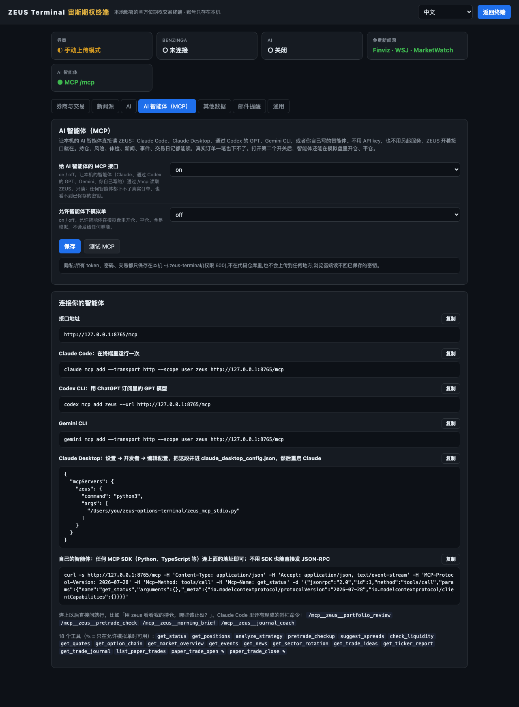

# ZEUS Terminal 使用手册

[English → USER_GUIDE.md](USER_GUIDE.md) · [功能清单](FEATURES_zh.md) · [新功能](../CHANGELOG_zh.md) · [回到 README](../README_zh.md)

这本手册讲 ZEUS Terminal 的每个页面、每个按钮和每项设置：它做什么、怎么用、需要什么数据。点目录里任意一行就能跳过去。所有功能的简表在[功能清单](FEATURES_zh.md)里，每次新加了什么写在[更新记录](../CHANGELOG_zh.md)里。

**每项功能需要什么**这样标：**免费**（免费的手动模式就能用）、**tastytrade**（要连上账户）、**Benzinga**（要 Benzinga Pro 登录）、**AI**（要配一个 AI）、**macOS**（桌面通知）。

## 目录

1. [安装和启动](#1-安装和启动)
   - [1.1 环境要求](#11-环境要求) · [1.2 第一次启动](#12-第一次启动) · [1.3 停止 重启 换端口](#13-停止-重启-换端口) · [1.4 装成应用](#14-装成应用) · [1.5 更新](#15-更新) · [1.6 卸载](#16-卸载) · [1.7 用 Docker 运行](#17-用-docker-运行) · [1.8 用 pipx 安装](#18-用-pipx-安装)
2. [第一次设置](#2-第一次设置)
   - [2.1 先选持仓从哪来](#21-先选持仓从哪来) · [2.2 连接券商](#22-连接券商) · [2.3 免费模式 用 CSV 导入交易](#23-免费模式-用-csv-导入交易) · [2.4 新闻源](#24-新闻源) · [2.5 AI](#25-ai) · [2.6 通知和邮件](#26-通知和邮件) · [2.7 全部设置项](#27-全部设置项)
3. [顶栏](#3-顶栏)
   - [3.1 每个页面的说明](#31-每个页面的说明)
4. [持仓](#4-持仓)
   - [4.1 总表](#41-总表) · [4.2 状态灯和筛选](#42-状态灯和筛选) · [4.3 总表工具](#43-总表工具) · [4.4 策略详情](#44-策略详情) · [4.5 风险视图](#45-风险视图) · [4.6 AI 持仓点评](#46-ai-持仓点评) · [4.7 持仓怎么归组和估值](#47-持仓怎么归组和估值)
5. [纪律工具](#5-纪律工具)
   - [5.1 出场顾问](#51-出场顾问) · [5.2 体检面板](#52-体检面板) · [5.3 流动性扫描](#53-流动性扫描) · [5.4 风险雷达](#54-风险雷达) · [5.5 四道关体检页](#55-四道关体检页)
6. [选股](#6-选股)
   - [6.1 K 线墙](#61-k-线墙) · [6.2 AI 选股](#62-ai-选股) · [6.3 Barchart 榜单](#63-barchart-榜单) · [6.4 单票详情](#64-单票详情) · [6.5 大盘判断](#65-大盘判断) · [6.6 行业轮动](#66-行业轮动) · [6.7 期权情绪](#67-期权情绪) · [6.8 盘后爬取](#68-盘后爬取)
7. [TA 扫描](#7-ta-扫描)
   - [7.1 跑扫描](#71-跑扫描) · [7.2 视图](#72-视图) · [7.3 信号和推荐价差](#73-信号和推荐价差) · [7.4 单票页](#74-单票页)
8. [模拟盘](#8-模拟盘)
   - [8.1 开始搭策略](#81-开始搭策略) · [8.2 策略模板](#82-策略模板) · [8.3 加腿和改腿](#83-加腿和改腿) · [8.4 看分析](#84-看分析) · [8.5 保存模拟单](#85-保存模拟单) · [8.6 模拟单列表](#86-模拟单列表) · [8.7 单笔详情和平仓](#87-单笔详情和平仓) · [8.8 模拟盘盈亏怎么算](#88-模拟盘盈亏怎么算)
9. [Digest 新闻台](#9-digest-新闻台)
   - [9.1 模式](#91-模式) · [9.2 筛选](#92-筛选) · [9.3 阅读工具](#93-阅读工具) · [9.4 AI 总结](#94-ai-总结) · [9.5 按代码排行和持仓新闻](#95-按代码排行和持仓新闻) · [9.6 日历 历史和搜索](#96-日历-历史和搜索) · [9.7 收藏](#97-收藏) · [9.8 大盘图](#98-大盘图)
10. [事件](#10-事件)
    - [10.1 财报日历](#101-财报日历) · [10.2 企业事件](#102-企业事件) · [10.3 SEC 文件阅读器](#103-sec-文件阅读器)
11. [交易日记](#11-交易日记)
    - [11.1 总览和目标](#111-总览和目标) · [11.2 日历](#112-日历) · [11.3 全部交易](#113-全部交易) · [11.4 分析和假设引擎](#114-分析和假设引擎) · [11.5 AI 复盘](#115-ai-复盘) · [11.6 决策日志](#116-决策日志) · [11.7 周复盘和每日复盘](#117-周复盘和每日复盘)
12. [提醒和通知](#12-提醒和通知)
    - [12.1 哪些情况会提醒](#121-哪些情况会提醒) · [12.2 桌面通知和浏览器通知](#122-桌面通知和浏览器通知) · [12.3 邮件提醒](#123-邮件提醒) · [12.4 静音和暂停](#124-静音和暂停)
13. [界面语言](#13-界面语言)
14. [手动交易 CSV 格式](#14-手动交易-csv-格式)
    - [14.1 各列含义](#141-各列含义) · [14.2 买卖方向和开平](#142-买卖方向和开平) · [14.3 期权代码写法](#143-期权代码写法) · [14.4 持仓怎么重建](#144-持仓怎么重建)
15. [你的数据和隐私](#15-你的数据和隐私)
    - [15.1 文件放在哪](#151-文件放在哪) · [15.2 环境变量](#152-环境变量) · [15.3 备份 迁移 重置](#153-备份-迁移-重置) · [15.4 会连哪些网络服务](#154-会连哪些网络服务)
16. [快捷键](#16-快捷键)
17. [遇到问题](#17-遇到问题)
18. [AI 智能体（MCP）](#18-ai-智能体mcp)
    - [18.1 智能体能做什么](#181-智能体能做什么) · [18.2 连接你的智能体](#182-连接你的智能体) · [18.3 你自己的智能体](#183-你自己的智能体) · [18.4 权限和隐私](#184-权限和隐私)
19. [名词解释](#19-名词解释)

---

## 1. 安装和启动

### 1.1 环境要求

- Python 3.10 或更新的版本；也可以不装 Python，改用 Docker（见 [1.7](#17-用-docker-运行)）。用 pipx 安装就不需要下载代码（见 [1.8](#18-用-pipx-安装)）。
- macOS、Linux、Windows 都可以。桌面通知只支持 macOS；邮件提醒支持 macOS 和 Linux。
- 新一点的 Chrome、Edge、Safari 或 Firefox。
- 开始用不需要任何账户。tastytrade 账户、Benzinga Pro 登录和 AI 各自能解锁更多功能（见 [2.7](#27-全部设置项)）。

### 1.2 第一次启动

```bash
git clone https://github.com/jackson-cmd/zeus-options-terminal
cd zeus-options-terminal
./start.sh
```

- **macOS**：也可以直接双击 `start.command`。**Windows**：双击 `start.bat`。
- 第一次运行会在 `.venv` 里建虚拟环境、装依赖，要一两分钟；以后启动只要几秒。
- 大约 4 秒后浏览器自己打开 **<http://localhost:8765>**。第一次打开时，持仓页给出三种开局方式：载入**示例组合**先看看、连接券商、或者上传你的交易（见 [2.1](#21-先选持仓从哪来)）。
- 第一次启动还会把默认的股票清单放进 `zeus/data/`：热力图票池、行业分组、ETF 清单和观察清单。你自己改过的文件永远不会被覆盖。

### 1.3 停止 重启 换端口

- **停止**：在终端运行的那个命令行窗口里按 Ctrl+C。
- **重启**：先停止，再启动。在设置里改了监听地址或端口，要重启才生效。
- **8765 被占了？** 用 `PORT=8790 ./start.sh` 启动一次（Windows 先 `set PORT=8790` 再运行 `start.bat`），或者在 ⚙ 设置 → 通用 里改端口。启动脚本会按正确的端口打开浏览器。

### 1.4 装成应用

ZEUS 是一个 PWA。在 Chrome 或 Edge 地址栏里点「安装 ZEUS Terminal」，以后它会在单独的窗口里打开，可以放进程序坞或任务栏。只要终端在运行，应用就能用。

### 1.5 更新

```bash
git pull
.venv/bin/python -m pip install -r requirements.txt
```

Windows 上第二条命令是 `.venv\Scripts\python -m pip install -r requirements.txt`。直接删掉 `.venv` 也行，下次启动会自动重建。更新后按 Cmd+Shift+R（Windows 上 Ctrl+Shift+R）强制刷新，装成应用的版本才会用上新页面。

### 1.6 卸载

删掉代码文件夹。如果连设置、交易和缓存也不要了，再删掉 `~/.zeus-terminal/`。

### 1.7 用 Docker 运行

ZEUS 也有容器镜像，发布在 GitHub Packages 上：`ghcr.io/jackson-cmd/zeus-options-terminal`，支持 Intel 和 AMD（`amd64`），也支持 ARM（`arm64`：Apple 芯片的 Mac、装 64 位系统的树莓派）。要装 Docker（macOS 和 Windows 用 Docker Desktop），不用装 Python。

```bash
docker run -d --name zeus --restart unless-stopped \
  -p 127.0.0.1:8765:8765 -v zeus-data:/data \
  -e TZ=America/New_York \
  ghcr.io/jackson-cmd/zeus-options-terminal:latest
```

然后打开 **<http://localhost:8765>**。第一次启动大约要半分钟，之后持仓页会给出示例组合、连接券商、上传交易三种开局方式（见 [2.1](#21-先选持仓从哪来)）。浏览器不会像 `./start.sh` 那样自己打开；装成应用（[1.4](#14-装成应用)）照样可以。

- **`-p` 里的 `127.0.0.1:` 不要去掉。** ZEUS 没有登录：谁能连上这个端口，谁就能看你的持仓、改你的设置。带上 `127.0.0.1:`，只有本机的程序连得上。想在本机用别的端口，改第一个数字，比如 `-p 127.0.0.1:8790:8765`。容器里 ZEUS 固定监听 8765，所以在 ⚙ 设置里改端口不起作用。
- **装在服务器或 NAS 上**，同样保留 `127.0.0.1:`，从你自己的电脑用 SSH 隧道连过去：`ssh -L 8765:localhost:8765 you@server`，然后打开 http://localhost:8765。用 IP 地址或主机名打开时，ZEUS 会回答 `host not allowed`，这是它防 DNS 重绑定的保护。
- **你的数据**存在 `zeus-data` 卷里，也就是容器里的 `/data`：存设置和密钥的 `config.json`、你上传的交易，以及 `runtime/` 下的所有东西。更新和 `docker rm` 都不会动它。新建的卷里设置是空的。想把文件放在一个文件夹里，改用 `-v ~/zeus-data:/data`；在 Linux 上要先让用户 1000（ZEUS 用的就是这个用户）能写这个文件夹：`sudo chown 1000 ~/zeus-data`。
- **时区。** 按钟点跑的任务（8:30 的 AI 新闻总结、9:00 的市场判断、AI 持仓点评）看的是容器的时钟。默认是纽约时间；把 `TZ` 换成你自己的时区，比如 `America/Chicago` 或 `Asia/Shanghai`，它们就按你的钟点跑。
- **更新**：`docker pull ghcr.io/jackson-cmd/zeus-options-terminal:latest`，然后 `docker rm -f zeus`，再运行同一条 `docker run`。卷里的东西都还在。想停在某个版本，就用它的标签：`:0.6.0`，或者 `:0.6`，只接收这个版本的修复。
- **停止、启动、看日志**：`docker stop zeus`、`docker start zeus`、`docker logs -f zeus`。带了 `--restart unless-stopped`，Docker 或电脑重启后 ZEUS 也会自己起来。
- **删除**：`docker rm -f zeus`；连设置和数据也不要了，再运行 `docker volume rm zeus-data`。
- **AI 智能体（MCP）**用 `docker exec` 在容器里启动 ZEUS 的桥接脚本；⚙ 设置 → AI 智能体 会列出每个智能体的命令（见 [18.2](#182-连接你的智能体)）。
- **本机上的模型**（Ollama、LM Studio）：在容器里，`localhost` 指的是容器自己，本机要写成 `host.docker.internal`。把 OpenAI 兼容 Base URL 设成 `http://host.docker.internal:11434/v1`，不用填 key。在 Linux 上，还要在 `docker run` 里加 `--add-host=host.docker.internal:host-gateway`，并让模型服务接受来自 Docker 网络的连接。镜像里没有 Claude Code CLI，请改用 Anthropic 或 OpenAI 兼容的 key。
- **镜像里没有的**：桌面通知（只支持 macOS；邮件提醒和浏览器自己的通知照常能用），要 Playwright 和 Chromium 的 Barchart 榜单和 Benzinga cookie 导出，以及要 Node.js 的 Benzinga 自动续登脚本。在设置里粘贴 Benzinga Pro 的 cookie 照常能用。需要这些功能，就用 `./start.sh` 运行 ZEUS。

用 Docker Compose 的话，同样的配置写成下面这个 `compose.yaml`。`docker compose up -d` 启动；先 `docker compose pull`、再 `docker compose up -d` 就是更新：

```yaml
services:
  zeus:
    image: ghcr.io/jackson-cmd/zeus-options-terminal:latest
    container_name: zeus
    restart: unless-stopped
    ports:
      - "127.0.0.1:8765:8765"
    volumes:
      - zeus-data:/data
    environment:
      TZ: America/New_York
volumes:
  zeus-data:
    name: zeus-data
```

想自己构建镜像，在代码文件夹最上层运行 `docker build -f zeus/Dockerfile -t zeus-terminal .`，之后把命令里的 ghcr.io 镜像名换成 `zeus-terminal`。

### 1.8 用 pipx 安装

ZEUS 也发布在 PyPI 上，包名是 `zeus-options-terminal`。[pipx](https://pipx.pypa.io/) 会把它装进单独的环境，既不用下载代码，也不用自己建虚拟环境（macOS 用 `brew install pipx`，其他系统用 `python3 -m pip install --user pipx`）：

```bash
pipx install zeus-options-terminal
zeus
```

`zeus` 启动的服务器和 `./start.sh` 完全一样，等它能响应了就打开 **<http://localhost:8765>**；持仓页会让你选示例组合、连券商或上传交易（见 [2.1](#21-先选持仓从哪来)）。

- **参数：** `zeus --port 8790` 换端口，`zeus --no-browser` 启动时不打开浏览器，`zeus --version` 看版本。`zeus-terminal` 是同一个命令，万一别的程序已经叫 `zeus` 可以用它。按 Ctrl+C 停止。
- **你的数据** 和用 `./start.sh` 时一样，都在 `~/.zeus-terminal`（或者 `ZEUS_HOME` 指定的文件夹）。
- **更新：** `pipx upgrade zeus-options-terminal`，设置和交易都保留。**卸载：** `pipx uninstall zeus-options-terminal`；设置文件夹会留着，要删自己删。
- **AI 智能体（MCP）**：⚙ 设置 → AI 智能体 里给出的命令，用的就是这次安装的路径（见 [18.2](#182-连接你的智能体)）。
- **不包含：** Barchart 清单和 Benzinga cookie 导出（要 Playwright 和 Chromium）、离线翻译标题、Benzinga 自动续登脚本（要 Node.js）。需要这些就从代码用 `./start.sh` 加 `requirements-optional.txt` 运行。

---

## 2. 第一次设置

点顶栏的 **⚙**。所有配置都在网页里填，不用手改任何文件。密钥只写不读：页面只显示「已设置」或「未设置」，从不把密钥传回浏览器。顶部的卡片一眼看清持仓和行情从哪来，以及 Benzinga、AI、免费新闻源和 AI 智能体的状态。

### 2.1 先选持仓从哪来

| | tastytrade | Alpaca | Public | 免费模式 |
|---|---|---|---|---|
| 需要什么 | tastytrade 账户 | 免费注册 Alpaca；模拟盘不用入金 | Public 实盘账户（Public 没有模拟盘） | 什么都不用 |
| 持仓 | 从你的账户实时拉取 | 从你的模拟盘或实盘实时拉取 | 从你的账户实时拉取 | 来自你上传的 CSV，或者手动录入的交易 |
| 报价 | DXLink 实时推送 | 免费：股票用 IEX 实时，期权用 Alpaca 参考价，带希腊值和 IV | 实时报价、期权链和希腊值 | 期权用 Cboe 延迟行情（约晚 15 分钟），股票用 Yahoo Finance，不行时改用 Finviz |
| 成交、到期、行权 | 券商自动入账 | 读你在 Alpaca 的成交 | 读你在 Public 的历史记录 | 按你的成交回放；过期期权按内在价值结算 |
| 交易日记 | 每小时同步 | 每小时按成交重算 | 每小时按历史记录重算 | 上传后立刻重算 |
| 购买力、在途订单、漏挂止盈单提醒 | 有 | 有 | 有 | 购买力按初始现金算；没有在途订单 |

ZEUS 对 Alpaca 和 Public 只读：从不在那里下单、改单或撤单，🧪 模拟盘里的操作也不会发给它们。

**持仓来源**（设置 → 券商与行情）决定持仓从哪来：*auto* 按 tastytrade、Alpaca、Public 的顺序用第一个填好 key 的券商，都没填就用你上传的交易；也可以直接选 *tastytrade*、*alpaca*、*public* 或 *manual*。**行情来源** 单独选：*auto* 用券商自己的行情，没有就用免费源；*free*、*alpaca*、*public* 指定一个。券商没有的数据（比如 SPX、VIX 的指数点位）照样走免费源；券商不回应时（限流、key 过期）所有行情也自动退回免费源。设置页顶部的卡片显示正在用的来源；选了某家券商却没填 key 时，卡片会直接写出来。

**只想先看看？** 在空的持仓页点 **载入示例组合**。ZEUS 会生成 6 个持仓（AAPL 股票、SPY 牛市看跌价差、NVDA 牛市看涨价差、QQQ 铁鹰、MSFT 看涨、TSLA 卖出看跌）和 1 笔已平仓的 AMD 交易，行权价、到期日和价格取自那一刻的真实期权报价，每个页面立刻有内容可看。页面顶部的提示条会说明这是示例；**清除示例** 只删这些示例交易，不碰你自己的。

### 2.2 连接券商

#### tastytrade

1. 在 my.tastytrade.com 打开 **Manage → API Access → OAuth Applications**，新建一个应用，复制 *client ID* 和 *client secret*（secret 只显示一次）。
2. 打开 **Manage → Create Grant**，勾选全部 scope，复制 *refresh token*。
3. 在 ⚙ 设置 → **券商与行情** 的 tastytrade 一栏粘贴 client ID、client secret 和 refresh token。只有一个账户的话，账户号可以不填。
4. 点 **保存**，再点这一栏的 **测试连接**。出现绿色的 ✓ 和找到的账户数就成功了，几秒内持仓就会出来。

#### Alpaca

1. 在 alpaca.markets 免费注册，进入 **Paper Trading** 模拟盘账户，点 **API Keys → Generate**，复制 *key ID*（模拟盘的以 PK 开头）和 *secret key*（只显示一次）。要接实盘就在实盘账户里生成，实盘的 key 以 AK 开头。
2. 在 ⚙ 设置 → **券商与行情** 的 Alpaca 一栏把两个都粘贴进去。模拟盘 key 保持 **Alpaca 模拟盘** 为 on；实盘 key 改成 *off*。
3. **Alpaca 股票行情**：*iex*（免费、实时，只含 IEX 交易所的成交）、*delayed_sip*（免费、全市场、延迟 15 分钟）或 *sip*（全市场实时，Alpaca 付费行情）。**Alpaca 期权行情**：*indicative*（免费；报价是 Alpaca 的参考价，成交延迟 15 分钟，带希腊值和 IV）或 *opra*（交易所实时，付费）。
4. 点 **保存**，再点 **测试连接**。✓ 后面会列出账户、是模拟盘还是实盘、期权权限、持仓数、AAPL 的实时价格，以及拿到了多少个带希腊值的 SPY 期权报价。

#### Public

1. 在 public.com 打开 **Account → Settings → API**，生成一个 *secret key*。Public 只有实盘账户。
2. 在 ⚙ 设置 → **券商与行情** 的 Public 一栏粘贴进去。只有多个 Public 账户时才需要填账户 ID；留空就用你的证券账户。
3. 点 **保存**，再点 **测试连接**。ZEUS 会自己用 secret 换一个短期 token；secret 除了发给 Public，不会离开这台电脑。

### 2.3 免费模式 用 CSV 导入交易

1. 在 ⚙ 设置 → **券商与行情** 里往下拉到交易一栏。如果持仓现在来自某家券商，要把 **持仓来源** 改成 *manual* 才会用你上传的交易。
2. 把 CSV 拖到上传区，或者点它选文件。勾上「替换」会整体替换，不勾是追加。
3. 也可以用下面的表单录一笔：日期、代码、股票还是期权、买还是卖、开仓还是平仓、数量、价格、费用；期权还要填类型、行权价和到期日。
4. 把 **手动模式：初始现金** 填成你第一笔交易之前的真实现金，净值和仓位大小都按它算。
5. **模板** 下载示例 CSV，**导出** 下载已存的交易，**全部清除** 删掉所有手动交易。

CSV 格式见[第 14 节](#14-手动交易-csv-格式)。tastytrade 导出的文件和大多数券商的导出都能直接认。

### 2.4 新闻源

- **免费新闻源**（Finviz、华尔街日报、MarketWatch）一开始就开着，*免费新闻源* 这一项决定用哪几路。
- **Benzinga Pro**（可选）：在登录了 pro.benzinga.com 的浏览器里导出 cookie（比如用 cookie 导出扩展），把 JSON 数组粘进来。就多了 Benzinga 实时新闻、盘前点评和企业事件。**测试 · Benzinga** 检查 cookie 是否有效。
- **Benzinga data API key**（可选）：加上实时信号流和扫描器。
- **Finviz Elite token**（可选）：Finviz 新闻改走官方导出接口。
- **标题翻译**：*google*（在 Google、Bing 和本地引擎之间轮换）、*bing*、*ai* 或 *off*。Google 翻译 key 可选。顶栏的 🌐 按钮能看到现在是哪个引擎在工作。
- 这一页的 **测试连接** 会把每路免费新闻抓一遍，显示各拿到几条。

### 2.5 AI

1. 选 **AI 提供方**：*auto*（自动用第一个配好的）、*claude_cli*（通过 `claude -p` 用你自己的 Claude 订阅）、*anthropic*（API key）、*openai*（任何 OpenAI 兼容接口：OpenAI、DeepSeek、OpenRouter、本地 Ollama……）或 *off*。
2. 填上这个提供方需要的东西：Claude CLI 路径（可选，不填会在 PATH 里找）、Anthropic key，或者 OpenAI 兼容接口的 key 和地址。
3. 可选：**快模型** 用来做总结，**强模型** 用来选股和复盘。留空就用提供方的默认模型（OpenAI 兼容接口要自己填模型名）。
4. **AI 回答语言**：*auto* 跟着界面走，也可以固定 *zh* 或 *en*。
5. **定时 AI 任务**：开着时会自己跑早盘新闻总结、大盘判断、AI 选股和持仓点评。
6. **测试连接** 发一个只要求回一个词的请求，显示回复。

不配 AI 也能完整使用，AI 按钮会提示还没配置。

### 2.6 通知和邮件

- **桌面通知（macOS）**：⚙ 设置 → 通用。浏览器关着也会弹。如果没弹，到 macOS 系统设置里允许你的终端程序发通知。
- **浏览器通知**：Positions → 🔔 → **Enable Notifications**。
- **邮件提醒**：⚙ 设置 → 邮件提醒。填好发件人、收件人（多个用逗号隔开）、应用专用密码（Gmail：Google 账号 → 安全性 → 应用专用密码）、SMTP 服务器和端口（587 走 STARTTLS，465 走 SSL）。点 **保存**，再点 **发一封测试邮件**。细节见 [12.3](#123-邮件提醒)。

### 2.7 全部设置项

**通用**

| 设置 | 作用 | 默认 |
|---|---|---|
| 界面语言 | *auto* 跟着浏览器；*zh* 中文、*bi* 双语、*en* 英文 | auto |
| 监听地址 | 保持 127.0.0.1；改成 0.0.0.0 等于把你的持仓暴露给整个网络 | 127.0.0.1 |
| 端口 | 终端监听的端口，改了要重启 | 8765 |
| 桌面通知（macOS） | 止盈、漏挂 GTC、风险雷达、支撑阻力提醒弹到桌面 | on |

**券商与行情**

| 设置 | 作用 | 默认值 |
|---|---|---|
| 持仓来源 | *auto*、*tastytrade*、*alpaca*、*public* 或 *manual*（见 [2.1](#21-先选持仓从哪来)） | auto |
| 行情来源 | *auto*、*free*、*alpaca* 或 *public*；券商是 tastytrade 时，行情一律走 tastytrade 实时推送 | auto |
| tastytrade OAuth Client ID / Client Secret / Refresh Token | tastytrade 连接（见 [2.2](#22-连接券商)） | |
| tastytrade 账户号（可选） | 只有多个账户时才需要 | |
| Alpaca API Key ID / Secret Key | Alpaca 连接 | |
| Alpaca 模拟盘 | *on* = 模拟盘，*off* = 实盘 | on |
| Alpaca 股票行情 | *iex*、*delayed_sip* 或 *sip* | iex |
| Alpaca 期权行情 | *indicative* 或 *opra* | indicative |
| Public API Secret Key | Public 连接 | |
| Public 账户 ID（可选） | 只有多个 Public 账户时才需要 | |
| 手动模式：初始现金 | 第一笔上传交易之前的现金 | 0 |

每家券商一栏都有自己的 **测试连接** 按钮；手动一栏是 **测试免费行情**，会从免费源取 AAPL 的价格和 AAPL、SPX 的期权链。

**新闻源**

| 设置 | 作用 |
|---|---|
| Benzinga Pro 登录 cookie（JSON） | Benzinga 实时新闻、盘前、事件、历史 |
| Benzinga data API key（可选） | 实时信号流和扫描器 |
| Benzinga 登录邮箱 / 密码（可选） | 只给可选的自动重新登录工具用 |
| Finviz Elite auth token（可选） | 通过官方导出接口拿 Finviz 新闻 |
| 免费新闻源 | finviz、wsj、marketwatch，逗号分隔 |
| 标题翻译 | google / bing / ai / off |
| Google 翻译 key（可选） | 不填就用 Bing 或你的 AI 翻译 |

**AI**

| 设置 | 作用 |
|---|---|
| AI 提供方 | auto / claude_cli / anthropic / openai / off |
| Claude Code CLI 路径（可选） | `claude` 的路径，不填就在 PATH 里找 |
| Anthropic API key | anthropic 提供方用 |
| OpenAI 兼容 API key 和 Base URL | OpenAI、DeepSeek、OpenRouter、本地 Ollama…… |
| 快速模型 / 强模型 | 做总结用的模型，和选股、复盘用的模型 |
| AI 回答语言 | auto / zh / en |
| 定时 AI 任务 | on / off |

**其他数据**

| 设置 | 作用 |
|---|---|
| Barchart 账号 / 密码（可选） | 选股页里的 Barchart 筛选器和信号榜单 |
| Finviz「为何异动」抓取 | on / off；按票池慢速抓取（约每秒 1 次），给 ✦AI 用 |
| SEC EDGAR User-Agent | SEC 要求里面带联系邮箱，填你自己的 |

**邮件提醒**

| 设置 | 作用 |
|---|---|
| 邮件提醒：发件人 | 用来发提醒的邮箱，也用它登录 SMTP 服务器 |
| 邮件提醒：收件人 | 提醒发到哪里，多个地址用逗号隔开 |
| SMTP 应用密码 | 不是平时登录的密码；Gmail 要用应用专用密码 |
| SMTP 服务器 / SMTP 端口 | 默认 smtp.gmail.com 和 587；465 走 SSL |

---

## 3. 顶栏

| 元素 | 作用 |
|---|---|
| **ZEUS Terminal** | 品牌名，鼠标悬停看一句话介绍 |
| **Positions** | 持仓总表（[第 4 节](#4-持仓)） |
| **🎯 选股** | K 线墙、AI 选股、大盘判断、行业轮动（[第 6 节](#6-选股)） |
| **📋 Digest** | 新闻台（[第 9 节](#9-digest-新闻台)） |
| **📅 Events** | 财报、企业事件、SEC 文件、风险雷达（[第 10 节](#10-事件)） |
| **Trade Journal** | 交易日记：统计、分析和决策日志（[第 11 节](#11-交易日记)）；红色数字是还没写笔记的决策数 |
| **🧪 模拟盘** | 模拟交易和实时盈亏（[第 8 节](#8-模拟盘)） |
| **语言菜单** | 中文 · 双语 · English（[第 13 节](#13-界面语言)） |
| **?** | 当前页面的说明（[3.1](#31-每个页面的说明)） |
| **⚙** | 在浮层里打开设置；鼠标悬停显示当前模式：● tastytrade 实时，或 ◐ 手动上传和手动交易笔数（设置页第一张卡片也有） |
| **AI** | 暂停或恢复定时 AI 任务 |
| **🔔** | 一键静音所有通知：止盈、异动、风险、AI 持仓点评 |
| **🌐** | 翻译状态：现在哪个引擎在工作、别的为什么不行、手动测试 |
| **👁** | 隐私模糊，录屏和分享屏幕时把金额模糊掉 |
| **LIVE** | 实时数据连接正常时是绿色 |

窗口太窄、标签放不下时，标签栏可以左右滚动（鼠标滚轮或触控板），当前打开的那个始终在视野里。按 **Esc** 关掉打开着的弹窗（体检、风险雷达、提醒、流动性、K 线图），或者退出详情页，和浏览器的「后退」一样；切换到别的标签时弹窗也会自动关掉。

### 3.1 每个页面的说明

每个页面都能自己讲清楚：

- **表头、分数、卡片旁边的小 ?**：点开是一张说明卡，分三段：是什么、怎么算、怎么用。比如选股页 **排序** 下拉框旁边的 ?，把 TA 评分一块一块拆开讲；持仓表头上的 ? 讲清 CoP、B/E %、最大盈亏和进度。
- **⚠ 风险视图、🌊 流动性扫描和 📡 风险雷达** 也有自己的说明卡：压测各列和合计、上行空间、已吃到和 →满利、组合希腊值、到期阶梯、Theta 跑道和蒙特卡洛盈亏概率；流动性结论和跨周对比表；雷达的两个分数和地雷日历。打开其中一个时，说明列出的就是它的卡片。
- **顶栏的 ?**：打开当前页面的说明，列出这个页面上的每个按钮和数字。TA 扫描、开单前体检和日记复盘这几页没有顶栏，改成右下角的圆形 ?。说明顶上能搜索；**👉 在页面上指给我看** 会滚到那个位置并把它框出来。
- 不在输入框里时按 **?** 键打开说明，按 **Esc** 关掉。
- 说明跟着界面语言走：中文、双语（中文下面附英文）或 English。说明顶上的开关可以隐藏页面上的小 ? 图标。

---

## 4. 持仓

### 4.1 总表

每个策略一行。点表头排序，再点一次反过来。

| 列 | 含义 |
|---|---|
| Name | 策略名，比如 *AAPL Dec 18 200/210 Bull Call Spread* |
| Underlying | 标的股票或 ETF |
| Total Return | 开仓以来的浮动盈亏，金额和百分比 |
| Today's Return | 和昨天官方收盘价比的盈亏 |
| B/E % | 股价离盈亏平衡点还有多远 |
| Max Profit / Max Loss | 到期时的最大盈利和最大亏损；没有上限时显示 **∞** |
| CoP | 到期获利概率 |
| DTE | 离到期还有几天 |
| Progress | 已经吃到最大利润的多少（亏损时是已经亏掉最大亏损的多少） |

总表上方的账户栏显示净值、已用购买力、现金和正在实时推送的代码数。

### 4.2 状态灯和筛选

出场顾问（[5.1](#51-出场顾问)）给每个仓位一盏灯：🔴 深亏 · 🔵 该止盈 · 🟡 接近目标 · 🟢 持有。总表上方的按钮按灯筛选，**全部** 恢复显示所有仓位。

### 4.3 总表工具

| 按钮 | 作用 |
|---|---|
| 🤖 AI | AI 持仓点评（[4.6](#46-ai-持仓点评)） |
| 📈 | 组合总览：一屏看完整个账户，带按板块的风险分布 |
| 🔥 / 💲 | 盈亏热图（色块大小按最大亏损或最大盈利）和盈亏柱，两者切换 |
| ≡ Compact | 行更紧凑 |
| ❄ Freeze | 冻结数字方便看，取消冻结后恢复更新 |
| ⚠ | 风险视图（[4.5](#45-风险视图)） |
| ↻ | 马上刷新持仓 |
| 🔔 | 提醒面板：最近的提醒，以及 **Enable Notifications** |
| 🩺 | 体检面板（[5.2](#52-体检面板)） |

### 4.4 策略详情

点任意一行打开。**← Back** 回到总表，◀ 收起侧栏。

- **各条腿**：数量、行权价、类型、开仓价和现价，以及希腊值。
- **汇总**：净付出或净收入、最大亏损、最大盈利、获利概率、盈亏平衡点和浮动盈亏。
- **Table / Graph**：到期前每个价格（行）、每个日期（列）的盈亏。上方的标签切换 **Profit / Loss $**（盈亏金额）、**Profit / Loss %**（盈亏百分比）、**Contract Value**（合约价值）和 **% of Max Risk**（占最大风险的比例）。曲线图显示到期盈亏线和今天的曲线，日期滑杆可以拖动时间。
- **RANGE**：表格覆盖现价上下多大范围（±2% 到 ±50%），旁边显示预期波动幅度。
- **PRICE**：填一个价格点 **Go**，表格以它为中心；**Clear** 复位。
- **IMPLIED VOLATILITY**：拖动看换一个隐波后的盈亏；**Reset** 回到市场隐波。
- **Midpoint / Bid / Ask**：用中间价估值，或者用实际能成交的买卖价估值。
- **希腊值**：整个策略的 Δ Γ Θ Vega ρ，价差隐波按 vega 加权并考虑偏斜。
- **TradingView 图** 和 **财报**：打开标的走势图，或者看下次财报日期和过去几次财报后的涨跌。

### 4.5 风险视图

点 **⚠** 打开，有四个标签：

| 标签 | 内容 |
|---|---|
| ⚠ 压测 | 每个仓位的隐波、剩余天数、1σ 波动、明天 1σ 和 2σ 的最坏情况、VaR 95%、CVaR 95%、最大亏损、最大盈利、已吃到的利润比例、盈利概率、离满利多远。合计：净值、现金、浮动盈亏、1σ 和 2σ 最坏情况、VaR、CVaR，以及理论最大亏损（有仓位亏损没有下限时显示 −∞） |
| 📅 到期 | 哪天到期什么，每周能收多少 theta |
| 🎯 情景 | 用滑杆拉动大盘和隐波，看整个账户怎么变 |
| 📊 盈亏概率 | 整个账户盈亏的概率分布 |

点表头排序。**📊 风险数据 & 规律** 打开出场建议背后的研究结论。压测各列、合计、上行空间、组合希腊值、到期阶梯、Theta 跑道和蒙特卡洛说明旁边的 **?**，分别讲它们怎么算（[3.1](#31-每个页面的说明)）。

### 4.6 AI 持仓点评

**🤖 AI → ▶ 开始分析**：让你的 AI 结合新闻逐个看仓位，给出持有、减仓还是平仓的建议和理由。开着定时 AI 任务时也会自己跑。**需要**：AI。

### 4.7 持仓怎么归组和估值

- 各条腿按开仓的那一单归成一个策略，所以分批建仓、移仓都不会把价差拆散。没有订单号时（免费模式），同一标的同一天开的腿归在一起。
- 每条腿按市价估值：券商的 mark，免费模式下是 Cboe 中间价。今日盈亏以官方昨收为基准。
- 最大盈利和最大亏损按到期计算：在价格为 0、每个行权价和最高行权价之上都算一遍。所以卖出看跌的最大亏损是股价跌到 0 的情况，单买看涨的最大盈利是 ∞。

---

## 5. 纪律工具

### 5.1 出场顾问

出场顾问给每个仓位一盏灯和一句理由：

- **🔵 该止盈**：已经吃到足够多的最大利润。止盈线跟着市场状态变：牛市大约 70–80%，震荡市大约 50–60%。再往上是强制止盈档，剩余时间不多时会提前。
- **🟡 接近**：快到止盈区了。
- **🔴 深亏**：亏 50% 或更多（会提醒你借方价差的亏损本来就有上限）。
- **🟢 持有**：其他情况。最大利润没有上限的仓位算不了进度，一直显示持有。

仓位进入止盈区时会发止盈提醒（[第 12 节](#12-提醒和通知)）。

### 5.2 体检面板

点持仓工具栏的 **🩺** 打开；终端顶部出现红色告警条时（有仓位没挂止盈单，或者当天到期），点告警条也能打开。有两个标签：

- **开单前**：输入想买的代码，或者别名（MAG7、MAGNIFICENT7、FAANG、FAAMG、SEMIS、BANKS），点 **体检**。每个候选会显示：趋势、相对 SPY 的 Beta、和你现有持仓的联动程度（普通相关和下跌时的相关，按仓位大小加权）、买进来后仓位会多集中，以及「错误镜子」：根据你自己的交易日记，提醒你哪些错容易再犯。清单内部的相关性也会提示出来（买全套 MAG7 等于押同一注）。后面附上价差推荐：按成交质量、流动性和赔率排好的牛市看涨价差，会跟着市场状态调整。
- **▸ 我要开的价差**（选填）：填上你打算开的价差，或者点 **拉期权链** 选行权价，体检会再检查价格、方向、虚值程度和赔率。
- **持仓止盈止损**：对已经持有的仓位做同样的检查：现在该止盈、止损，还是继续拿着。

### 5.3 流动性扫描

在体检里点 **🌊 流动性**，再点 **扫描**。会列出现价附近（约 −10% 到 +15%）各行权价、各到期日（约 50 天以内）的 **Calls** 或 **Puts** 网格，带买卖价差宽度、成交量和持仓量，给出这只票的流动性结论，并把同一个价差放到不同周对比。点格子看详情。结论旁边的 **?** 写着 🟢 🟡 🔴 和 ★ 的具体规则，跨周对比表旁边的 **?** 讲借记和价差宽度怎么算。

### 5.4 风险雷达

从 Events 或任何页面的风险雷达按钮打开。**📡 实时雷达** 显示今日新闻风险和未来 30 天的事件密度（地雷日历）。**📊 异动原因** 解释最近的大幅异动。风险突然升高时会发风险雷达提醒。每个分数和地雷日历旁边的 **?** 讲分数怎么算、lift 的数字是什么意思。

### 5.5 四道关体检页

打开 **<http://localhost:8765/pretrade-checkup>**；[每日复盘页](#117-周复盘和每日复盘)上的「跑今日体检」也会链到这里。

1. 填代码、方向（看多或看空）和离到期天数（默认 40），点 **🩺 跑体检**。**🔄** 再跑一次。
2. 四道关逐个给出通过或不通过和理由：趋势、是否碰到支撑或阻力、隐波和财报、宏观日历，最后给出结论。
3. 结论说别开、你还是想开：写至少 20 个字，说清你在赌什么，点 **🔓 覆盖 verdict 并记录**。覆盖记录会保存下来，以后可以回头看。

像 `/pretrade-checkup?ticker=NVDA&direction=bull&dte=40` 这样的链接会自动填好表单并马上跑一次。

---

## 6. 选股

选股页顶部有三个子视图：**📈 K 线图墙**、**🟩 热力图**（[6.9](#69-热力图)）和 **🧭 大盘判断**。

### 6.1 K 线墙

整个票池的日线蜡烛图墙（默认约 110 只；改 `zeus/data/heatmap_universe.txt` 就能换）。每张卡片有价格、今日涨跌、市值、下次财报日期、板块、EMA50（橙）和 EMA200（蓝）、支撑线（绿）和阻力线（红），★ 表示强支撑阻力。点 **🔎 深度** 打开[单票详情](#64-单票详情)。

工具栏：

| 控件 | 选项 |
|---|---|
| 周期 | 1 月、3 月、6 月、1 年、2 年 |
| 排序 | 市值、今日涨跌、TA 评分 |
| 每行 | 自动，或每行 3–6 张 |
| AI | 全部、▲ 看涨（全）、▲ 低点抄底、▲ 趋势追涨、— 不交易、▼ 看跌（全）、▼ 高点阻力、▼ 颓势追跌 |
| 财报 | 全部、排除临近财报、只看临近财报 |
| 🚀 AI 选股 | 打开 [AI 选股](#62-ai-选股) |
| ⊕ 全展开 | 展开每张卡片的详情 |
| 📊 Barchart ▾ | [Barchart 榜单](#63-barchart-榜单)；保存了 Barchart 账号后才显示 |
| Auto | 每 5 秒到 1 小时自动刷新，或者关闭 |
| Refresh | 马上重拉；收盘后图墙没有报价时点它 |
| ▴ 收起 | 收起工具栏 |

### 6.2 AI 选股

**🚀 AI 选股** 打开一份报告，分趋势跟踪和回踩抄底两套候选。每个候选附行权价、获利概率和可以直接粘贴到券商的挂单。配了 AI 后，AI 会结合新闻和财报重新排序；**🚀 重新分析** 再跑一次，日期菜单可以翻看以前的报告。不配 AI 名单照样能用。定时跑完会发通知。

### 6.3 Barchart 榜单

在 设置 → 其他数据 里保存了 Barchart 账号后，K 线墙上才会出现 **📊 Barchart ▾** 按钮，列出你保存的 Barchart 筛选器和信号页（榜单要先在 TA 扫描页 `/ta/` 的 📊 Barchart 菜单里爬取）。选几个，再选 **交集**（同时出现在所有榜单里的票）或 **并集**（出现在任何一个里的票）；**清除** 取消筛选。**需要**：Barchart 账户。

### 6.4 单票详情

从图墙卡片（🔎 深度）或任何代码链接打开：

- **K 线**：1 周到 2 年。
- **Finviz** 技术面（RSI、ATR、离 SMA20/50/200 的距离）、表现（周到年）和基本面（市盈率、远期市盈率、PEG、市值、市销率、市净率、Beta）。
- **⚖️ 多空叙事**：根据近期新闻整理的看多和看空理由。**需要**：AI。
- **🏢 公司简介**：根据最新 10-Q 写的介绍，**🔄 更新** 重新生成。**需要**：AI。
- **📑 财报** 跳到 [SEC 阅读器](#103-sec-文件阅读器)；**🔍 深度搜索** 找更多新闻。

### 6.5 大盘判断

**🧭 大盘判断 → 🧭 市场判断。** AI 对大盘的判断：坏消息有多坏、价格已经反映了多少；对照历史基准率的大跌概率；三层支撑；以及什么情况会证明这个判断是错的。开着定时 AI 任务时每天早上自己跑；**🔄 重新分析**（大盘判断右上角）马上跑一次，约 3 分钟。**需要**：AI。

### 6.6 行业轮动

**🧭 大盘判断 → 🔄 行业轮动。** 80 个细分行业（575 只股票）按涨跌排名。

- **排序周期**：短期（1 个月）、中期（3 个月）、长期（6 个月）、超长（1 年）。
- **隐藏 ETF 组** 和 **图只看显著变化（≥3%）**。
- 柱状图是每个行业的涨跌，颜色是趋势：趋势向上、超跌反弹（未确认）、高位回调、趋势向下。鼠标悬停看全名和数字。
- 下面的表列出每个行业 5 天、1 个月、3 个月、6 个月、12 个月的涨跌，行业里站上 50 日和 200 日均线的股票占比，以及成分股。
- **🔄 重拉数据** 重新下载所有分组的日线（大约一分钟）。改 `zeus/data/industry_universe.txt` 就能换分组。

### 6.7 期权情绪

**🧭 大盘判断 → 🎲 期权情绪。** 每个板块的 IV 百分位、25Δ 偏斜百分位、Put/Call 成交量百分位和 Put/Call 持仓量百分位，都是跟自己的历史比。四个指标都能用来排序。数据来自[盘后爬取](#68-盘后爬取)攒下的每日期权链存档；**🔄 汇总新交易日** 把最新的几天加进来。攒够几周数据后百分位才有意义。

### 6.8 盘后爬取

**⚡ 现在盘后爬取**（选股页和 TA 页都有）把整个票池当天的收盘数据拉下来：日线，以及存档用的期权链。**↻ 重爬** 再跑一次，进度会显示在旁边。

### 6.9 热力图

**🟩 热力图** 用方块展示同一个票池，先按板块、再按行业分组：面积是市值，颜色是今日涨跌，绿涨红跌。鼠标移上去看数字，点方块打开[单票详情](#64-单票详情)。上方的工具栏（自动刷新、财报筛选、**Refresh**）和 K 线墙共用，选股页会记住你上次看的是哪一个。

---

## 7. TA 扫描

TA 扫描在 `/ta/` 页；在选股页点某只票时，它也会在页面里打开。

### 7.1 跑扫描

- 每个交易日自动跑四次：纽约时间 09:40、10:30、12:00、15:00。
- **▶ 跑扫描** 马上跑一次。第一次扫描要 2–4 分钟。
- 扫描找 MACD、RSI、量能、均线突破，以及多周期支撑阻力共振，并给每个信号算滚动前向胜率。

### 7.2 视图

- **📋 表格**：每个信号的评分和推荐价差。
- **📊 图**：带信号的蜡烛图。
- **🔥 热图**：按今日涨跌着色的方格，按 **板块** 或 **细分行业** 分组。
- 迷你走势图可以切换短（3 个月）、中（1 年）、长（2 年）。
- **?** 打开大白话帮助弹窗，按 Esc 关闭。

### 7.3 信号和推荐价差

看多的票配一个 35–45 天到期的牛市看涨价差；看空的票只提示方向，不推荐开单：

- **⚠️ 财报**：到期前有财报。
- **📋**：把价差复制成订单票。
- **⚡ 模拟盘**：把价差载入[模拟盘](#8-模拟盘)。在单票页按 **B** 键效果一样。

### 7.4 单票页

最新收盘价和涨跌；带支撑阻力的日线图（3 个月到 2 年）；Finviz 技术面、表现和基本面；公司简介；近期 Digest 新闻和 Finviz 新闻；**📄 财报** 打开 SEC 阅读器。主推荐价差显示在图下方，带 ⚡ 按钮。

---

## 8. 模拟盘

模拟盘记录模拟交易并跟踪盈亏，任何单子都不会发到券商。**需要**：终端自己的行情就够了。

### 8.1 开始搭策略

1. 打开 **🧪 模拟盘**，点 **+ New Trade**。
2. 输入代码，按回车或点 **Load**。旁边会显示价格和今日涨跌。
3. ZEUS 会挑一个大约 25 到 50 天后的到期日，先放一个牛市看涨价差。行权价条上方的到期日时间轴按月列出所有到期日（w 表示周期权，📣 表示那个月有财报），点日期就能切换。

### 8.2 策略模板

点左上角写着策略名的菜单：

| 分组 | 模板 |
|---|---|
| 入门 | Long Call、Long Put、Covered Call、Cash-Secured Put、Protective Put |
| 进阶：贷方价差 | Bull Put Spread、Bear Call Spread |
| 进阶：中性 | Iron Butterfly、Iron Condor、Long Put Butterfly、Long Call Butterfly |
| 进阶：借方价差 | Bull Call Spread、Bear Put Spread |
| 进阶：方向性 | Straddle、Strangle |
| 高级：裸卖 | Short Put、Short Call |
| 高级：中性 | Short Straddle、Short Strangle |
| 高级：比率 | Call Ratio Backspread、Put Ratio Backspread |
| 高级：其他 | Jade Lizard、Reverse Jade Lizard |

模板会把行权价放在平值附近，之后可以自己调。

### 8.3 加腿和改腿

- **Add +** → 在平值附近买入或卖出 call、put，或者买入、卖空 100 股。
- **行权价条**：小点是每个行权价的成交量（或持仓量，用 **Volume ⇄** 切换），轴上方是 call，下方是 put。点小点就在那个行权价加一条腿；拖动腿的标签可以换行权价。
- **腿卡片**：− / + 改数量（股票每次 100 股）；点价格可以自己填成交价；✕ 删掉这条腿。
- **点腿卡片** 看它的报价（买价、卖价、成交量、持仓量、隐波、希腊值）和提醒（持仓量或成交量太低、买卖价差太宽），还能在 call 和 put、买和卖之间切换。
- 换到期日时，已有的腿会挪到新日期最近的行权价上。

### 8.4 看分析

- **净付出 / 净收入**、**最大亏损**、**最大盈利**（没有上限时显示 ∞）、**获利概率**、**盈亏平衡点**（离现价最近的那个和距离）以及**浮动盈亏**。
- **Table / Graph** 和 **Profit / Loss $、%、Contract Value、% of Max Risk**，用法同[策略详情](#44-策略详情)。
- **RANGE**、**PRICE**、**IMPLIED VOLATILITY** 和日期滑杆，以及希腊值栏。

### 8.5 保存模拟单

点 **Save Paper Trade ☑**。按页面上显示的中间价记一笔，存进当前分组。每条腿都要有价格；哪条没有，就点它的价格自己填一个。保存后会打开列表，新单子在里面。

### 8.6 模拟单列表

- **汇总栏**：持仓盈亏、今日盈亏、已平仓的已实现盈亏，以及持仓中和已平仓的笔数。
- **各列**：名称（带 CLOSED 和分组标记）、总收益（金额和百分比）、今日收益、创建时间、离到期天数。点表头排序。
- **Group**：选分组；**+** 新建分组。
- **Sort**：到期日、创建时间、盈亏、名称。**Show**：持仓中、已平仓或全部。
- **↻ Refresh P/L** 重新估值所有持仓中的单子；**Export CSV ↓** 导出列表。
- 行尾的 **⚙**：看详情、换分组、平仓、删除。**🗑** 直接删除。
- 显示 —（破折号）表示还没拿到报价；表格下方的说明会写最近一次估值的时间。

### 8.7 单笔详情和平仓

点某一笔，看每条腿（开仓价、现价、每条腿的盈亏）、汇总、希腊值和盈亏表。**Close at market** 按当前价格平仓，这笔的盈亏转入已实现。已经过了到期日的期权腿按内在价值平仓。**↻ Refresh** 重新估值。

### 8.8 模拟盘盈亏怎么算

- 期权腿按券商的 mark（中间价）估值，股票腿按最新价。
- **总收益** = 现值 − 开仓成本。**今日收益** 和昨天收盘比；当天新开的单子和开仓价比。
- 免费模式下开盘之前，股票价格还是昨天的收盘价，而 Cboe 的期权报价可能已经变了，所以开盘前的今日收益可能看着对不上，开盘后就正常了。
- 模拟单存在 `~/.zeus-terminal/runtime/` 里，不会离开你的电脑。

---

## 9. Digest 新闻台

### 9.1 模式

| 模式 | 内容 |
|---|---|
| 📡 今天 | 今天的实时新闻列表，每 5 分钟更新 |
| 📅 日历 / 历史 | 以前任意一天，以及搜索 |
| 🌅 Pre-market | Benzinga 的盘前点评和期权流报告（**需要**：Benzinga） |
| ❤️ 喜欢 | 你收藏的新闻 |
| 📈 大盘图 | 带转折点的 SPY、QQQ 走势（[9.8](#98-大盘图)） |

每条新闻显示来源、时间、相关代码和情绪，英文标题下面配中文翻译。点一条展开看全文。

### 9.2 筛选

| 筛选 | 留下什么 |
|---|---|
| ⭐ 必读 | 强催化剂和大宏观 |
| ✦AI | Finviz「为什么在涨跌」的说明 |
| ▲ 多 / ▼ 空 / ● 中 / 有情绪 | 看多、看空、中性，或者任何带情绪的新闻 |
| 代码框 + **筛** / **清除** | 只看这些代码 |
| 🔖 只看清单 | 只看观察清单里的票 |
| ✨ 去噪 | 过滤标题党模板 |
| 🗂 分类 | 评级、目标价、财报、WIIM、异动、交易点子、并购、IPO、加密、宏观 |
| 来源开关 | 自由组合 Benzinga、Finviz、华尔街日报、MarketWatch |

### 9.3 阅读工具

**✓ 标已读** 把当前全部标为已读并收起；**👁 显示全部** 把已读的显示回来；**⇊ 展开** 和 **⇈ 收起** 一次展开或收起所有新闻；**🔄** 重新加载。

### 9.4 AI 总结

**🤖 AI 总结** 把当天（或当前筛选出来的）新闻合并去重，写成两分钟能读完的一篇，有新消息就增量更新。开着定时 AI 任务时，早上会自动写一篇。**需要**：AI。

### 9.5 按代码排行和持仓新闻

- **📊 Tickers**：今天、3 天、7 天、30 天每只票的新闻数，带价格。点某只票看它的新闻，**← 返回排行榜** 回去。
- **💼 持仓 news**：只看和你持仓有关的新闻，时间范围同上。

### 9.6 日历 历史和搜索

在 **📅 日历 / 历史** 里，用 ‹ › 一天一天翻，用 « » 跳得更远，或者在日历上点某天，也可以用 7 天、1 月、3 月三个快捷范围。输入关键词点 **搜索**，会在所有存过的日子里找；**清除** 复位。这里同样有 **全部展开 / 全部收起**。

### 9.7 收藏

在任意新闻上点 ❤️ 就能跨天保留。**❤️ 喜欢** 列出所有收藏，**🗑 清空** 全部删掉。

### 9.8 大盘图

SPY 和 QQQ 全历史日线，标出每个大转折点。点一个转折点，AI 告诉你背后是哪条消息推动的。**需要**：解释要 AI。

---

## 10. 事件

### 10.1 财报日历

**📅 财报日历** 按天列出你的票池和持仓的财报，标明盘前还是盘后，再加上高影响的宏观日期（FOMC、CPI、非农等）。点公司看它的历次财报。**🔄 Refresh** 重新加载。日期来自 Nasdaq 的财报日历；Nasdaq 拒绝请求时，改用选股页维护的财报日期（来自 tastytrade、Yahoo 或 Finviz），知道是盘前还是盘后时也会标出来。

### 10.2 企业事件

**📋 企业事件**：IPO、并购、增发、拆股。**需要**：Benzinga。

### 10.3 SEC 文件阅读器

1. 打开 **📄 SEC 文件**，输入代码，点 **拉取**。
2. 选一份文件（10-K、10-Q、8-K），侧边的目录可以跳到各个章节。
3. **双语 EN/中** 中英文左右对照。
4. **📞 电话会** 显示财报电话会文字稿，来自公开的电话会录音（需要 `yt-dlp`）。
5. **📋 简介** 根据文件写一段公司业务介绍（**需要**：AI），**🔄 重新生成** 重写。
6. **🗂 缓存** 列出打开过的文件，离线也能看。

记得在 设置 → 其他数据 → SEC EDGAR User-Agent 里填上你的联系邮箱。

---

## 11. 交易日记

顶部的标签：**📊 Overview · 📅 Calendar · 📋 All Trades · 🔍 Analysis · ✦ AI 复盘 · 📋 Decisions**。**Refresh Trades** 重新加载；接 tastytrade 时日记还会每小时自动同步。

### 11.1 总览和目标

胜率、盈亏比、平均每笔、最大回撤、已平仓与持仓盈亏、费用、资金曲线。**⚙ targets** 设置月度目标，这一页会跟踪进度。

### 11.2 日历

按天、周、月看盈亏；点某一天看那天的交易。

### 11.3 全部交易

每条腿、每次成交，可以筛选和排序。

### 11.4 分析和假设引擎

按代码、持有时间、开仓理由看盈亏；分布图；累计曲线。**假设引擎** 在你自己的交易上算：早点止盈、晚点止盈、扛到到期，哪个更好，并给出一条建议规则。

### 11.5 AI 复盘

**✦ 让 AI 复盘我的交易**：AI 读你的交易和笔记，指出你反复犯的错。**需要**：AI。

### 11.6 决策日志

决策日志记录每次开仓、平仓的理由。

- **筛选**：Pending（待填）、Completed（已填）、All；🟢 Active（持仓中）、🔒 Closed（已平仓）。
- **🔄 Sync from TastyTrade** 拉取新成交（tastytrade）；**🔔 Test Notification** 测试提醒。
- **打开一条**来填写，也可以从模板开始。开仓模板：🎯 超跌反弹、📈 趋势追涨、🛡️ 对冲单、🎲 赌一把等；平仓模板：✅ 止盈平仓、💰 赚了早跑、😞 没拿住等。
- **字段**：开仓逻辑（抄底、均值回归、动量、对冲……）、信号来源、信心（低、中、高、赌博）、情绪状态（可多选）、关于状态的是非题，以及笔记。
- **📸 Capture chart** 把当前图表截进这条决策，也可以贴别的图片。
- **决策之后**：你做完决定之后，价差价值、隐波和希腊值（Δ Γ Θ Vega）的走势图或表格。
- **统计**：按方向、策略、代码筛选（**Apply / Reset**）。*信心校准* 看你填的信心能不能预测胜率。
- 没填的决策会定时提醒。

### 11.7 周复盘和每日复盘

- **周复盘**：复盘这一周平掉的交易，按周保存；一周结束时会提醒。
- **每日复盘**：`/journal-review` 显示昨天开了和平了哪些单、规则检查和今天的观察清单，还有一个链接直接打开[今天的开单前体检](#55-四道关体检页)。

---

## 12. 提醒和通知

### 12.1 哪些情况会提醒

| 提醒 | 什么时候 | 需要 |
|---|---|---|
| 止盈 | 仓位进入止盈区 | 免费 |
| 漏挂 GTC | 仓位没有挂着的止盈单 | tastytrade |
| 下错贷方价差 | 本来想付钱买借方价差，结果成交成了收钱的贷方价差 | 免费 |
| 支撑阻力 | 你持有的股票碰到支撑或阻力区 | 免费 |
| 风险雷达 | 新闻风险突然升高 | 免费 |
| 大幅异动 | 票池里某只票大涨大跌，点通知打开它的新闻 | 免费 |
| AI 选股完成 | 定时 AI 选股跑完 | AI |
| 决策日志 | 有决策等你写笔记 | 免费 |
| 周复盘 | 一周结束 | 免费 |
| Benzinga 登录 | Benzinga cookie 过期 | Benzinga |

### 12.2 桌面通知和浏览器通知

- **桌面通知（macOS）**：⚙ 设置 → 通用 → 桌面通知。浏览器关着也会弹。
- **浏览器通知**：Positions → 🔔 → **Enable Notifications**。

### 12.3 邮件提醒

配好邮箱后，[12.1](#121-哪些情况会提醒) 里的每条提醒都会同时发一封邮件，邮件标题就是提醒的标题。

- 同一条提醒 30 分钟内只发一次，每小时最多发 20 封。
- Linux 上没有桌面通知，就靠邮件收提醒。Windows 暂不支持。
- 设置页的 **发一封测试邮件** 用来检查配置，按钮旁边会显示邮件服务器的回复。

### 12.4 静音和暂停

顶栏的 **🔔** 一键静音所有通知。顶栏的 **AI** 暂停定时 AI 任务。在设置里关掉桌面通知就彻底不弹了。

---

## 13. 界面语言

在顶栏或 设置 → 通用 里选：

- **中文**：说明、提示和新闻翻译是中文；持仓表、策略详情、模拟盘、交易日记这类页面沿用交易软件里常见的英文标签（Max Profit、Win Rate……）。
- **双语**：中文界面，每个中文的标签页、按钮、表头和字段旁边挂上对应的英文，鼠标悬停的提示里也附英文。
- **English**：界面换成英文，TA 扫描和单票详情页也是；个别标签可能还是中文。

新闻保留英文原文，每条标题下面配中文翻译；英文模式下翻译默认隐藏，点一下就显示。AI 的回答跟着界面语言走，也可以在 设置 → AI 里单独指定。

---

## 14. 手动交易 CSV 格式

### 14.1 各列含义

```csv
date,symbol,asset,side,effect,qty,price,fees,option_type,strike,expiration,multiplier,order_id,note
2026-03-02 10:15,AAPL,stock,buy,open,50,231.40,0,,,,,,long stock
2026-03-03 11:02,NVDA,option,buy,open,1,12.50,1.10,C,180,2026-04-17,100,nvda-bcs-1,bull call spread long leg
2026-03-03 11:02,NVDA,option,sell,open,1,6.20,1.10,C,190,2026-04-17,100,nvda-bcs-1,bull call spread short leg
```

| 列 | 含义 |
|---|---|
| date | 成交时间，`YYYY-MM-DD HH:MM` |
| symbol | 股票代码，或完整的期权代码（[14.3](#143-期权代码写法)） |
| asset | `stock` 或 `option` |
| side | 买还是卖（[14.2](#142-买卖方向和开平)） |
| effect | `open`、`close`，留空就自动判断 |
| qty, price, fees | 数量、每股或每张合约的价格、总费用 |
| option_type, strike, expiration | 期权才填：`C` 或 `P`、行权价、`YYYY-MM-DD` |
| multiplier | 标准期权填 100 |
| order_id | 订单号相同（或者同一分钟成交）的几条腿算一个策略 |
| note | 备注，随便写 |

### 14.2 买卖方向和开平

`side` 认 `buy` / `sell`，也认券商简写 **BTO、STO、BTC、STC**，以及 "Buy to Open"、"Sell to Close" 这种写法。`effect` 留空时，ZEUS 根据你现有的持仓判断是开仓还是平仓。

### 14.3 期权代码写法

期权也可以不填那四列，只写一个代码：OCC（`AAPL  260618C00200000`）、紧凑写法（`AAPL260618C200`）或券商描述（`AAPL 06/18/2026 200.00 C`）。

### 14.4 持仓怎么重建

成交按时间顺序回放，先进先出。过期的期权在到期日按内在价值结算。初始现金用设置里的数字；没填的话，按「刚好撑得起你这些交易的最小账户」来估。

---

## 15. 你的数据和隐私

### 15.1 文件放在哪

| 路径 | 里面有什么 |
|---|---|
| `~/.zeus-terminal/config.json` | 所有设置和密钥（权限 600） |
| `~/.zeus-terminal/runtime/` | 终端运行时写的所有东西：持仓快照、交易日记和截图、模拟单、新闻存档、缓存、下载、日志 |
| `~/.zeus-terminal/mail_state.json` | 最近发过哪些邮件提醒（用来去重和限制每小时数量） |
| 代码里的 `zeus/data/` 等运行目录 | 指向 `~/.zeus-terminal/runtime/` 的链接，git 会忽略 |
| Docker 里的 `/data` | 同样这些文件，放在容器的 `zeus-data` 卷里（见 [1.7](#17-用-docker-运行)） |

代码文件夹里从来不放你的数据，所以 `git pull`、`git push` 都碰不到它。

### 15.2 环境变量

- 任何设置都能写成环境变量 `ZEUS_<KEY>`，比如 `ZEUS_TT_REFRESH_TOKEN`、`ZEUS_ALPACA_KEY_ID`、`ZEUS_PUBLIC_SECRET_KEY`、`ZEUS_PORT`。
- `ZEUS_HOME=/路径` 换设置文件夹的位置。
- `PORT=8790` 只对这一次启动改端口。
- 用 Docker 时，镜像设好了 `ZEUS_HOME=/data` 和 `ZEUS_PORT=8765`，在容器里监听所有网卡（`HOST=0.0.0.0`），时钟是纽约时间（`TZ`）。加上 `-e ZEUS_MCP_FROM_HOST=1`，本机的程序也能通过 HTTP 用 MCP（见 [18.2](#182-连接你的智能体)）。

### 15.3 备份 迁移 重置

- **备份**：复制 `~/.zeus-terminal/`。
- **换电脑**：把这个文件夹复制过去，或者启动时用 `ZEUS_HOME` 指向它。
- **从头来过**：停掉终端，删掉 `~/.zeus-terminal/`。
- **用 Docker 时**：`docker cp zeus:/data ./zeus-backup` 把所有东西复制出来；先 `docker rm -f zeus`、再 `docker volume rm zeus-data` 就是从头来过。

### 15.4 会连哪些网络服务

ZEUS 没有任何遥测。它只连你自己接入的服务（tastytrade、Alpaca、Public、Benzinga、你的 AI、你的 SMTP 邮箱、Barchart），以及公开行情数据：Cboe 延迟行情、Yahoo Finance、Finviz、SEC EDGAR、道琼斯 RSS（华尔街日报、MarketWatch）和翻译引擎。服务只监听 127.0.0.1，拒绝陌生的 Host 头，每次写操作都要带一个其他网站发不出来的请求头。

---

## 16. 快捷键

| 按键 | 在哪里 | 作用 |
|---|---|---|
| 回车 | 任何代码框或搜索框 | 加载或搜索 |
| B | TA 单票页 | 把主推荐价差载入模拟盘 |
| ? | 任何地方（不在输入框里时） | 打开当前页面的说明（[3.1](#31-每个页面的说明)） |
| Esc | 任何地方 | 关掉打开着的弹窗（体检、风险雷达、提醒、流动性、K 线图、AI 点评、AI 选股、🌐 翻译源面板、说明卡片或说明列表），光标在弹窗的输入框里也一样；或者退出详情页 |
| Cmd+Shift+R / Ctrl+Shift+R | 任何页面 | 不走缓存强制刷新（更新之后用） |

---

## 17. 遇到问题

| 问题 | 怎么办 |
|---|---|
| 页面打不开 | 看终端运行的那个命令行窗口有没有报错。是不是别的程序占了 8765？用 `PORT=8790 ./start.sh` 启动。 |
| Docker：页面打不开 | `docker ps` 看容器在不在跑，`docker logs zeus` 看为什么没起来。在本机打开 `-p` 左边的端口：http://localhost:8765。 |
| Docker：页面显示 `host not allowed` | 你是用 IP 地址或主机名打开的。请打开 http://localhost:8765；从别的电脑访问，用 SSH 隧道（见 [1.7](#17-用-docker-运行)）。 |
| 收盘后选股页显示 0 只报价 | 点选股页的 **Refresh**，几秒钟就会补上最近一个交易日的收盘价。 |
| 免费模式下报价不动了 | Yahoo Finance 在限流，ZEUS 会自动把股票报价切到 Finviz。等一分钟再刷新。 |
| 免费模式下持仓是空的 | 到 设置 → 券商与行情 上传交易，并检查 CSV 的列是否和[第 14 节](#14-手动交易-csv-格式)一致。想先看看效果，就在持仓页点 **载入示例组合**。 |
| Alpaca 测试连接报 401 或 403 | key 和 secret 不配对，或者模拟盘 key 配了 *Alpaca 模拟盘：off*（实盘 key 配了 *on*）。模拟盘 key 以 PK 开头，实盘以 AK 开头。 |
| Alpaca 上某只小盘股的价格不怎么动 | 免费的 *iex* 只含 IEX 交易所的成交。把 **Alpaca 股票行情** 改成 *delayed_sip*（全市场，延迟 15 分钟）。 |
| Public 测试连接失败 | 在 public.com 重新生成 secret key 再粘贴；有多个账户的话把账户 ID 填上。 |
| 选了券商，持仓却是空的 | 这家券商的 key 没填，ZEUS 退回了手动模式，设置页的「券商」卡片会写明。把 key 填好再点测试连接。 |
| tastytrade 测试连接失败 | 重新 Create Grant（勾选全部 scope），粘贴新的 refresh token；检查 client secret。 |
| 没有 AI 按钮，或者提示 AI 没配置 | 在 设置 → AI 里配一个提供方，点测试连接，再刷新页面。 |
| Benzinga 新闻停了 | cookie 过期了，到 设置 → 新闻源 里粘贴新的。 |
| 没有桌面通知 | 只支持 macOS。在 设置 → 通用 里打开，再到系统设置里允许你的终端程序发通知。 |
| 测试邮件发不出去 | 用应用专用密码，不是平时登录的密码；检查服务器和端口（587 走 STARTTLS，465 走 SSL）。 |
| 行业轮动或期权情绪是空的 | 行业轮动点 **🔄 重拉数据**。期权情绪要攒几周盘后爬取的数据。 |
| 模拟盘提示 "No market data yet" | 终端刚启动还在加载，等几秒。用 tastytrade 的话，到设置里点测试连接。 |
| 更新之后页面还是旧的 | 按 Cmd+Shift+R（Ctrl+Shift+R）强制刷新。 |
| AI 智能体连不上 | ZEUS 要开着，并且 设置 → AI 智能体（MCP）→ MCP 接口 要是 on。在 ZEUS 文件夹里运行 `python3 zeus/zeus_mcp_stdio.py --check`（用 Docker 时运行 `docker exec -i zeus python /app/zeus/zeus_mcp_stdio.py --check`）；地址用 `127.0.0.1`，别用 `localhost`。 |
| 智能体说不能下模拟单 | 打开 设置 → AI 智能体（MCP）→ 允许智能体下模拟单。 |

还是解决不了？[提一个 Issue](https://github.com/jackson-cmd/zeus-options-terminal/issues)，写清楚你做了什么、看到了什么（别贴 token、cookie 和账户号）。

---

## 18. AI 智能体（MCP）

ZEUS 支持 MCP（Model Context Protocol，AI 智能体调用工具的通用协议）。本机上的智能体（Claude Code、Claude Desktop、通过 Codex 用的 GPT、Gemini CLI，或者你自己写的）可以读你的持仓、跑开单前体检、给价差估价、读新闻、日历和交易日记，你允许的话还能下模拟单。用的全是 ZEUS 自己算出来的数字，不需要 API key，也不用另起服务：ZEUS 开着，接口就在。

### 18.1 智能体能做什么

| 工具 | 返回什么 |
|---|---|
| `get_status` | 券商模式、数据新鲜度、账户（净值、现金、购买力）、持仓和模拟单数量、市场环境，以及智能体被允许做什么。智能体一般先调它 |
| `get_positions` | 每个持仓，算法和持仓页一样：成本、浮动盈亏和今日盈亏、最大盈利和最大亏损、盈亏平衡点、获利概率、希腊值、到期前有没有财报、单日压力测试和 VaR、出场建议；再加每个标的的风险占净值比例 |
| `analyze_strategy` | 任意期权或股票组合的假设分析，按实时期权链估价：借方还是贷方、精确的最大盈亏、赔率、盈亏平衡点、获利概率、希腊值、盈亏表，以及价差太宽、未平仓太少的提醒。不会保存任何东西 |
| `pretrade_checkup` | 四道关体检（[5.5](#55-四道关体检页)），带理由和结论 |
| `suggest_spreads` | 排好序的牛市看涨价差，附成本、最大盈亏、盈亏平衡点和流动性 |
| `check_liquidity` | 每个到期日平值附近的买卖价差、成交量和未平仓，每个行权价的最佳到期日，以及同一个价差跨周的价格 |
| `get_quotes`、`get_option_chain` | 最多 20 只票的报价；平值附近的期权链，带买价、卖价、中间价、隐波、Delta、成交量和未平仓 |
| `get_market_overview` | 市场环境、VIX、风险雷达、当天生成过的 AI 大盘判断、行业轮动、期权情绪、SPY / QQQ / IWM / VIX |
| `get_events` | 宏观数据和财报，并标出哪些持仓会跨过财报日 |
| `get_news` | 新闻流，按时间倒序，可以按代码（公司名也算）或标题里的词筛选 |
| `get_sector_rotation` | 80 个行业组按收益排序，带趋势和广度 |
| `get_trade_ideas` | 最新的 AI 选股和 TA 扫描信号 |
| `get_ticker_report` | 单只票的深度信息：报价、基本面、分析师动作、历次财报后的涨跌、TA 观点、新闻 |
| `get_trade_journal` | 胜率、盈亏比、期望值，按策略、代码、持有时间和开仓 DTE 拆开的结果，以及最近平仓的交易和你写的笔记 |
| `list_paper_trades` · `paper_trade_open` · `paper_trade_close` | 模拟盘：列出模拟单和实时盈亏；开仓和平仓需要你允许（[18.4](#184-权限和隐私)） |

没有任何工具能下真实订单、读出已保存的密钥，或者看到文件路径。

另外有四个现成的提示词：**持仓复盘**、**开单前检查**（针对一只票）、**早盘简报** 和 **交易日记教练**。在 Claude Code 里是斜杠命令，比如 `/mcp__zeus__portfolio_review`；在 Gemini CLI 里是 `/portfolio_review`。

### 18.2 连接你的智能体

打开 ⚙ 设置 → **AI 智能体（MCP）**，那里列出了本机的接口地址和每个智能体的完整命令，都带复制按钮。地址是 `http://127.0.0.1:8765/mcp`（改过端口就换成你的端口）。



| 智能体 | 怎么接 |
|---|---|
| Claude Code | `claude mcp add --transport http --scope user zeus http://127.0.0.1:8765/mcp` |
| Codex CLI（用 ChatGPT 订阅里的 GPT） | `codex mcp add zeus --url http://127.0.0.1:8765/mcp` |
| Gemini CLI | `gemini mcp add --transport http --scope user zeus http://127.0.0.1:8765/mcp` |
| Claude Desktop | 设置 → 开发者 → 编辑配置：加上下面这段，然后重启 Claude |
| 你自己的智能体 | 任何 MCP 客户端库，或者直接通过 HTTP 发 JSON-RPC（[18.3](#183-你自己的智能体)） |

Claude Desktop 以命令的方式启动本地工具，所以要用 ZEUS 自带的桥接脚本。它只用 Python 标准库（Python 3.8 及以上）：

```json
{
  "mcpServers": {
    "zeus": {
      "command": "python3",
      "args": ["/path/to/zeus-options-terminal/zeus/zeus_mcp_stdio.py"]
    }
  }
}
```

设置页会帮你填好本机的真实路径。随时可以在 ZEUS 文件夹里运行 `python3 zeus/zeus_mcp_stdio.py --check` 检查连接。

**ZEUS 跑在 Docker 里时**（见 [1.7](#17-用-docker-运行)）：经过 Docker 的端口映射，本机发出的请求是从 Docker 自己的网络地址进到容器的，所以 MCP 的 HTTP 接口会像拒绝别的电脑一样拒绝它。智能体改用 `docker exec` 在容器里启动桥接脚本，⚙ 设置 → AI 智能体 这时列出的就是下面这些命令（`zeus` 是容器的 `--name`）：

| 智能体 | 怎么接 |
|---|---|
| Claude Code | `claude mcp add --scope user zeus -- docker exec -i zeus python /app/zeus/zeus_mcp_stdio.py` |
| Codex CLI | `codex mcp add zeus -- docker exec -i zeus python /app/zeus/zeus_mcp_stdio.py` |
| Claude Desktop、Gemini CLI | 在 `claude_desktop_config.json` 或 `~/.gemini/settings.json` 的 `mcpServers` 里加上 `"zeus": {"command": "docker", "args": ["exec", "-i", "zeus", "python", "/app/zeus/zeus_mcp_stdio.py"]}` |

运行 `docker exec -i zeus python /app/zeus/zeus_mcp_stdio.py --check` 检查连接。想改用 HTTP 地址，启动容器时再加上 `-e ZEUS_MCP_FROM_HOST=1`：ZEUS 就也会回应经过发布端口进来的程序。只能和 `-p 127.0.0.1:…` 一起用，否则局域网里的机器也能用这些工具。

**从 MCP Registry 安装。** ZEUS 在官方 MCP Registry 里的名字是 `io.github.jackson-cmd/zeus-options-terminal`。从这个目录安装服务器的客户端会自己把 ZEUS 启动起来：用 `uvx zeus-options-terminal --no-browser --port 8765`（从 PyPI 装，和 `zeus` 是同一个程序），或者用 Docker 镜像加 `-e ZEUS_MCP_FROM_HOST=1`，然后连 `http://localhost:8765/mcp`。用 uvx 启动时，设置和交易和 `zeus` 命令一样存在 `~/.zeus-terminal`。

连上以后直接问就行，比如：「用 zeus 看看我的持仓，哪些该止盈？」「对 NVDA 跑一下开单前体检，再给一个 30 天的牛市看涨价差估价」「这个月有哪些财报落在我的到期日之前？」

### 18.3 你自己的智能体

用官方 Python SDK（`pip install mcp`，示例是 1.x 版本）：

```python
import asyncio
from mcp import ClientSession
from mcp.client.streamable_http import streamablehttp_client

async def main():
    async with streamablehttp_client("http://127.0.0.1:8765/mcp") as (read, write, _):
        async with ClientSession(read, write) as session:
            await session.initialize()
            result = await session.call_tool("get_positions", {"include_legs": False})
            print(result.content[0].text)

asyncio.run(main())
```

同一个地址也能用 TypeScript SDK，以及任何接受 MCP 服务器地址的智能体框架。不用 SDK 的话，每次 POST 一条 JSON-RPC 消息即可，设置页里有 `curl` 示例。ZEUS 同时支持当前的协议（2026-07-28，无状态，带 `server/discover`）和更早的握手式版本（2025-11-25、2025-06-18、2025-03-26），新旧客户端都能连。

### 18.4 权限和隐私

- **MCP 接口**（默认开）：在 设置 → AI 智能体（MCP）里关掉后，所有智能体请求都会被拒绝。
- **允许智能体下模拟单**（默认关）：允许智能体在模拟盘里开仓、平仓。全是模拟，不会发给任何券商。
- 只有本机程序能得到回应。来自别的电脑、网页（外来的 `Origin`）或者 `Host` 不对的请求一律拒绝，即使 ZEUS 监听在 0.0.0.0 也一样。
- 智能体读到的内容会发给它背后的模型服务商（Anthropic、OpenAI、Google……），和你粘贴给它的任何东西一样。

---

## 19. 名词解释

| 名词 | 含义 |
|---|---|
| Mark / 中间价 | 买价和卖价的中间，持仓按它估值 |
| 买价 / 卖价（Bid / Ask） | 现在能卖出 / 能买入的最好价格 |
| DTE | 离到期还有几天 |
| 借方 / 贷方（Debit / Credit） | 开仓时付钱 / 收钱 |
| 垂直价差 | 买一张、卖一张同类型同到期日的期权（牛市看涨、熊市看跌、牛市看跌、熊市看涨） |
| 铁鹰（Iron Condor） | 一个牛市看跌价差加一个熊市看涨价差，股价在区间里就赚钱 |
| 备兑看涨（Covered Call） | 100 股加卖一张看涨 |
| 保护性看跌（Protective Put） | 100 股加买一张看跌 |
| 领口（Collar） | 100 股、买一张看跌、卖一张看涨 |
| 最大盈利 / 最大亏损 | 到期时最好和最坏的盈亏；没有上限时是 ∞ |
| 盈亏平衡点（B/E） | 到期时不赚不亏的股价 |
| 获利概率（CoP / POP） | 按隐波算的到期获利概率 |
| 隐波（IV） | 隐含波动率：市场预期股价会动多大 |
| IV 百分位 | 今天的隐波在它自己历史里排在哪（0–100） |
| 25Δ 偏斜 | 25 delta 的 put 隐波减 call 隐波；越高说明下跌保护被抢得越凶 |
| Put/Call 比 | put 成交量（或持仓量）除以 call 的 |
| Δ Γ Θ Vega ρ | 希腊值：对股价、对 delta 变化、对时间、对隐波、对利率的敏感度 |
| 1σ / 2σ 波动 | 按隐波算的一倍 / 两倍标准差的波动 |
| VaR 95% / CVaR 95% | 95% 的日子里亏损不会超过的数 / 最差 5% 的日子平均亏多少 |
| 净值（NLV） | 账户现在值多少钱 |
| 购买力（BP） | 持仓占用的资金 |
| GTC | 撤销前一直有效的订单 |
| OCC 代码 | 期权的标准代码，比如 `AAPL  260618C00200000` |
| EMA50 / EMA200 | 50 日和 200 日指数移动平均线 |
| 支撑 / 阻力（S/R） | 以前买盘或卖盘挡住过走势的价位 |
| 市场状态（Regime） | 牛市、震荡市等，决定止盈线的位置 |
| WIIM | "Why is it moving"：简短说明一只票为什么在涨跌 |
